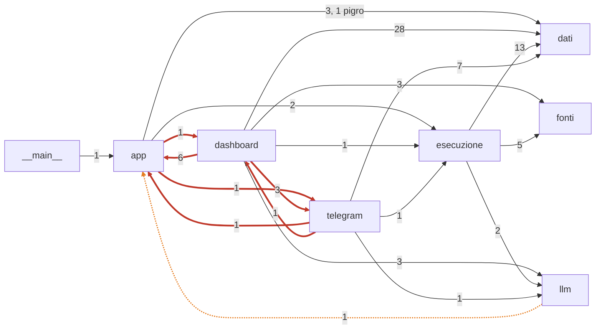
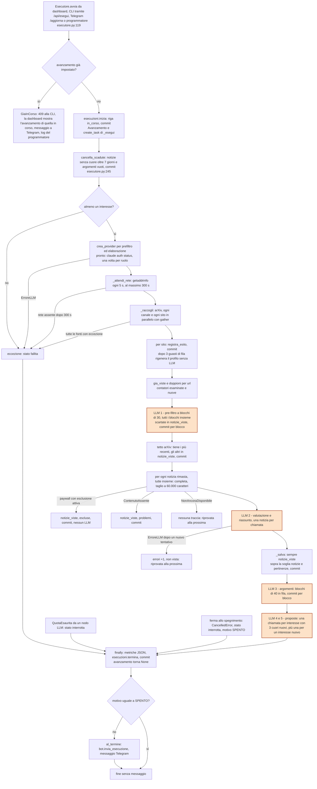
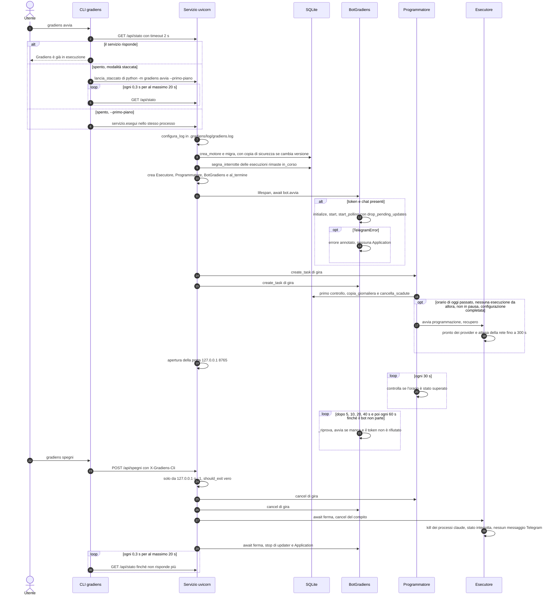
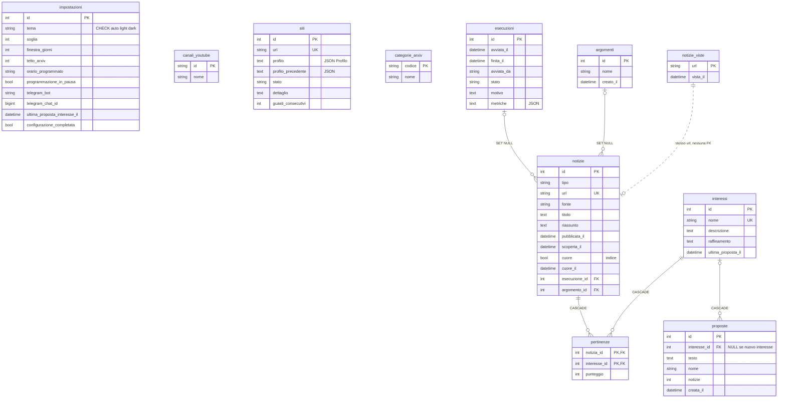
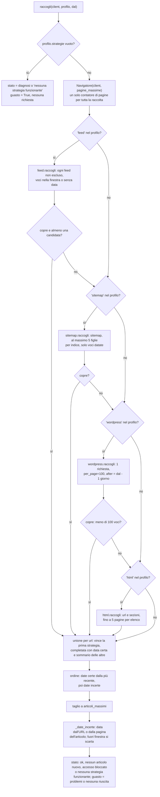
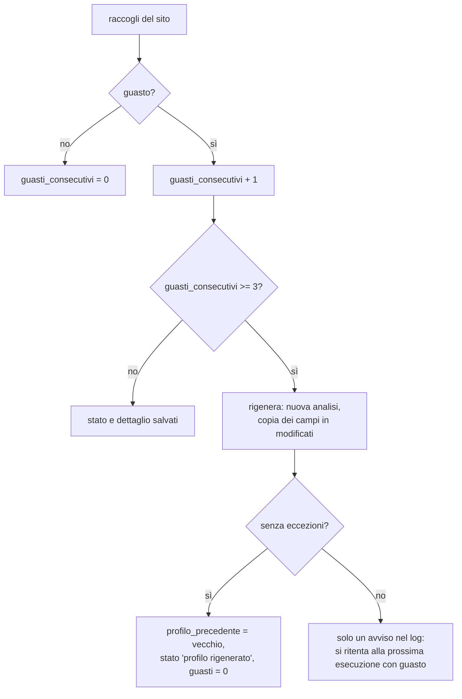

# Mappa dei moduli di Gradiens

Fotografia del codice di `src/gradiens` al 12 novembre 2026 (commit `3868260`): dipendenze tra i
moduli, flusso di un'esecuzione, avvio del servizio, una scheda per ogni modulo, tabelle lette e
scritte, e le parti che non si capiscono leggendo un file solo ("Come funziona davvero"). È il
risultato della fase 1 del lavoro descritto in [docs/miglioramenti/README.md](../miglioramenti/README.md).

**Cosa è cambiato dopo questa fotografia** (aggiornato il 17 novembre 2026). La mappa non è stata riscritta: grafo
degli import, numeri di riga e schede descrivono il commit indicato. Dopo sono arrivati, elencati con il commit in
[docs/miglioramenti/README.md](../miglioramenti/README.md), sezione "Fatto": il pre-filtro arXiv fino al tetto (ADR
0010), la protezione del profilo dei siti, la raccolta incrementale (ADR 0011, colonne `coperto_fino_a` e
`coperto_con`), le correzioni delle schede 3, 4, 7, 8, 9, 11, 12, 13 e 14 di
[04-debugging.md](../miglioramenti/04-debugging.md) (tra l'altro: attesa della rete di 15 minuti invece di 300
secondi, recupero che non conta le esecuzioni fallite per la rete), ruff, la versione di Claude Code con la prova di
funzionamento, la seconda porta per Tailscale Serve (ADR 0013) e l'aiuto dell'LLM al profilo (ADR 0012). Solo per
quest'ultimo la mappa ha le schede dei due moduli nuovi e qualche frase corretta, segnata "Aggiornamento del 17 nov
2026".

Completa [struttura.md](struttura.md), che resta il documento delle regole e dei contratti: dove i
due non coincidono, questa mappa descrive ciò che il codice fa oggi e lo segnala tra le
osservazioni.

## Come leggere questo documento

- **Percorsi**: i riferimenti `pacchetto/file.py:riga` sono relativi a `src/gradiens/`; quelli di
  test e documenti alla radice della repository. I numeri di riga valgono per il commit indicato
  sopra.
- **Verificato o ipotesi**: ogni affermazione viene dalla lettura del codice, dal database o dai
  log. Dove non è stato possibile verificare, il testo dice "ipotesi:" oppure "non verificato".
- **Dati veri**: le cifre sulle esecuzioni vengono da `.gradiens/gradiens.db` di questa
  installazione Linux, letto in sola lettura il 12 novembre 2026 (10 esecuzioni, 13 siti, 8
  categorie arXiv, 1 canale YouTube). Non sono riportati segreti né dati personali.
- **Sezioni**: i codici A, B e C dicono chi ha analizzato quella parte (A: app, esecuzione, llm,
  telegram; B: dati e dashboard; C: fonti) e servono per i rimandi interni (es. "vedi B4b").
- **Osservazioni**: i comportamenti che sembrano sbagliati o fragili sono raccolti in A6, B5 e
  C4. Sono spunti, non diagnosi: passano alle fasi di test e di debugging, dove ognuno viene
  confermato o escluso.

## Metodo

- **Import**: uno script che legge i file con il modulo `ast` di Python (fuori dal progetto, in
  sola lettura) ha elencato ogni import tra moduli di Gradiens con la sua riga, distinguendo quelli
  in cima al file da quelli dentro una funzione ("pigri"), e ha cercato i cicli. Risultato:
  **nessun ciclo con i soli import in cima ai file**; con gli import pigri ci sono due cicli tra
  moduli (`dashboard.rotte_configurazione` ↔ `dashboard.rotte_impostazioni` e `app.aggiornamento`
  ↔ `app.cli` ↔ `app.pannello`) e tre coppie di pacchetti che dipendono l'una dall'altra
  (`app` ↔ `dashboard`, `app` ↔ `telegram`, `dashboard` ↔ `telegram`). I dettagli sono in A1.
- **Chiamate a runtime, stato condiviso e tabelle**: lettura integrale dei moduli, ricerca di
  thread, task, lock, variabili globali e accessi al database.
- **Limiti**: nessuna esecuzione vera, nessuna chiamata LLM e nessuna richiesta a siti esterni
  durante l'analisi; il ramo Windows è stato solo letto, non provato.

## Indice

- **Diagrammi**
  - [A1. Dipendenze tra i pacchetti](#a1-dipendenze-tra-i-pacchetti)
  - [A2. Flusso di un'esecuzione completa](#a2-flusso-di-unesecuzione-completa)
  - [A3. Avvio del servizio](#a3-avvio-del-servizio)
- **Schede dei moduli**
  - [A4. Schede dei moduli: app, esecuzione, llm, telegram](#a4-schede-dei-moduli-app-esecuzione-llm-telegram)
  - [B1. Schede dei moduli: dati](#b1-schede-dei-moduli-dati)
  - [B2. Schede dei moduli: dashboard](#b2-schede-dei-moduli-dashboard)
  - [C1. Schede dei moduli: fonti](#c1-schede-dei-moduli-fonti)
- **Database**
  - [B3. Tabelle lette e scritte](#b3-tabelle-lette-e-scritte)
- **Come funziona davvero**
  - [A5. Come funziona davvero (app, esecuzione, llm, telegram)](#a5-come-funziona-davvero-app-esecuzione-llm-telegram)
  - [B4. Come funziona davvero (dati e dashboard)](#b4-come-funziona-davvero-dati-e-dashboard)
  - [C2. Come funziona davvero: i siti web](#c2-come-funziona-davvero-i-siti-web)
  - [C3. Come funziona davvero: YouTube e arXiv](#c3-come-funziona-davvero-youtube-e-arxiv)
- **Osservazioni per le fasi successive**
  - [A6. Osservazioni per le fasi successive](#a6-osservazioni-per-le-fasi-successive)
  - [B5. Osservazioni per le fasi successive](#b5-osservazioni-per-le-fasi-successive)
  - [C4. Osservazioni per le fasi successive](#c4-osservazioni-per-le-fasi-successive)

## Le dieci cose da sapere prima di toccare il codice

Sintesi delle scoperte più pesanti, con il rimando alla sezione che le dimostra.

*Al 17 novembre 2026*: il punto 1 è risolto (ADR 0010); il punto 2 vale ancora per le esecuzioni, ma alla creazione
del profilo l'LLM può aiutare su richiesta (ADR 0012); per il punto 10 "dal PC" non dipende più dalle intestazioni
ma dalla porta (ADR 0013), e l'autenticazione la fa Tailscale. I punti 3-9 valgono ancora: in parte per scelta
dell'utente (la data presa da `lastmod`, decisione 16; il "rate limit" trattato come quota esaurita, decisione 27);
l'8 e il 9 sono le schede 6 e 5 di [04-debugging.md](../miglioramenti/04-debugging.md), senza una soluzione sicura.

1. **Il tetto arXiv si applica dopo il pre-filtro** (`esecuzione/esecutore.py:274-283`, come
   chiede `ARX-02`): tutti i paper nuovi consumano chiamate di pre-filtro, e quelli oltre il tetto
   vengono poi scartati senza essere valutati. Nelle esecuzioni 9 e 10 i paper oltre il tetto
   sono il 73-75% delle notizie mandate al pre-filtro (circa 12-13 chiamate su 17
   nell'esecuzione 10). Vedi A2 e C3.
2. **Nella ricerca sui siti l'LLM non interviene mai**, nemmeno alla creazione del profilo
   (`WEB-04` lo permetterebbe). Mancano anche l'anteprima degli articoli (`WEB-02`) e la vista
   delle differenze dopo una rigenerazione (`WEB-25`). Vedi C2. *Aggiornamento del 17 nov 2026*: alla
   creazione del profilo l'LLM ora può aiutare, solo su richiesta dell'utente (ADR 0012); nelle
   esecuzioni continua a non intervenire.
3. **Se la cascata arriva alla sitemap, di solito si ferma lì**: basta una voce datata fuori
   dalla finestra (`fonti/siti/strategie/sitemap.py:101`, `:110-111`) perché API WordPress e HTML
   non si provino, e le sezioni del profilo restano inutilizzate. Una data presa solo da
   `lastmod` vale come data certa (salvo quando la sitemap è stata solo rigenerata: lo stesso
   `lastmod` su almeno 10 voci e almeno metà del totale): un articolo vecchio ma modificato di
   recente sembra nuovo. Vedi C2.
4. **La data di un articolo può costare una pagina**: per gli articoli con data incerta e senza
   data nell'indirizzo si legge una pagina per articolo, anche se l'articolo è già visto, perché
   la fonte non conosce il registro delle notizie viste. Nel passaggio diagnostico del 12
   novembre (proposta 6a) hwupgrade ha speso così 36 delle sue 40 pagine; anche nature arriva
   al tetto, ma per le letture di sitemap e i redirect. Le metriche dell'app non registrano le
   pagine lette. Vedi C2.
5. **Alcune notizie ripassano dal pre-filtro a ogni esecuzione** e, se lo superano, anche dalla
   valutazione (blocchi falliti, valutazioni fallite, resti di un'interruzione; le dirette si
   fermano prima della valutazione). Inoltre un "rate limit" viene trattato come quota esaurita e
   interrompe l'esecuzione. Vedi A2 e A6.
6. **Provider e modello dei due ruoli non si cambiano dalla dashboard**: esistono solo come valori
   predefiniti nel database (la sezione Modelli LLM è rimandata). Vedi A2.
7. **`GRADIENS_CLAUDE` scritto nel `.env` viene ignorato**: si legge solo dall'ambiente del
   processo (`llm/claude_code.py:31`), quindi funziona tramite il servizio di systemd ma non da
   `.env`. Vedi A5.
8. **Un secondo processo del servizio fa danni prima di accorgersi che la porta è occupata**:
   migrazioni e `segna_interrotte` girano in `crea_app`, prima che uvicorn apra la porta
   (`app/servizio.py:94-103`). Vedi A3 e A6.
9. **Una migrazione che fallisce a metà non viene annullata per intero** e il secondo avvio
   fallisce di nuovo; l'esecutore usa una sola sessione per tutta l'esecuzione, senza WAL. Vedi B4.
10. **La dashboard non ha autenticazione**, e lo spegnimento "solo da 127.0.0.1" non regge dietro
    un proxy o un tunnel sullo stesso PC: le richieste arrivano da 127.0.0.1 e l'indirizzo del
    client dipende dall'intestazione `X-Forwarded-For`. Vedi B4.

## A1. Dipendenze tra i pacchetti



Legenda: archi rossi e spessi = coppie di pacchetti che dipendono l'una dall'altra; arco arancione tratteggiato = `llm -> app`, a senso unico ma chiude cicli più lunghi (`app -> esecuzione -> llm -> app`, `app -> telegram -> llm -> app`, `app -> dashboard -> llm -> app`). Il numero sull'arco è il numero di import. `dati` e `fonti` non importano nessun altro pacchetto: sono le foglie.

**Archi sorprendenti** (verificati sul codice):
- `llm -> app`: `llm/claude_code.py:12` importa `eseguibile_claude` da `app/avvio_sistema.py`. Serve perché la conversione `claude.cmd` -> `claude.exe` è codice specifico di Windows, e la regola (ADR 0007, `struttura.md`) vuole tutto il codice di sistema in `app/avvio_sistema.py`. `avvio_sistema` non importa niente di Gradiens, quindi il ciclo tra pacchetti non diventa un ciclo tra moduli.
- `telegram -> dashboard`: `telegram/messaggi.py:7` importa `AVVIATA_DA, FONTI, durata, token_brevi` da `dashboard/comune.py`: etichette e formattazione condivise tra pagina e messaggio. Effetto collaterale: caricare il bot carica anche `comune` con FastAPI, Jinja e `dashboard/segnali.py`.
- `telegram -> app`: `telegram/bot.py:20`, `Configurazione` (token in `SecretStr`).
- `dashboard -> telegram`: `dashboard/rotte.py:23` (`COMANDI`, pagina Aiuto), `dashboard/rotte_impostazioni.py:25` (`bot as telegram`: `verifica_token`, `cerca_chat`, `collega`, `ErroreTelegram`, usati nel tutorial a :258-:290), `dashboard/rotte_impostazioni.py:26` (`COMANDI`). L'istanza `BotGradiens` non si importa: si usa `request.app.state.bot` (`ferma`, `avvia`, `invia_prova`, `problema`, `errore`).
- `dashboard -> app`: `dashboard/comune.py:14-15` (`avvio_sistema.stato_avvio` per il segnale globale in ogni pagina, `RADICE`), `dashboard/rotte_configurazione.py:12-13` (`crea_icone`, `RADICE`), `dashboard/rotte_impostazioni.py:23-24` (`attiva_avvio`, `disattiva_avvio`, `stato_avvio`, `icone_*`, `RADICE`, `salva_segreto`).
- `app -> dashboard`: `app/servizio.py:17` (`rotte as dashboard`, poi `dashboard.registra(app)` a `app/servizio.py:119`).
- `app -> telegram`: `app/servizio.py:22` (`BotGradiens`, istanziato a :106).
- `dashboard -> llm`: `dashboard/rotte.py:22` (`claude_code.avviso_login`, Home), `dashboard/rotte_configurazione.py:18-19` (`ErroreLLM`, `stato_account`). La dashboard non chiama mai `chiedi`.
- `dashboard -> esecuzione`: solo `GiaInCorso` (`dashboard/rotte.py:21`); l'`Esecutore` arriva da `request.app.state.esecutore`.

**Cicli di import**
- In cima ai file: nessuno (confermato: `avvio_sistema` e `configurazione` non importano moduli Gradiens; `servizio` è importato solo pigramente).
- Pigri (import dentro una funzione):
  - `app.cli <-> app.aggiornamento <-> app.pannello`: `aggiornamento` importa `cli` in cima (`app/aggiornamento.py:10`), `pannello` importa `cli` e `aggiornamento` in cima (`app/pannello.py:17-18`); `cli` li importa solo dentro `main` (`app/cli.py:179`, `app/cli.py:188`). Commenti nel codice: "il modulo importa questo" e "Tkinter serve solo al pannello". Anche `servizio` (`app/cli.py:47`) e `dati.esecuzioni` (`app/cli.py:101`) sono pigri, per tenere veloci `stato` e `spegni` senza caricare FastAPI e SQLAlchemy.
  - `dashboard.rotte_configurazione <-> dashboard.rotte_impostazioni`: `rotte_configurazione` importa `rotte_impostazioni` in cima (`dashboard/rotte_configurazione.py:15`), il contrario è pigro dentro `finestra` (`dashboard/rotte_impostazioni.py:45`).
  - Rischio di ImportError: nessuno, finché l'import in cima resta da un solo lato. Il rischio riguarda gli import di nomi (`from modulo import nome`), che falliscono su un modulo caricato a metà: `pannello`, che importa nomi da `cli` (`from gradiens.app.cli import ATTESA_MASSIMA, ...`), e `rotte_configurazione`, che importa `dati_sezione` da `rotte_impostazioni`. Se questi cicli diventassero attivi, l'errore dipenderebbe da quale modulo viene importato per primo. `aggiornamento` invece importa il modulo `cli` intero e ne usa gli attributi solo quando le funzioni girano: spostarne l'import in cima a `cli.py` probabilmente non darebbe errore (non verificato).

## A2. Flusso di un'esecuzione completa



I nodi arancioni (prefisso "LLM") sono gli unici punti in cui si consuma quota. Nota sull'ordine: nel codice la pulizia delle notizie scadute è il primo passo, **prima** del controllo dei provider e dell'attesa della rete (`esecuzione/esecutore.py:245-255`).

### Chiamate LLM di un'esecuzione

Tutte passano da `Provider.chiedi(sistema=, messaggio=, schema=, modello=)` (`llm/base.py:29`); l'unico provider registrato è `ClaudeCode` (`llm/__init__.py:6`). Ruolo e modello vengono dalla riga unica di `impostazioni`: `provider_prefiltro`/`modello_prefiltro` e `provider_elaborazione`/`modello_elaborazione` (`esecuzione/esecutore.py:251-252`, `:275`, `:301`), con valori predefiniti `"claude-code"` e `"haiku"` (`dati/modelli.py:31-34`). **Nessuna pagina della dashboard li modifica** (nessun riferimento nella dashboard: li legge solo l'esecutore, `esecuzione/esecutore.py:251-258`; `dashboard/segnali.py:3`: "Modelli LLM ... rimandata"). Valori nel database attuale: haiku per entrambi i ruoli.

| # | Fase | Funzione | Ruolo e modello | Prompt di sistema | Messaggio | Schema JSON | Notizie per chiamata | Caratteri massimi | Parallelismo | Tentativi e timeout | Se fallisce |
|---|---|---|---|---|---|---|---|---|---|---|---|
| 1 | Pre-filtro | `_prefiltra.filtra`, `esecuzione/esecutore.py:389` | prefiltro | `sistema_prefiltro` (`esecuzione/prompt.py:24-34`): ruolo, interessi come `[id] nome: descrizione` più `Raffinamento:` (`prompt.py:15-21`), "nel dubbio includi la notizia"; con `escludi_sponsorizzati` chiede gli id sponsorizzati. Uguale per tutti i blocchi | `messaggio_prefiltro` (`prompt.py:47-49`): lista JSON `{id: indice nel blocco, titolo, sommario}` | `SCHEMA_PREFILTRO` (`prompt.py:37-44`): `pertinenti: int[]` obbligatorio, `sponsorizzate: int[]` facoltativo | `BLOCCO_PREFILTRO = 30` (`esecutore.py:32`) | `MAX_SOMMARIO = 1500` per notizia (`prompt.py:12`), titolo intero: fino a circa 45.000 per blocco | tutti i blocchi lanciati insieme (`esecutore.py:416`, `_tutti`), al massimo 3 processi `claude` (semaforo, `llm/claude_code.py:69`) | 1 nuovo tentativo per ogni `ErroreLLM` (`claude_code.py:81-83`); timeout 300 s per tentativo (`claude_code.py:67`, `:100`) | `ErroreLLM`: blocco perso, `errori +1` per notizia, nessuna segnata come vista (`esecutore.py:393-397`). `QuotaEsaurita`: risale, il TaskGroup cancella gli altri blocchi |
| 2 | Valutazione e riassunto | `_pipeline.elabora`, `esecutore.py:299` | elaborazione | `sistema_valutazione` (`prompt.py:52-64`): interessi, fasce di punteggio (90-100, 60-89, sotto 60), riassunto italiano di 3-6 frasi, `titolo_it`. Calcolato una volta (`esecutore.py:288`) | `messaggio_valutazione` (`prompt.py:88-89`): `{tipo, fonte, titolo, testo}`, dove `testo` è `contenuto`. Il sommario **non** si manda; per arXiv `contenuto` è l'abstract (`fonti/arxiv/__init__.py:43`) | `SCHEMA_VALUTAZIONE` (`prompt.py:67-85`): `punteggi[{interesse, pertinenza 0-100}]`, `riassunto`, `titolo_it`, tutti obbligatori | 1 | `MAX_CONTENUTO = 60_000` (`esecutore.py:34`, taglio a `:422-423` con stato "contenuto parziale") | tutte le notizie insieme (`esecutore.py:321`); LLM al massimo 3 per semaforo; `completa` non ha limiti nell'esecutore (limiti in `fonti/`: YouTube `Semaphore(2)` `fonti/youtube/__init__.py:43-46`; siti 1 s tra richieste allo stesso dominio, `fonti/siti/rete.py:19`, `:172-181`) | come sopra | qualsiasi eccezione tranne la quota: `errori +1`, notizia non vista, si riprova alla prossima (`esecutore.py:312-315`). `QuotaEsaurita`: interrompe tutto |
| 3 | Argomenti | `_argomenti`, `esecutore.py:334` | elaborazione (token contati in "elaborazione") | `sistema_argomenti(esistenti)` (`prompt.py:92-106`): definizione di argomento ed elenco `[id] nome` degli argomenti con una notizia scoperta negli ultimi 30 giorni, al massimo 100 (`dati/argomenti.py:13`, `:29-37`). **Ricalcolato a ogni blocco** (`esecutore.py:332`) | `messaggio_argomenti` (`prompt.py:120-122`): `{id, titolo_it o titolo, riassunto[:600]}` | `SCHEMA_ARGOMENTI` (`prompt.py:109-117`): `assegnazioni[{notizia, argomento?, nuovo?}]` | `BLOCCO_ARGOMENTI = 40` (`esecutore.py:33`), solo le notizie salvate da questa esecuzione | 600 di riassunto per notizia; nomi degli argomenti fino a 200 (`dati/argomenti.py:41`) | nessuno: blocchi in fila | come sopra | `ErroreLLM`: `return`, i blocchi successivi si saltano e le notizie restano senza argomento per sempre (`esecutore.py:339-341`, ADR 0008) |
| 4 | Proposta di raffinamento | `_proposte`, `esecutore.py:370` | elaborazione | `sistema_raffinamento(interesse)` (`prompt.py:130-141`): nome, descrizione, raffinamento attuale, 1-3 frasi oppure stringa vuota | `messaggio_proposta` (`prompt.py:169-170`, `:125-127`): `{titolo, riassunto[:600]}` delle notizie con cuore, le ultime a riceverlo (`dati/proposte.py:26`) | `SCHEMA_RAFFINAMENTO` (`prompt.py:144`): `raffinamento` | al massimo `MASSIMO_NOTIZIE = 10` (`dati/proposte.py:16`) | 600 per notizia | in fila | come sopra | rollback, log, si passa alla successiva (`esecutore.py:374-377`); `ultima_proposta_il` non cambia, quindi si riprova alla prossima |
| 5 | Proposta di interesse nuovo | `_proposte`, `esecutore.py:370` (compito aggiunto a `:362-366`) | elaborazione | `sistema_nuovo_interesse(interessi)` (`prompt.py:147-159`) | `messaggio_nuovo_interesse` (`prompt.py:173-176`): `{titolo, riassunto[:600], punteggi {nome interesse: punteggio}}` | `SCHEMA_NUOVO_INTERESSE` (`prompt.py:162-166`): `nome`, `descrizione` | al massimo 10 | 600 per notizia | in fila | come sopra | come la riga 4 |

Quando partono le chiamate 4 e 5: la 4 per ogni interesse senza proposta in sospeso con almeno `MINIMO_CUORI = 3` cuori messi dopo `Interesse.ultima_proposta_il` su notizie con punteggio pari o superiore alla soglia per quell'interesse (`dati/proposte.py:15`, `:29-40`); la 5 se nessuna proposta di interesse nuovo è in sospeso e ci sono almeno 3 cuori dopo `Impostazioni.ultima_proposta_interesse_il` (`dati/proposte.py:43-50`). `registra_*` aggiorna la data anche quando la risposta è vuota (`dati/proposte.py:53-66`), quindi la stessa domanda non si ripete finché non arrivano 3 cuori nuovi.

**Numero di chiamate di un'esecuzione**: `ceil(nuove/30)` + (notizie che passano pre-filtro e tetto, meno quelle escluse prima della chiamata: paywall, contenuto assente, diretta, `completa` fallito per un errore di rete) + `ceil(mostrate/40)` + (interessi con 3 cuori nuovi) + (0 o 1), con ogni chiamata raddoppiabile dal nuovo tentativo. Esecuzione 10 (11/11): 499 notizie nuove, quindi 17 chiamate di pre-filtro (239.085 token in ingresso, 29.317 in uscita: circa 14.000 e 1.700 per chiamata); circa 45 valutazioni e 2 chiamate per gli argomenti (169.199 in ingresso e 79.149 in uscita in tutto, circa 3.600 e 1.700 per chiamata, calcolato dalle metriche salvate); 0 proposte.

**Chiamate fuori dall'esecuzione**: nessuna chiamata `chiedi`. L'unico altro punto che usa Claude Code è `stato_account` (`claude auth status`, `llm/claude_code.py:117-129`), chiamato da `ClaudeCode.pronto` (due volte per esecuzione, una per ruolo, anche se il provider è lo stesso: `esecutore.py:253-254`) e dalla configurazione iniziale (`dashboard/rotte_configurazione.py:47`, passo "claude" e "completa"). Ipotesi: `auth status` non interroga il modello, quindi non consuma quota. `avviso_login` legge solo un file (`claude_code.py:132-151`). L'analisi e la rigenerazione del profilo di un sito non usano LLM (`fonti/siti/__init__.py:3`). *Aggiornamento del 17 nov
2026*: c'è ora una chiamata `chiedi` fuori dall'esecuzione, l'aiuto al profilo di un sito, solo su richiesta dell'utente
(bottone "Chiedi aiuto all'LLM", `esecuzione/aiuto_profilo.aiuta`, ruolo elaborazione, una chiamata, tetto stimato di
10.000 token; ADR 0012). Il bot Telegram non chiama LLM.

**Riga di comando di `claude`** (`llm/claude_code.py:85-92`), lanciata con `asyncio.create_subprocess_exec` (lista di argomenti, niente shell):

```
<claude> -p --model <modello> --system-prompt <sistema> --json-schema <schema in JSON>
         --output-format json --tools "" --strict-mcp-config --safe-mode
         --disable-slash-commands --no-session-persistence
```

- `<claude>` è `trova_eseguibile()` (A5 a), oppure il comando finto dei test (`claude_code.py:68`).
- Il messaggio passa da stdin in UTF-8 (`claude_code.py:99-100`); prompt di sistema e schema passano invece come argomenti.
- L'ambiente è quello del servizio senza `ANTHROPIC_API_KEY` e `ANTHROPIC_AUTH_TOKEN` (`claude_code.py:40-42`), così si usa l'abbonamento e non l'API a pagamento.
- `--strict-mcp-config` senza `--mcp-config` vuol dire nessun server MCP.
- Il codice di uscita del processo non si guarda: conta solo stdout. Se stdout è vuoto si ha `ErroreLLM` con i primi 300 caratteri di stderr (`claude_code.py:108-109`).
- Lettura della risposta, `interpreta` (`claude_code.py:45-61`): JSON non valido dà `ErroreLLM`. Con `is_error`, `api_error_status == 429` oppure una delle parole `usage limit`, `rate limit`, `limit reached`, `quota` nel testo dà `QuotaEsaurita`, altrimenti `ErroreLLM`. Poi `structured_output` deve essere un dict.
- Token: `ingresso = input_tokens + cache_creation_input_tokens + cache_read_input_tokens`, `uscita = output_tokens`.
- La quota rimasta non si legge mai: la si scopre solo quando una chiamata fallisce. (Nella misura del 12 novembre il flusso `--output-format stream-json` conteneva un evento `rate_limit_event` con la percentuale d'uso delle finestre di 5 ore e di 7 giorni: osservato, non descritto nella documentazione letta, e i dati grezzi sono andati persi; l'app usa `--output-format json`, che non lo contiene.) `total_cost_usd` e `credential_expires_at` del JSON non si usano.

### Ordine dei passi, commit e salvataggi

1. `avvia` (`esecutore.py:119-128`): controllo di `self.avanzamento`, poi `esecuzioni.inizia` (riga `in_corso`, **commit**, `dati/esecuzioni.py:13-17`), `Avanzamento(fase="raccolta")` e `create_task(_esegui)`. Restituisce l'id subito.
2. `_esegui` (`esecutore.py:141-167`) apre **una sola sessione** per tutta la pipeline (`:146-147`), condivisa dalle coroutine in parallelo. Regge perché tra una modifica al database e il suo commit non c'è mai un `await` (verificato leggendo `_pipeline`, `_argomenti` e `_proposte`; il commento di `_tutti`, `:459`, dice solo che al primo errore le altre coroutine si fermano perché la sessione è condivisa).
3. `_pipeline` (`esecutore.py:244-323`):
   - `cancella_scadute`, con **commit** (`dati/notizie.py:104-111`).
   - Impostazioni e interessi.
   - Provider e `pronto()`.
   - `_attendi_rete`.
   - Finestra `dal = adesso - finestra_giorni` (UTC).
   - `httpx.AsyncClient(follow_redirects=True)` unico per tutte le fonti.
4. Raccolta (`:262`, `_raccogli` `:179-215`): un compito per arXiv (se ci sono categorie), uno per canale, uno per sito. Per ogni sito, `registra_esito` fa **commit** (`dati/siti.py:46-52`); al terzo guasto di fila, `rigenera` più `salva_rigenerato` (**commit**).
5. Già viste e doppioni (`:263-266`): si tolgono gli url già in `notizie_viste` e si tiene la prima candidata per url. Doppioni tra fonti diverse con url diversi non si riconoscono qui.
6. Pre-filtro (`:274-275`, `:381-416`): per ogni blocco riuscito, le non pertinenti (comprese le sponsorizzate) vanno in `notizie_viste` con **commit** (`:407-408`).
7. Tetto arXiv (`:278-284`): i paper che hanno passato il pre-filtro si ordinano per data; quelli oltre `tetto_arxiv` vanno in `notizie_viste`, **commit**.
8. Valutazione (`:287-321`): `_fase("valutazione", n)` e un compito per notizia: `_completa` e poi `chiedi`. Esiti:
   - paywall con `escludi_pagamento`: vista e **commit**;
   - `ContenutoAssente`: vista e **commit**;
   - `NonAncoraDisponibile`: niente;
   - errore: niente;
   - risposta valida: `_salva` (`:429-455`) segna sempre la notizia come vista. Se il punteggio massimo valido è sotto la soglia, solo **commit**. Altrimenti `Notizia` con `pertinenze` (solo punteggi > 0) e **commit**.
9. Argomenti (`:325-354`): **commit** per blocco.
10. Proposte (`:356-379`): `registra_*` fa **commit** per proposta.
11. `finally` (`:156-167`): `termina` (stato, `finita_il`, metriche, motivo, **commit**), poi `avanzamento = None`, poi `al_termine(id)` se il motivo non è `SPENTO`.

**Interruzione (`ferma`, `esecutore.py:134-139`)**: cancella il compito e ne attende la fine. `CancelledError` porta allo stato `interrotta` con motivo `SPENTO` (`:150-152`); il `finally` registra lo stesso le metriche e non manda Telegram. I processi `claude` in corso si uccidono (`claude_code.py:105-107`). Ciò che ha fatto commit resta. Le notizie passate dal pre-filtro ma non valutate non sono "viste": alla prossima esecuzione **ripassano dal pre-filtro**.

**Quota esaurita**: `QuotaEsaurita` attraversa tutti gli `except` (sono sempre `except QuotaEsaurita: raise` prima degli altri). In `_tutti` (`esecutore.py:458-466`) il TaskGroup cancella i compiti fratelli e `except*` la estrae dal gruppo. `_esegui` la registra come `interrotta` con il suo testo (`:148-149`); il messaggio Telegram parte. Eccezione: se nello stesso gruppo c'è anche un errore di altro tipo, la quota resta dentro un `ExceptionGroup`, `_esegui` non la riconosce e l'esecuzione risulta `fallita` invece di `interrotta` (comportamento di `except*` provato con Python, fuori dal progetto).

**Errori per singola notizia**: dentro `elabora` ogni eccezione è presa (`:312-315`). Sono fuori dal `try` `m.conta_token` e `_salva` (`:318-319`): un loro errore (es. database) esce dal TaskGroup e fa fallire l'intera esecuzione (A6).

**Metriche** (`esecutore.py:53-89`): `Metriche.di(tipo)` raggruppa per fonte (`video` e `short` danno `youtube`, `FONTE_DI_TIPO` `:35`).
- `raccolta_s`: il compito più lento del tipo (`:192-198`).
- `esaminate`: notizie nuove dopo viste e doppioni (`:265-266`).
- `stati[].nuove`: conteggio per nome di fonte (`:269-272`).
- `scartate_prefiltro`, `escluse` con `notizie_escluse` (sponsorizzate e paywall), `oltre_tetto`, `senza_contenuto` con `problemi`, `scartate_valutazione`, `mostrate`.
- `errori`: fonte non raggiungibile, sito guasto, una per notizia di un blocco di pre-filtro fallito, valutazione fallita.
- `token`: per ruolo, con provider e modello (`:257-258`). Solo le risposte riuscite: il primo tentativo fallito e le proposte la cui registrazione fallisce non si contano.
- `durata_s`: `time.monotonic` (`:142`, `:158`).

Tutto finisce in `esecuzioni.metriche` come JSON (`:157-163`), letto da `dati/esecuzioni.py:53-69`.

**Avanzamento**: la fase parte da `"raccolta"` (default di `Avanzamento`, `:48`), poi `"attesa della rete"` (solo se manca la rete), `"pre-filtro"` (totale = blocchi), `"valutazione"` (totale = notizie), `"argomenti"` (blocchi), `"proposte"` (compiti). `_raccogli` non chiama `_fase`.

## A3. Avvio del servizio



**Dettagli verificati**
- `gradiens avvia` (`app/cli.py:42-56`): se `/api/stato` risponde (timeout 2 s, `app/cli.py:20`) non fa niente. Con `--primo-piano` chiama `servizio.esegui` nello stesso processo; altrimenti `_avvia_staccato` (`app/cli.py:36-39`) lancia `[sys.executable, "-m", "gradiens", "avvia", "--primo-piano"]` (`ARGOMENTI`, `app/avvio_sistema.py:45`) con stderr in `.gradiens/log/avvio.log`, poi aspetta fino a 20 s (`ATTESA_MASSIMA`, `app/cli.py:13`) controllando ogni 0,3 s.
- Staccato (`app/avvio_sistema.py:20-32`): su Linux `start_new_session=True` (niente SIGHUP); su Windows `DETACHED_PROCESS | CREATE_NEW_PROCESS_GROUP | CREATE_BREAKAWAY_FROM_JOB`, senza l'ultimo se il job non lo permette.
- `servizio.esegui` (`app/servizio.py:133-141`): `configura_log` (`:123-130`): file a rotazione da 1 MB per 3 copie, stdout solo se esiste, httpx a WARNING perché gli url di Telegram contengono il token. Poi `crea_app` (`:94-120`): migrazioni (`dati/database.py:30-50`, copia prima di migrare un database esistente), `segna_interrotte` (`dati/esecuzioni.py:28-36`), oggetti e `al_termine = bot.invia_esecuzione` (`:107`), middleware anti-CSRF (`:110-114`) e `TrustedHostMiddleware` (`:117`). Infine `uvicorn.Server(...).run()`.
- Ordine in uvicorn: la startup del lifespan avviene **prima** di aprire la porta (`.venv/.../uvicorn/server.py:115-118` poi `:154-192`). Quindi `await bot.avvia()` (`app/servizio.py:84`) ritarda l'apertura della porta. Se la porta è occupata, uvicorn esce con `sys.exit(3)`.
- Lifespan (`app/servizio.py:81-91`): prima il bot, così un'esecuzione recuperata che fallisce subito si segnala; poi i due compiti `programmatore.gira()` e `bot.gira()`. Allo spegnimento: `cancel()` dei due compiti senza attenderli, `await esecutore.ferma()`, `await bot.ferma()`.
- Programmatore (`esecuzione/programmatore.py:72-78`): `controlla()` subito, poi ogni `INTERVALLO = 30` s; un'eccezione si registra e il ciclo continua. Al primo controllo dopo l'avvio e al primo di ogni giorno (`:51`): `copia_giornaliera` (una al giorno, ne tiene 7: `dati/database.py:74-78`) e poi `cancella_scadute` (`:52-56`).
- Bot (`telegram/bot.py:145-156`): `gira` aspetta 5 s, prova `_riprova`, poi raddoppia l'attesa fino a 60 s (`RIPROVA_MINIMA, RIPROVA = 5, 60`, `:32`). La sequenza dei tentativi è quindi 5, 10, 20, 40, 60, 60... secondi. Con il bot avviato il ciclo continua ogni 5 s senza fare niente. Non riprova se l'errore contiene "token" (`:154`).
- Spegnimento: `/api/spegni` (`app/servizio.py:48-56`) imposta solo `server.should_exit = True`. Con systemd (SIGTERM) uvicorn segue la stessa strada; su Windows, se il processo dell'attività viene terminato a forza, il `finally` non gira e ci pensa `segna_interrotte` al riavvio successivo (`app/servizio.py:101`). `gradiens spegni` (`app/cli.py:84-97`) aspetta fino a 20 s che `/api/stato` smetta di rispondere.

## A4. Schede dei moduli: app, esecuzione, llm, telegram

### `app/aggiornamento.py` (68 righe)
- **Responsabilità**: aggiorna la copia locale con `git fetch` e `git merge --ff-only`, poi `uv sync`, spegnendo e riaccendendo il servizio se era acceso.
- **Interfaccia pubblica**: `aggiorna(conf, avanzamento: Callable[[str], None] = print, radice=RADICE) -> str`; `ErroreAggiornamento`.
- **Stato condiviso**: processi `git` e `uv` (`subprocess.run`, timeout 600 s, `cwd=radice`); HTTP verso il servizio tramite `cli.leggi_stato`, `cli.richiedi_spegnimento`, `cli._avvia_staccato`. Nessuna variabile globale.
- **Dipende da / usato da**: `app.cli`, `app.avvio_sistema` (`eseguibile`), `app.configurazione` / `app.cli` (pigro, `:179`), `app.pannello`.
- **Note**: rifiuta se `git status --porcelain --untracked-files=no` non è vuoto (`:34`), se `HEAD..@{u}` non esiste (`:40-42`) o se l'ultima esecuzione è `in_corso` (`:46-48`). La riaccensione è nel `finally` (`:63-67`): avviene anche se merge o sync falliscono. Il servizio riacceso è un processo staccato, non più sotto systemd o l'attività pianificata.

### `app/avvio_sistema.py` (372 righe)
- **Responsabilità**: l'unico codice specifico di un sistema operativo: avvio staccato, eseguibile nativo di Claude, avvio all'accensione (systemd o attività pianificata), icone del pannello, ricerca di `git` e `uv`.
- **Interfaccia pubblica**: `lancia_staccato(comando, file_errori)`; `eseguibile_claude(percorso) -> Path`; `ARGOMENTI`; `StatoAvvio(attivo, problema, comando)`; `ErroreAvvio(messaggio, comando)`; `stato_avvio(radice) -> StatoAvvio`; `attiva_avvio(radice) -> StatoAvvio`; `disattiva_avvio(radice)`; `su_windows()`; `icone_presenti()`, `crea_icone(radice)`, `togli_icone()`; `eseguibile(nome) -> str | None`; per i test `unita_systemd`, `script_windows`, `stato_da_xml`, `voce_desktop`, `script_icone_windows`.
- **Stato condiviso**: variabile globale `_cache: (monotonic, StatoAvvio)` con durata 60 s (`:48`, `:66`, `:74-82`). Scrive `~/.config/systemd/user/gradiens.service` (o `$XDG_CONFIG_HOME`), i file `.desktop` in `~/.local/share/applications/` e sul desktop, e su Windows i collegamenti `.lnk` in Desktop e Programs. Lancia `systemctl --user`, `loginctl`, `xdg-user-dir`, `schtasks`, `powershell.exe` (anche elevato con UAC). Nessuna tabella.
- **Dipende da / usato da**: nessun modulo Gradiens / `app.cli`, `app.aggiornamento`, `llm.claude_code`, `dashboard.comune`, `dashboard.rotte_configurazione`, `dashboard.rotte_impostazioni`.
- **Note**: `_sessione_senza_desktop` (`:220-226`) usa `ctypes.windll` ed è chiamata solo nel ramo Windows. `_esegui` ha timeout 300 s (`:106`), quindi la richiesta della dashboard che attiva l'avvio resta in attesa finché l'utente risponde alla finestra UAC.

### `app/cli.py` (191 righe)
- **Responsabilità**: comandi `avvia | esegui | stato | spegni | pannello | aggiorna`; tutti tranne `avvia --primo-piano` parlano con il servizio via HTTP su `127.0.0.1:<porta>`.
- **Interfaccia pubblica**: `main(argv=None) -> int` (script `gradiens` in `pyproject.toml`, e `__main__.py`); `leggi_stato(conf) -> dict | None`; `richiedi_spegnimento(conf)`; `avvia(conf, primo_piano)`; `esegui(conf)`; `stato(conf)`; `spegni(conf)`; `ATTESA_MASSIMA = 20`; `INTESTAZIONE_CLI`; usati da altri moduli anche i "privati" `_attendi`, `_avvia_staccato`.
- **Stato condiviso**: nessuna variabile globale; richieste httpx a `/api/stato`, `/api/esegui`, `/api/esecuzione`, `/api/spegni`; può lanciare il servizio staccato. Riconfigura stdout e stderr in UTF-8 (`:157-159`).
- **Dipende da / usato da**: `app.avvio_sistema`, `app.configurazione`, pigri `app.servizio`, `app.aggiornamento`, `app.pannello`, `dati.esecuzioni` / `__main__`, `app.aggiornamento`, `app.pannello`.
- **Note**: `esegui` (`:124-151`) avvia il servizio se è spento, fa POST `/api/esegui` (409 = già in corso) e legge l'avanzamento ogni secondo finché `avanzamento` è None o ha un altro id; poi stampa `_riepilogo` dell'ultima esecuzione. Ctrl+C chiude solo il comando.

### `app/configurazione.py` (60 righe)
- **Responsabilità**: configurazione di avvio da variabili `GRADIENS_*` e `.env`: percorsi, rete, token Telegram.
- **Interfaccia pubblica**: `RADICE`; `Configurazione` (`cartella_dati`, `host`, `porta`, `host_consentiti`, `file_env`, `telegram_token: SecretStr | None`, proprietà `percorso_database`, `cartella_log`, `indirizzo_locale`); `configurazione()` con `lru_cache`; `salva_segreto(conf, nome, valore)`.
- **Stato condiviso**: un oggetto `Configurazione` per processo (`lru_cache`, `:58-60`), modificato da `salva_segreto` con `setattr` (`:55`). Legge e riscrive `.env` (con `chmod 0o600`, `:54`).
- **Dipende da / usato da**: nessun modulo Gradiens / `app.cli`, `app.aggiornamento`, `app.pannello`, `app.servizio`, `telegram.bot`, `dashboard.comune`, `dashboard.rotte_configurazione`, `dashboard.rotte_impostazioni`.
- **Note**: `RADICE = parents[3]` del file (`:16`) vale solo con l'installazione modificabile di uv. Il `.env` si legge solo nei campi del modello (`extra="ignore"`, `:20-22`) e **non** finisce in `os.environ`: una chiave come `GRADIENS_CLAUDE` messa nel `.env` non arriva a `trova_eseguibile` (A6).

### `app/pannello.py` (159 righe)
- **Responsabilità**: finestra Tkinter con stato (pallino), Accendi, Spegni, Apri la dashboard, Aggiorna.
- **Interfaccia pubblica**: `apri(conf) -> int`; `descrivi(dati) -> (stato, titolo, dettaglio)`; `Pannello`.
- **Stato condiviso**: thread demone `_leggi_sempre` che mette `leggi_stato` in `queue.Queue` ogni `OGNI = 3` s (`:22`, `:75-78`); `_controlla` nel thread principale ogni 500 ms (`:80-102`); thread demone per Accendi (`:123`) e per Aggiorna (`:144-150`), con gli esiti in una seconda coda (`:46`). `_passo` è una stringa scritta dal thread di aggiornamento e letta da Tk.
- **Dipende da / usato da**: `app.aggiornamento`, `app.cli`, `app.configurazione` / `app.cli` (pigro).
- **Note**: Spegni chiama `richiedi_spegnimento` nel thread di Tk (`:133`, timeout 5 s): la finestra può restare ferma qualche secondo. Accendi e Spegni hanno un'attesa di 20 s (`ATTESA_MASSIMA`) controllata da `_controlla`.

### `app/servizio.py` (141 righe)
- **Responsabilità**: il processo unico: FastAPI con API di controllo e dashboard, lifespan con bot e programmatore, uvicorn.
- **Interfaccia pubblica**: `esegui(conf)`; `crea_app(conf) -> FastAPI`; `configura_log(conf)`; `ciclo_di_vita`; rotte `/api/stato`, `/api/spegni`, `/api/esegui`, `/api/esecuzione`.
- **Stato condiviso**: `app.state.{sessioni, esecutore, programmatore, conf, bot, avviato_alle, server}`; due compiti asyncio (`gira` di programmatore e bot); logging di root su file. Tabelle: `esecuzioni` (`segna_interrotte`, `ultima`), migrazioni Alembic su tutto il database.
- **Dipende da / usato da**: `app.configurazione`, `dashboard.rotte`, `dati.database`, `dati.esecuzioni`, `esecuzione.esecutore`, `esecuzione.programmatore`, `telegram.bot` / `app.cli` (pigro).
- **Note**: `/api/esegui` è `async def` (`:59-66`) perché `Esecutore.avvia` usa `asyncio.create_task` e deve girare nel ciclo del servizio. `/api/stato` e `/api/esecuzione` sono sincrone (threadpool). Il blocco delle richieste forgiate (`:110-114`) vale anche per `/api/*`.

### `esecuzione/esecutore.py` (466 righe)
- **Responsabilità**: una esecuzione dall'avvio alle metriche (A2), una sola alla volta per processo.
- **Interfaccia pubblica**: `Esecutore(sessioni, fabbrica_provider=crea_provider, fonti=None)` con `avvia(avviata_da) -> int`, `attendi()` (solo test), `ferma()`, `avanzamento: Avanzamento | None`, `al_termine: Callable[[int], Awaitable] | None`; `GiaInCorso`; `Avanzamento`, `Contatori`, `Metriche`; `rete_disponibile()`; costanti `BLOCCO_PREFILTRO = 30`, `BLOCCO_ARGOMENTI = 40`, `MAX_CONTENUTO = 60_000`, `FONTE_DI_TIPO`, `SPENTO`, `ATTESA_RETE, PAUSA_RETE = 300, 5`, `HOST_DI_PROVA = ("one.one.one.one", 443)`.
- **Stato condiviso**: `self.avanzamento` (il segnale "in corso"), `self._compito: asyncio.Task`; una sessione SQLAlchemy condivisa da tutte le coroutine della pipeline; un `httpx.AsyncClient` per esecuzione; thread di `asyncio.to_thread` per `getaddrinfo`. Processi `claude` tramite il provider. Tabelle: `esecuzioni`, `notizie`, `pertinenze`, `notizie_viste`, `argomenti`, `proposte`, `interessi` (lettura e `ultima_proposta_il`), `impostazioni` (lettura e `ultima_proposta_interesse_il`), `siti` (stato, guasti, profilo), `canali_youtube` e `categorie_arxiv` (lettura).
- **Dipende da / usato da**: `dati.{argomenti, esecuzioni, impostazioni, interessi, notizie, proposte, siti, modelli}`, `esecuzione.prompt`, `fonti` (`Candidata`, `ContenutoAssente`, `NonAncoraDisponibile`, `arxiv`, `siti`, `youtube`), `llm` (`crea_provider`), `llm.base` / `app.servizio`, `esecuzione.programmatore`, `telegram.bot`, `dashboard.rotte`.
- **Note**: `_tutti` (`:458-466`) usa `asyncio.TaskGroup`: al primo errore non gestito cancella i fratelli; `except* QuotaEsaurita` rilancia la prima quota come eccezione semplice solo se nel gruppo ci sono soltanto quote; gli altri errori escono come `ExceptionGroup`, e una quota insieme a un altro errore resta dentro il gruppo (l'esecuzione risulta fallita, non interrotta). In `_raccogli` un `BaseException` che non è `Exception` (es. cancellazione) si rilancia (`:207-208`).

### `esecuzione/programmatore.py` (78 righe)
- **Responsabilità**: esecuzione giornaliera all'orario delle Impostazioni, recupero all'avvio, pausa, copia e pulizia giornaliere.
- **Interfaccia pubblica**: `Programmatore(sessioni, esecutore, adesso=datetime.now)` con `gira()`, `controlla()`, `prossima() -> datetime | None`; `INTERVALLO = 30`.
- **Stato condiviso**: `self._ultimo_controllo` (ora locale senza fuso); un compito asyncio (`gira`). File: copie in `.gradiens/backup/gradiens-AAAAMMGG-hhmmss-giornaliera.db`. Tabelle: `impostazioni` (lettura), `esecuzioni` (`avviate_dal`), `notizie` e `argomenti` (`cancella_scadute`).
- **Dipende da / usato da**: `dati.database`, `dati.esecuzioni`, `dati.impostazioni`, `dati.notizie`, `esecuzione.esecutore` / `app.servizio` (e `prossima` passata al bot, `app/servizio.py:106`).
- **Note**: vedi A5 c.

### `esecuzione/prompt.py` (177 righe)
- **Responsabilità**: testi dei prompt di sistema, messaggi JSON e schemi per pre-filtro, valutazione, argomenti, raffinamento e interesse nuovo.
- **Interfaccia pubblica**: `sistema_prefiltro(interessi, escludi_sponsorizzati=True)`, `messaggio_prefiltro(blocco)`, `SCHEMA_PREFILTRO`; `sistema_valutazione(interessi)`, `messaggio_valutazione(c)`, `SCHEMA_VALUTAZIONE`; `sistema_argomenti(argomenti)`, `messaggio_argomenti(blocco)`, `SCHEMA_ARGOMENTI`; `sistema_raffinamento(interesse)`, `messaggio_proposta(notizie)`, `SCHEMA_RAFFINAMENTO`; `sistema_nuovo_interesse(interessi)`, `messaggio_nuovo_interesse(notizie)`, `SCHEMA_NUOVO_INTERESSE`; `MAX_SOMMARIO = 1500`. Dal 17 nov 2026 anche `sistema_aiuto_profilo()`, `messaggio_aiuto_profilo(profilo, gruppi)`, `SCHEMA_AIUTO_PROFILO` (ADR 0012), usati da `esecuzione.aiuto_profilo`.
- **Stato condiviso**: nessuno.
- **Dipende da / usato da**: `dati.modelli`, `fonti` (`Candidata`) / `esecuzione.esecutore`.
- **Note**: nei messaggi gli `id` delle notizie sono indici nel blocco (0..n-1), non id del database (`:48`, `:121`); l'esecutore li riporta alle notizie e scarta quelli fuori intervallo. Gli interessi invece usano gli id veri (`:18`). `messaggio_nuovo_interesse` legge `p.interesse.nome` per ogni pertinenza (`:175`): carica gli interessi in modo pigro dalla sessione.

### `esecuzione/aiuto_profilo.py` (aggiunto il 17 nov 2026)
- **Responsabilità**: l'aiuto dell'LLM al profilo di un sito, su richiesta (ADR 0012): l'unica chiamata LLM fuori da un'esecuzione.
- **Interfaccia pubblica**: `async aiuta(s, client, profilo, fabbrica_provider=None) -> Aiuto`; `@dataclass Aiuto(proposta, token, gruppi_tolti)` con `oltre_il_tetto`; `AiutoNonDisponibile` (messaggio per l'utente, anche per ogni `ErroreLLM`); costanti `TETTO = 10_000`, `CARATTERI_PER_TOKEN = 2.35`, `CARICO_FISSO = 1_300`, `USCITA = 2_700`.
- **Stato condiviso**: nessuno. Tabelle: `impostazioni` (lettura di provider e modello dell'elaborazione). Un processo `claude` tramite il provider; due o più richieste al sito tramite `fonti.siti.aiuto.leggi_albero`.
- **Dipende da / usato da**: `dati.impostazioni`, `esecuzione.prompt`, `esecuzione.esecutore` (`chiedi`, per il controllo della forma), `fonti.siti` (`Profilo`), `fonti.siti.aiuto`, `llm` / `dashboard.rotte_impostazioni` (rotta `/impostazioni/siti/{id}/aiuto`).
- **Note**: il tetto è una stima: prima della chiamata si tolgono gli ultimi gruppi di link finché caratteri / 2,35 + carico fisso + uscita stanno nei 10.000 token; dopo, i token veri finiscono nel log e nella risposta all'utente. Non salva niente: le proposte si applicano con la rotta `/impostazioni/siti/{id}/aiuto/applica`, come modifiche manuali del profilo.

### `llm/__init__.py` (12 righe)
- **Responsabilità**: registro dei provider e fabbrica.
- **Interfaccia pubblica**: `PROVIDER = {"claude-code": ClaudeCode}`; `crea_provider(nome) -> Provider` (nome sconosciuto: `ErroreLLM`).
- **Stato condiviso**: nessuno; ogni chiamata a `crea_provider` crea un'**istanza nuova** di `ClaudeCode`, con il suo semaforo.
- **Dipende da / usato da**: `llm.base`, `llm.claude_code` / `esecuzione.esecutore`.

### `llm/base.py` (31 righe)
- **Responsabilità**: contratto dei provider.
- **Interfaccia pubblica**: `Risposta(dati, token_ingresso, token_uscita)`; `ErroreLLM`; `QuotaEsaurita(ErroreLLM)`; `Provider` (Protocol: `nome`, `pronto()`, `chiedi(*, sistema, messaggio, schema, modello)`).
- **Stato condiviso**: nessuno.
- **Dipende da / usato da**: nessuno / `llm`, `llm.claude_code`, `llm.finto`, `esecuzione.esecutore`, `dashboard.rotte_configurazione`.
- **Note**: `QuotaEsaurita` è sottoclasse di `ErroreLLM`, quindi ogni `except ErroreLLM` deve essere preceduto da `except QuotaEsaurita: raise`, come avviene in `claude_code.py:79-80` e `esecutore.py:391-393`.

### `llm/claude_code.py` (151 righe)
- **Responsabilità**: provider Claude Code (`claude -p`) più controllo del login e avviso di scadenza.
- **Interfaccia pubblica**: `ClaudeCode(comando=None, parallelismo=3, timeout=300)` con `nome`, `pronto()`, `chiedi(...)`; `trova_eseguibile() -> Path`; `interpreta(uscita) -> Risposta`; `stato_account(comando=None) -> str`; `scadenza_login() -> datetime | None`; `avviso_login(adesso=None) -> str | None`; `OPZIONI_ISOLAMENTO`, `PAROLE_QUOTA`, `RIMEDIO_LOGIN`, `GIORNI_AVVISO_LOGIN = 3`.
- **Stato condiviso**: `asyncio.Semaphore(parallelismo)` per istanza (`:69`); processi `claude -p` (asincroni) e `claude auth status` (sincrono, timeout 30 s, `:121-122`, in un thread quando viene da `pronto`). Legge `~/.claude/.credentials.json` (o `$CLAUDE_CONFIG_DIR`): `json.loads` carica in memoria tutto il file, token compresi, ma il codice ne usa solo il campo `claudeAiOauth.refreshTokenExpiresAt` (`:136-141`). Nessuna tabella.
- **Dipende da / usato da**: `app.avvio_sistema`, `llm.base` / `llm`, `telegram.bot`, `dashboard.rotte`, `dashboard.rotte_configurazione`.
- **Note**: il nuovo tentativo (`:76-83`) vale per **ogni** `ErroreLLM`: timeout, JSON illeggibile, `structured_output` mancante, `is_error` non legato alla quota. Il timeout si applica dopo l'attesa del semaforo (`:93-100`): l'attesa in coda non conta.

### `llm/finto.py` (21 righe)
- **Responsabilità**: provider finto per i test, senza processi né quota.
- **Interfaccia pubblica**: `Finto(risponditore)` con `nome = "finto"`, `pronto()`, `chiedi(...)`, `chiamate: list[(sistema, messaggio)]`.
- **Stato condiviso**: la lista `chiamate`.
- **Dipende da / usato da**: `llm.base` / nessun modulo di `src` (solo `tests/`). Non è registrato in `PROVIDER`.
- **Note**: i token sono stimati come `(len(sistema) + len(messaggio)) // 4` in ingresso e 50 in uscita (`:21`).

### `telegram/bot.py` (274 righe)
- **Responsabilità**: tutorial di collegamento (chiamate dirette), bot in polling con i comandi, messaggio di fine esecuzione, cuore dai bottoni.
- **Interfaccia pubblica**: `verifica_token(token) -> str`, `cerca_chat(token) -> (id, nome) | None`, `collega(token, chat_id)`, `ErroreTelegram`, `FORMATO_TOKEN`, `RIFIUTATO`; `BotGradiens(conf, sessioni, esecutore, prossima)` con `avvia()`, `ferma()`, `gira()`, `invia_esecuzione(id)`, `invia_prova()`, `problema() -> str | None`, `errore: str | None`.
- **Stato condiviso**: `self._app: telegram.ext.Application | None` (polling in task interni della libreria, nello stesso ciclo asyncio di uvicorn); compito `gira`; `self.errore`. Tabelle: `impostazioni` (`telegram_chat_id`, pausa), `esecuzioni`, `notizie` (cuore), `pertinenze` e `interessi` in lettura. Legge il token da `Configurazione`.
- **Dipende da / usato da**: `app.configurazione`, `dati.{esecuzioni, impostazioni, notizie, modelli}`, `esecuzione.esecutore`, `llm.claude_code` (`avviso_login`), `telegram.messaggi` / `app.servizio`, `dashboard.rotte_impostazioni`.
- **Note**: vedi A5 f.

### `telegram/messaggi.py` (95 righe)
- **Responsabilità**: testi del bot in HTML di Telegram, con i testi delle fonti escapati.
- **Interfaccia pubblica**: `fine_esecuzione(e, r, gruppi, nomi_categorie, avviso=None) -> (testo, numerate)`; `stato(avanzamento, ultima, r, prossima) -> str`; `aiuto() -> str`; `etichetta_cuore(numero, n)`; `riga_metriche(r)`; `COMANDI`; `ICONE`; `MAX_TITOLO, MAX_RIASSUNTO = 120, 220`; `MAX_PROBLEMI = 5`.
- **Stato condiviso**: nessuno.
- **Dipende da / usato da**: `dashboard.comune`, `dati.esecuzioni`, `dati.modelli`, `dati.notizie` / `telegram.bot`, `dashboard.rotte`, `dashboard.rotte_impostazioni`.
- **Note**: al massimo 3 notizie per gruppo (`dati/notizie.py:76-77`), quindi 9 in tutto, che con i tagli stanno nei 4.096 caratteri (`:13`). La "migliore" pertinenza è `n.pertinenze[0]`, giusta perché la relazione è ordinata per punteggio decrescente (`dati/modelli.py:119-121`).

## B1. Schede dei moduli: dati

Convenzioni. Tutti i percorsi sono relativi a `src/gradiens/`. "Funzione di dati" = funzione di un modulo di `dati/` che riceve una `Session` e, salvo dove indicato, fa essa stessa `commit()`. Le sessioni non nascono in `dati/`: le crea chi chiama (vedi B4b). Le date sono UTC senza fuso (`notizie.adesso()`, `dati/notizie.py:15`). Righe del grafo degli import tra parentesi dove utili. I file `dati/__init__.py` e `dashboard/__init__.py` sono vuoti e non hanno scheda.

### `dati/modelli.py` (169 righe)
- **Responsabilità**: descrive con SQLAlchemy 2.0 le 11 tabelle (più `alembic_version`, che crea Alembic) e le costanti di dominio dei tipi.
- **Interfaccia pubblica**: `Base`; classi `Impostazioni`, `Interesse`, `CanaleYoutube`, `Sito`, `CategoriaArxiv`, `Esecuzione`, `Notizia`, `Argomento`, `Pertinenza`, `Proposta`, `NotiziaVista`; costanti `TEMI = ("auto","light","dark")`, `TIPI_NOTIZIA = ("arxiv","sito","video","short")`, `STATI_ESECUZIONE`. Relazioni ORM: `Notizia.pertinenze` (cascade `all, delete-orphan`, ordinate per punteggio decrescente), `Notizia.argomento` / `Argomento.notizie` (ordinate per `pubblicata_il` decrescente), `Pertinenza.notizia` / `.interesse`, `Proposta.interesse`.
- **Stato condiviso**: nessuno. `Base.metadata` è il bersaglio di `migrazioni/env.py`.
- **Dipende da / usato da**: non importa moduli di Gradiens. Usato da tutti i moduli di `dati/`, da `dashboard.rotte` e `rotte_impostazioni` (accesso diretto ai modelli), da `esecuzione.esecutore` (`Notizia`, `Pertinenza`), `esecuzione.prompt` (solo tipi), `telegram.bot` (`Esecuzione`, `Notizia`), `telegram.messaggi` (solo tipi), `dati/migrazioni/env.py`.
- **Note**: `STATI_ESECUZIONE` non è usata da nessuno (grep su `src/` e `tests/`): `esecuzioni.stato` non ha nessun `CHECK`, solo `impostazioni.tema` ne ha uno (`dati/modelli.py:24`). `TIPI_NOTIZIA` è duplicata a mano come `TIPI` in `dashboard/comune.py:36` e `TEMI` come `Literal` in `dashboard/rotte_impostazioni.py:99`. Il file dichiara "ogni modifica qui richiede una migrazione": ho confrontato i modelli con lo schema di una copia del database vero e di uno nuovo con `alembic.autogenerate.compare_metadata`: nessuna differenza.

### `dati/database.py` (78 righe)
- **Responsabilità**: crea il motore SQLite con le chiavi esterne accese, applica le migrazioni Alembic e fa le copie di sicurezza.
- **Interfaccia pubblica**: `crea_motore(percorso: Path) -> Engine`; `migra(motore) -> None`; `fabbrica_sessioni(motore) -> sessionmaker[Session]` (`expire_on_commit=False`, `autoflush` di default); `copia_di_sicurezza(motore, motivo: str, tenute: int) -> Path`; `copia_giornaliera(motore) -> Path | None`; `CARTELLA_MIGRAZIONI`.
- **Stato condiviso**: legge e scrive `.gradiens/gradiens.db` e `.gradiens/backup/gradiens-AAAAMMGG-HHMMSS-<motivo>.db`; tutte le tabelle (solo tramite Alembic). Nessuna variabile globale: il motore sta in `app.state` di chi lo riceve.
- **Dipende da / usato da**: non importa moduli di Gradiens (carica `migrazioni/env.py` da percorso). Usato da `app.servizio` (`crea_motore`, `migra`, `fabbrica_sessioni`, `servizio.py:95-99`) e da `esecuzione.programmatore` (`copia_giornaliera`, `programmatore.py:53`).
- **Note**: il comportamento di `migra` è spiegato in B4a. `crea_motore` imposta solo `PRAGMA foreign_keys = ON` a ogni nuova connessione (`database.py:21-25`): niente `journal_mode`, niente `busy_timeout` (restano `delete` e i 5 s di default di `sqlite3`, misurati su un motore di prova), pool `QueuePool` 5+10. `copia_giornaliera` salta se esiste già `gradiens-<oggi>-*-giornaliera.db` (`database.py:76`). Il nome del file ha la precisione del secondo e l'ora locale del PC (`datetime.now()`); l'ordine per nome coincide con l'ordine cronologico, e su quello si cancellano le più vecchie (`database.py:69`).

### `dati/impostazioni.py` (113 righe)
- **Responsabilità**: lettura e validazione delle impostazioni, delle categorie arXiv e dei canali YouTube, più l'eccezione di validazione usata da tutta la dashboard.
- **Interfaccia pubblica**: `ImpostazioneNonValida(ValueError)` (messaggio per l'utente; la importano anche `interessi`, `siti`, `argomenti`, `proposte`); `leggi(s) -> Impostazioni` (`get_one(Impostazioni, 1)`); `salva_tema(s, tema)`; `salva_esecuzione(s, soglia, finestra_giorni, escludi_sponsorizzati=True, escludi_pagamento=True, orario=None, in_pausa=False)`; `imposta_pausa(s, in_pausa)`; `salva_tetto_arxiv(s, tetto)`; `elenca_categorie(s)`, `categorie_arxiv(s) -> list[str]`, `nomi_categorie(s) -> dict[codice, nome]`, `aggiungi_categoria(s, codice, nome="")`, `rimuovi_categoria(s, codice)`; `canali_youtube(s)`, `aggiungi_canale(s, id, nome)`, `rimuovi_canale(s, id)`; `FORMATO_CATEGORIA`.
- **Stato condiviso**: nessuno. Tabelle: `impostazioni` (L/S, sempre la riga con id 1), `categorie_arxiv` (L/S), `canali_youtube` (L/S).
- **Dipende da / usato da**: `dati.modelli`. Usato da `dashboard.comune`, `rotte`, `rotte_configurazione`, `rotte_impostazioni`, `segnali`; `esecuzione.esecutore`, `programmatore`; `telegram.bot`; e dagli altri moduli di `dati/` (`argomenti`, `interessi`, `proposte`, `siti`).
- **Note**: `leggi` solleva `NoResultFound` se manca la riga 1 (la crea la migrazione 0001); `dashboard/rotte_impostazioni.py:84` trasforma ogni `NoResultFound` in un 404 "Elemento inesistente", quindi una riga mancante si manifesterebbe come 404 nelle azioni; nelle pagine e nell'apertura delle sezioni invece come errore 500, perché `finestra` (`rotte_impostazioni.py:50`) e `comune.pagina` (`comune.py:120`) chiamano `leggi` fuori da quel `try`. `aggiungi_categoria` su un codice esistente ne cambia il nome (`impostazioni.py:84-87`). `salva_esecuzione` riceve `in_pausa=False` come valore di base (`impostazioni.py:32`): chi la chiama senza quel parametro riaccende la programmazione. `salva_esecuzione` assegna l'orario prima di assegnare il resto ma convalida soglia e finestra prima di tutto (`:34-38`), quindi un errore non lascia modifiche a metà.

### `dati/interessi.py` (53 righe)
- **Responsabilità**: crea, modifica, elimina ed elenca gli Interessi.
- **Interfaccia pubblica**: `elenca(s) -> list[Interesse]` (ordinati per nome); `aggiungi(s, nome, descrizione) -> Interesse`; `modifica(s, id, nome, descrizione, raffinamento)` (un raffinamento vuoto diventa `NULL`, INT-05); `elimina(s, id)` (rifiuta di cancellare l'ultimo).
- **Stato condiviso**: nessuno. Tabella `interessi` (L/S). L'eliminazione porta via a cascata `pertinenze` e `proposte` grazie a `ON DELETE CASCADE`, non al codice (`Interesse` non ha relazioni verso di esse).
- **Dipende da / usato da**: `dati.impostazioni`, `dati.modelli`. Usato da `dashboard.rotte`, `rotte_configurazione`, `rotte_impostazioni`, `segnali`; `esecuzione.esecutore`; `dati.proposte`.
- **Note**: l'unicità del nome (`interessi.py:29`) si basa sul vincolo `UNIQUE` e su `IntegrityError` (confronto binario di SQLite: "AI" e "ai" sono nomi diversi; ipotesi, non provato). `elimina` controlla `len(elenca) <= 1` e poi cancella: due richieste simultanee potrebbero cancellare l'ultimo (`interessi.py:50-53`, ipotesi, finestra minima).

### `dati/siti.py` (60 righe)
- **Responsabilità**: salva i siti seguiti con il loro Profilo del sito (JSON) e lo stato dell'ultima raccolta.
- **Interfaccia pubblica**: `elenca(s)`; `in_errore(s)` (siti con `guasti_consecutivi > 0`); `aggiungi(s, url, profilo: dict, stato=None) -> Sito` (duplicato: `ImpostazioneNonValida`); `rimuovi(s, id)`; `salva_profilo(s, id, profilo: dict)`; `registra_esito(s, id, stato, dettaglio, guasto: bool) -> int` (azzera o incrementa `guasti_consecutivi` e li restituisce); `salva_rigenerato(s, id, nuovo: dict)` (sposta il vecchio profilo in `profilo_precedente`, stato "profilo rigenerato", guasti a 0); `GUASTI_PER_RIGENERARE = 3`.
- **Stato condiviso**: nessuno. Tabella `siti` (L/S).
- **Dipende da / usato da**: `dati.impostazioni`, `dati.modelli`. Usato da `dashboard.rotte` (`in_errore`), `rotte_configurazione`, `rotte_impostazioni`, `segnali`; `esecuzione.esecutore` (`elenca`, `registra_esito`, `salva_rigenerato`, `GUASTI_PER_RIGENERARE`).
- **Note**: il JSON si serializza con `ensure_ascii=False` (`siti.py:25,42,58`); `dati/` non importa `fonti.siti.Profilo`, quindi la struttura del JSON è un contratto implicito con `fonti/siti/profilo.py` (vedi B3). `registra_esito` è chiamata dall'esecutore durante la raccolta in parallelo di tutti i siti, sulla sessione unica dell'esecuzione (`esecutore.py:227`).

### `dati/esecuzioni.py` (73 righe)
- **Responsabilità**: registro delle Esecuzioni (apertura, chiusura, interrotte) e riepilogo delle loro metriche.
- **Interfaccia pubblica**: `inizia(s, avviata_da) -> Esecuzione`; `termina(s, id, stato, metriche: dict, motivo=None)`; `segna_interrotte(s) -> int` (UPDATE di massa di `in_corso` in `interrotta`); `avviate_dal(s, quando: datetime) -> bool`; `storico(s, limite=20)`; `ultima(s)`; `riepilogo(esecuzione) -> dict` (funzione pura: non tocca il database, legge `esecuzione.metriche`); costanti `STATI_BUONI = ("ok", "nessun articolo nuovo")`, `CONTATORI`.
- **Stato condiviso**: nessuno. Tabella `esecuzioni` (L/S).
- **Dipende da / usato da**: `dati.modelli`, `dati.notizie` (solo `adesso`). Usato da `app.servizio` (`segna_interrotte`, `ultima`), `app.cli` (solo la costante `STATI_BUONI`, import pigro), `dashboard.comune` (`STATI_BUONI`), `rotte`, `segnali`; `esecuzione.esecutore` (`inizia`, `termina`), `programmatore` (`avviate_dal`); `telegram.bot`, `telegram.messaggi`.
- **Note**: `riepilogo` legge con `.get` perché le esecuzioni vecchie non hanno tutti i campi (`esecuzioni.py:54-55`); nel database vero le esecuzioni 1 e 2 non hanno `stati`, `raccolta_s`, `notizie_escluse` né `provider`/`modello` nei token (la 2 ha solo la fonte `siti`). `riepilogo` ordina `stati` mettendo prima i problemi (`esecuzioni.py:67`). Non esiste nessuna funzione che cancelli esecuzioni (grep su tutto `src/`): il registro cresce senza limite, per ora 10 righe.

### `dati/notizie.py` (139 righe)
- **Responsabilità**: query di Notizie e Archivio (filtri, ricerca, ordinamento), "in evidenza", Cuore, cancellazione delle scadute e registro delle notizie viste.
- **Interfaccia pubblica**: `Filtri` (dataclass: `archivio, tipi, interesse_id, fonte, giorni, testo, solo_cuore, ordine, crescente`); `elenca(s, filtri, soglia) -> list[Notizia]`; `in_evidenza(s, soglia, esecuzione_id=None, quante=3) -> dict["siti"|"youtube"|"arxiv", list[Notizia]]`; `nome_fonte(tipo, fonte, nomi_categorie)`; `fonti(s, tipi, nomi_categorie) -> dict[valore, nome]`; `cancella_scadute(s) -> int`; `dettaglio(s, id)`; `imposta_cuore(s, id, cuore) -> Notizia`; `gia_viste(s, urls) -> set[str]`; `segna_viste(s, urls)`; `adesso()`; `GIORNI_CONSERVAZIONE = 7`, `GRUPPI_EVIDENZA`.
- **Stato condiviso**: nessuno. Tabelle: `notizie` (L/S), `pertinenze` (L; cancellate a cascata dal DB), `argomenti` (L tramite `selectinload`; S: cancella i vuoti in `cancella_scadute`), `notizie_viste` (L/S).
- **Dipende da / usato da**: `dati.modelli`. Usato da `dashboard.comune` (`nome_fonte`), `dashboard.rotte`; `esecuzione.esecutore`, `programmatore`; `telegram.bot`, `telegram.messaggi` (`nome_fonte`); `dati.argomenti`, `dati.esecuzioni`, `dati.proposte` (`adesso`).
- **Note**: composizione della query in B4g; cancellazione in B4h. `segna_viste` NON fa commit (`notizie.py:136-139`): ogni chiamante deve farlo (lo fa sempre l'esecutore, subito dopo). `in_evidenza` chiama `elenca(Filtri())` senza limite e poi sceglie 3 per gruppo in Python (`notizie.py:82-86`). `fonti()` non dipende da archivio né da soglia (`notizie.py:95-101`): l'elenco delle fonti nei filtri comprende anche fonti senza risultati. Il commento sul limite di `LIKE` con le lettere accentate è corretto: SQLAlchemy genera `lower(col) LIKE '%' || lower(?) || '%' ESCAPE '/'` e `lower()` di SQLite è solo ASCII (verificato compilando la query).

### `dati/argomenti.py` (95 righe)
- **Responsabilità**: assegnazione, Timeline e azioni dell'utente sugli Argomenti.
- **Interfaccia pubblica**: `Riassunto` (dataclass: `argomento, notizie, dal, aggiornato, in_archivio, nuove`); `per_prompt(s) -> list[Argomento]` (con notizia scoperta negli ultimi 30 giorni, max 100); `crea(s, nome) -> Argomento` (solo `flush`, NON `commit`); `timeline(s, ultima_esecuzione_id) -> list[Riassunto]` (almeno 2 notizie); `riassunto(s, id, ultima_esecuzione_id)`; `tutti(s)`; `rinomina(s, id, nome)`; `unisci(s, id, destinazione)`; `elimina(s, id)`; `GIORNI_PER_PROMPT = 30`, `MASSIMO_PER_PROMPT = 100`, `MINIMO_TIMELINE = 2`.
- **Stato condiviso**: nessuno. Tabelle: `argomenti` (L/S), `notizie` (L; S: `UPDATE notizie SET argomento_id` in `unisci` e `elimina`).
- **Dipende da / usato da**: `dati.impostazioni`, `dati.modelli`, `dati.notizie`. Usato da `dashboard.rotte` (`timeline`, `riassunto`, `tutti`, `rinomina`, `unisci`, `elimina`) e `esecuzione.esecutore` (`per_prompt`, `crea`).
- **Note**: `timeline` carica TUTTI gli argomenti con TUTTE le notizie (`selectinload`) e filtra in Python quelli con almeno 2 notizie (`argomenti.py:55-57`); la Home la chiama solo per sapere quali argomenti hanno notizie nuove (`rotte.py:48`). `unisci` e `elimina` usano un `UPDATE` di massa e poi `sessione.delete`: l'ordine è importante perché `Argomento.notizie` non ha cascade (`argomenti.py:85-86, 92-93`). `crea` non fa commit: lo fa l'esecutore alla fine del blocco (`esecutore.py:353`).

### `dati/proposte.py` (84 righe)
- **Responsabilità**: Proposte di raffinamento e di nuovi Interessi: quando generarle, registrarle, approvarle o scartarle.
- **Interfaccia pubblica**: `pendenti(s)`; `da_raffinare(s, soglia) -> list[tuple[Interesse, list[Notizia]]]`; `per_interesse_nuovo(s) -> list[Notizia]`; `registra_raffinamento(s, interesse, testo, notizie)`; `registra_interesse(s, nome, descrizione, notizie)`; `approva(s, id, testo=None, nome=None)`; `scarta(s, id)`; `MINIMO_CUORI = 3`, `MASSIMO_NOTIZIE = 10`.
- **Stato condiviso**: nessuno. Tabelle: `proposte` (L/S), `interessi` (L; S: `ultima_proposta_il`, `raffinamento`, e creazione via `interessi.aggiungi`), `notizie` e `pertinenze` (L, con join), `impostazioni` (L/S: `ultima_proposta_interesse_il`).
- **Dipende da / usato da**: `dati.impostazioni`, `dati.interessi`, `dati.modelli`, `dati.notizie`. Usato da `dashboard.rotte` (`pendenti`), `rotte_impostazioni` (`pendenti`, `approva`, `scarta`), `segnali` (`pendenti`); `esecuzione.esecutore` (tutto il resto).
- **Note**: `approva` per un interesse nuovo fa DUE commit separati: `interessi.aggiungi` (che chiama `commit` internamente) e poi `delete(p)` + `commit` (`proposte.py:77-79`): se il secondo fallisce l'interesse esiste e la proposta resta. `registra_raffinamento` e `registra_interesse` aggiornano la data dell'ultima proposta anche quando l'LLM non propone nulla (così i cuori si riconteggiano da capo, `proposte.py:55, 62`). `registra_*` lavorano sui modelli passati dall'esecutore, cioè oggetti della sua sessione di lunga durata (B4b).

### `dati/migrazioni/env.py` e `dati/migrazioni/versions/*.py` (376 righe: 11 + 365)
- **Responsabilità**: ambiente Alembic e le 11 versioni dello schema; `env.py` usa la connessione passata da `database.migra` (`config.attributes["connection"]`) con `render_as_batch=True`.
- **Interfaccia pubblica**: nessuna importata da altri moduli; si carica da `database.migra` tramite `ScriptDirectory`/`command.upgrade`. Ogni versione ha `upgrade()` e `downgrade()` (il `downgrade` non è mai chiamato dall'app né, per quanto ho letto, dai test).
- **Stato condiviso**: nessuno proprio; scrivono lo schema e `alembic_version`.
- **Dipende da / usato da**: `env.py` importa `dati.modelli.Base`; le versioni non importano moduli di Gradiens. Usate solo da `dati.database`.
- **Versioni** (la colonna "ricrea" l'ho ricavata eseguendo tutte le migrazioni su un database nuovo con il log delle istruzioni SQL; il motivo è in `alembic/ddl/sqlite.py:requires_recreate_in_batch`: in modalità batch Alembic ricrea la tabella se un `add_column` ha un `server_default` che è un'espressione, come `sa.true()`/`sa.false()`, oppure per qualunque altra operazione oltre ad `add_column`, `create_index`, `drop_index`):

| Versione | Cosa cambia | Ricrea tabelle? |
|---|---|---|
| 0001 `impostazioni` | crea `impostazioni` (`id`, `tema` con `CHECK`) e inserisce la riga 1 | no (tabella nuova) |
| 0002 `notizie_arxiv` | aggiunge 7 colonne a `impostazioni` (`soglia`, `finestra_giorni`, `tetto_arxiv`, provider e modello di pre-filtro ed elaborazione); crea `interessi`, `categorie_arxiv`, `esecuzioni`, `notizie` (+ indice `ix_notizie_cuore`), `pertinenze`, `notizie_viste` | no (7 `ALTER TABLE ADD COLUMN`) |
| 0003 `canali_youtube` | crea `canali_youtube` | no |
| 0004 `siti` | crea `siti` | no |
| 0005 `esclusioni` | aggiunge `escludi_sponsorizzati`, `escludi_pagamento` a `impostazioni` (default `sa.true()`) | SI: `impostazioni` |
| 0006 `nomi_categorie` | aggiunge `categorie_arxiv.nome` | no |
| 0007 `programmazione` | aggiunge `orario_programmato`, `programmazione_in_pausa` (default `sa.false()`) | SI: `impostazioni` |
| 0008 `telegram` | aggiunge `telegram_bot`, `telegram_chat_id`, `telegram_chat_nome` a `impostazioni` | no |
| 0009 `argomenti` | crea `argomenti`; aggiunge a `notizie` `argomento_id`, la FK `fk_notizie_argomento` (`SET NULL`) e l'indice `ix_notizie_argomento_id` | SI: `notizie` (è la tabella a cui `pertinenze` punta con `CASCADE`: il caso che il 7 nov svuotò le pertinenze) |
| 0010 `proposte` | crea `proposte`; aggiunge `notizie.cuore_il` (con `UPDATE ... SET cuore_il = scoperta_il WHERE cuore`), `interessi.ultima_proposta_il`, `impostazioni.ultima_proposta_interesse_il` | no (tre `ADD COLUMN`) |
| 0011 `configurazione` | aggiunge `impostazioni.configurazione_completata` (default `sa.false()`); `UPDATE` a 1 se esiste già un interesse | SI: `impostazioni` |

- **Note**: le ricreazioni di `impostazioni` sono innocue per le chiavi esterne perché nessuna tabella punta a `impostazioni`; l'unica pericolosa era la 0009 (`notizie`). Le tabelle ricreate perdono la formattazione originale e il nome compare tra virgolette nel database vero (`CREATE TABLE "impostazioni"`, `"notizie"`). Atomicità e fallimento: B4a. Una migrazione nuova deve essere provata su un database con dati (`piano-fase-4.md`, nota "Migrazioni e chiavi esterne"); il test che lo fa oggi è `tests/dati/test_database.py:36`.

## B2. Schede dei moduli: dashboard

Convenzioni. Le rotte rispondono con HTML (pagine intere con `comune.pagina`, frammenti per htmx con `comune.frammento`). Ogni rotta con `Sessione` riceve una `Session` nuova per richiesta (`comune.sessione`, B4b). Tutte le rotte con metodo diverso da GET/HEAD/OPTIONS richiedono l'intestazione `HX-Request` o `X-Gradiens-Cli` (middleware di `app/servizio.py:110-114`, B4e). Le rotte sono registrate in `rotte.registra` (`rotte.py:209-213`): prima `rotte_impostazioni.router`, poi `rotte_configurazione.router`, poi `router` di `rotte.py`; `/static` è montata da `StaticFiles`.

### `dashboard/comune.py` (132 righe)
- **Responsabilità**: parti comuni: motore dei template Jinja2 con filtri e globali, dipendenza della sessione, `pagina` (pagina intera con blocco della configurazione iniziale e segnali) e `frammento`.
- **Interfaccia pubblica**: `modelli` (`Jinja2Templates`); `CARTELLA`; `statico(nome) -> str` (indirizzo con `?v=<mtime>`); costanti `PAGINE`, `TIPI`, `FONTI`, `AVVIATA_DA`, `MESI`; filtri `data_breve`, `data_breve_giorno`, `data_lunga`, `data_relativa`, `evidenzia(attuale, proposto) -> list[(testo, nuovo)]`, `durata`, `migliaia`, `token_brevi`; `sessione(request)` e `Sessione = Annotated[Session, Depends(sessione)]`; `pagina(request, s, modello, nome, **contesto) -> HTMLResponse | RedirectResponse`; `frammento(request, modello, **contesto)`.
- **Stato condiviso**: l'oggetto `modelli` (globale di modulo, creato all'import con `directory=CARTELLA/"templates"`, `comune.py:21-22`) con filtri e globali registrati in `:103-106`; legge `dashboard/static/<nome>` (`stat()` a ogni chiamata di `statico`); da `app.state` prende `sessioni` (in `sessione`) e `bot` (in `pagina`, `request.app.state.bot.problema()`). Tabella `impostazioni` (L, `impostazioni.leggi`); le altre le leggono `segnali` e le rotte.
- **Dipende da / usato da**: dipende da `app.avvio_sistema`, `app.configurazione` (`RADICE`), `dashboard.segnali`, `dati.esecuzioni` (`STATI_BUONI`), `dati.impostazioni`, `dati.notizie` (`nome_fonte`). Usato da `rotte`, `rotte_configurazione`, `rotte_impostazioni` e, dall'esterno, da `telegram.messaggi` (`AVVIATA_DA`, `FONTI`, `durata`, `token_brevi`: `messaggi.py:7`).
- **Note**: `pagina` blocca solo le pagine che la usano (`comune.py:121-122`), non le rotte POST né `/esecuzione*` (B4d). `_locale` interpreta le date come UTC e le converte con `astimezone()` (ora del PC). `import` di `comune` crea l'ambiente Jinja2: `telegram.messaggi` lo trascina in avanti per usare quattro piccole funzioni (B5).

### `dashboard/segnali.py` (83 righe)
- **Responsabilità**: calcola i segnali ("avvertimento" o "novita") delle sezioni delle Impostazioni e quello globale dell'ingranaggio.
- **Interfaccia pubblica**: `Segnale` (dataclass: `tipo, motivi, voci`; proprietà `motivo`); `segnali(s, problema_telegram=None, problema_avvio=None) -> dict[str, Segnale]`; `globale(trovati) -> (sezione, Segnale) | None`.
- **Stato condiviso**: nessuno (funzioni pure sui dati passati). Tabelle lette: `interessi`, `proposte`, `canali_youtube`, `siti`, `categorie_arxiv` (solo se non ci sono né canali né siti, `segnali.py:47`), `esecuzioni` (le ultime 2).
- **Dipende da / usato da**: `dati.esecuzioni`, `dati.impostazioni`, `dati.interessi`, `dati.proposte`, `dati.siti`. Usato da `dashboard.comune` (`pagina`) e `rotte_impostazioni` (`finestra`).
- **Note**: costo e frequenza in B4f. `segnala` fa prevalere l'avvertimento sulla novità cancellando i motivi di novità già raccolti (`segnali.py:30-36`). Il tipo di una sezione è deciso dall'ordine di valutazione; `globale` prende la prima sezione con un avvertimento, altrimenti la prima inserita (`:76-83`). Per ogni sito senza stato o "profilo rigenerato" fa `json.loads(sito.profilo)` (`:66`).

### `dashboard/rotte.py` (213 righe)
- **Responsabilità**: pagine principali (Home, resoconto, Timeline, argomenti, Notizie, Archivio, notizia, Aiuto), cuore, avvio dell'esecuzione dalla dashboard e avanzamento.
- **Interfaccia pubblica**: `router`; `registra(app)`; `leggi_filtri(q: QueryParams, archivio: bool) -> Filtri`. Rotte:
  - GET `/aiuto`: pagina Aiuto con i comandi Telegram
  - GET `/`: Home (ultima esecuzione, evidenza, avvisi)
  - GET `/esecuzioni/{id}`: resoconto di un'esecuzione
  - GET `/timeline`: elenco degli argomenti
  - GET `/argomenti/{id}`: pagina di un argomento
  - POST `/argomenti/{id}/rinomina`: rinomina argomento (204, `HX-Refresh`)
  - POST `/argomenti/{id}/unisci`: unisce in un altro argomento
  - POST `/argomenti/{id}/elimina`: elimina argomento, notizie restano
  - GET `/notizie`: elenco notizie filtrabile
  - GET `/archivio`: elenco notizie con cuore
  - GET `/notizie/{id}`: pagina di una notizia
  - POST `/notizie/{id}/cuore`: inverte il cuore, restituisce il bottone
  - POST `/esecuzione`: avvia esecuzione (`async`, "dashboard")
  - GET `/esecuzione/avanzamento`: frammento di avanzamento (polling ogni 2 s)
- **Stato condiviso**: da `app.state` usa `programmatore` (`prossima()`, `rotte.py:39`), `esecutore` (`avvia`, `avanzamento`, `:43,156,194,202`) e, tramite `comune`, `sessioni`. Nessun thread, lock o cache proprio. Tabelle: lette `impostazioni`, `esecuzioni`, `notizie`, `pertinenze`, `argomenti`, `interessi`, `siti`, `proposte`, `categorie_arxiv`; scritte (tramite funzioni di dati/) `notizie.cuore` e `notizie.cuore_il` (`imposta_cuore`), `argomenti` e `notizie.argomento_id` (`rinomina`, `unisci`, `elimina`).
- **Dipende da / usato da**: `dashboard.comune`, `rotte_configurazione`, `rotte_impostazioni`, `dati.argomenti`, `esecuzioni`, `impostazioni`, `interessi`, `modelli` (`Esecuzione`, `Notizia`), `notizie`, `proposte`, `siti`; `esecuzione.esecutore` (`GiaInCorso`), `llm.claude_code` (`avviso_login`), `telegram.messaggi` (`COMANDI`). Usato da `app.servizio` (`dashboard.registra`).
- **Note**: `avvia_esecuzione` è `async def` apposta: `Esecutore.avvia` usa `asyncio.create_task` e deve girare nel ciclo di eventi (`rotte.py:191-197`; lo stesso vale per `servizio.esegui`); una `GiaInCorso` si ignora e si mostra l'avanzamento. `cuore` legge `s.get(Notizia, id)` e poi chiama `imposta_cuore(..., not attuale.cuore)` (`rotte.py:182-185`): è un'inversione, non un'impostazione idempotente. `resoconto` legge `s.get(Esecuzione, id)` direttamente (`:55`). `_azione` traduce `ImpostazioneNonValida` in 422 e `NoResultFound` in 404, ma il messaggio "Argomento inesistente" è fisso anche per altre cause (`:94`). `leggi_filtri` ignora tutto ciò che non riconosce e limita `q` a 200 caratteri (`:135`).

### `dashboard/rotte_impostazioni.py` (344 righe)
- **Responsabilità**: finestra delle Impostazioni: ogni azione restituisce la finestra aggiornata (o il passo della configurazione iniziale).
- **Interfaccia pubblica**: `router` (prefisso `/impostazioni`); `SEZIONI`; `finestra(request, s, sezione, errore=None, **extra)`; `dati_sezione(request, s, sezione) -> dict` (usata da `rotte_configurazione`). Rotte:
  - GET `/impostazioni/{sezione}`: apre una sezione
  - POST `/impostazioni/tema`: cambia tema (`HX-Trigger`)
  - POST `/impostazioni/interessi`: aggiunge interesse
  - POST `/impostazioni/interessi/{id}`: modifica interesse e raffinamento
  - POST `/impostazioni/interessi/{id}/elimina`: elimina interesse
  - POST `/impostazioni/proposte/{id}/approva`: approva (o modifica) proposta
  - POST `/impostazioni/proposte/{id}/scarta`: scarta proposta
  - POST `/impostazioni/youtube`: aggiunge canale (`yt-dlp`)
  - POST `/impostazioni/youtube/rimuovi`: rimuove canale
  - POST `/impostazioni/siti`: analizza e aggiunge sito
  - POST `/impostazioni/siti/{id}/rimuovi`: rimuove sito
  - POST `/impostazioni/siti/{id}/feed`: aggiunge feed al profilo
  - POST `/impostazioni/siti/{id}/escludi`: esclude un percorso
  - POST `/impostazioni/siti/{id}/collegato`: attiva sito collegato
  - POST `/impostazioni/siti/{id}/tetti`: cambia tetti pagine e articoli
  - POST `/impostazioni/siti/{id}/rigenera`: rigenera il profilo
  - POST `/impostazioni/arxiv/categorie`: aggiunge o rinomina categoria
  - POST `/impostazioni/arxiv/categorie/rimuovi`: rimuove categoria
  - POST `/impostazioni/arxiv/tetto`: tetto di paper
  - POST `/impostazioni/esecuzione`: soglia, finestra, esclusioni, orario, pausa
  - POST `/impostazioni/telegram/token`: verifica e salva il token nel `.env`
  - POST `/impostazioni/telegram/cerca`: cerca la chat con `/start`
  - POST `/impostazioni/telegram/conferma`: collega la chat e avvia il bot
  - POST `/impostazioni/telegram/prova`: invia messaggio di prova
  - POST `/impostazioni/telegram/cambia-chat`: scollega la chat
  - POST `/impostazioni/avvio`: registra o toglie l'avvio all'accensione
  - POST `/impostazioni/avvio/icone`: crea o toglie le icone
- **Stato condiviso**: da `app.state`: `bot` (`ferma`, `avvia`, `invia_prova`, `errore`, `problema`), `conf` (`telegram_token`, scritto da `salva_segreto`). File: `.env` (scritto da `salva_segreto`, `:262`). Il modulo `app.avvio_sistema` ha una cache di modulo (B4f) e scrive la registrazione dell'avvio nel sistema operativo. Ogni richiesta che analizza un sito apre un `httpx.AsyncClient` nuovo (`:172, 222`). Tabelle: vedi matrice B3 (scritte: `impostazioni`, `interessi`, `canali_youtube`, `siti`, `categorie_arxiv`, `proposte`).
- **Dipende da / usato da**: `dashboard.comune`, `segnali`, `rotte_configurazione` (import pigro, vedi note), `dati.impostazioni`, `interessi`, `proposte`, `siti`, `modelli` (`Sito`), `fonti.siti` (`analizza`, `rigenera`, `Profilo`), `fonti.youtube` (`risolvi_canale`), `app.avvio_sistema`, `app.configurazione` (`RADICE`, `salva_segreto`), `telegram.bot` (`verifica_token`, `cerca_chat`, `collega`, `ErroreTelegram`), `telegram.messaggi` (`COMANDI`). Usato da `rotte` (router) e `rotte_configurazione` (`dati_sezione`).
- **Note**: ciclo con `rotte_configurazione` spiegato qui sotto e in B4d. `finestra` (`:42-53`) se `HX-Current-URL` indica `/configurazione` risponde con il passo (`PASSO_DI[sezione]`): per una sezione che non appartiene a un passo (`esecuzione`, `avvio`, `aspetto`) darebbe `KeyError` e un 500 (`:48`; si innesca solo con un'intestazione `HX-Current-URL` falsa, perché i passi non includono quelle sezioni). Scritture dirette sui modelli, fuori da dati/: `:263-265` (token: nome del bot, chat azzerata), `:292-294` (chat confermata), `:311-313` (cambio chat). Letture dirette: `s.get_one(Sito, id)` (`:161`) e `s.get(Sito, id)` (`:219`). Le rotte `async` (`:134, 169, 218, 254-314`) chiamano `finestra` -> `segnali` -> `stato_avvio` (subprocess) sul ciclo di eventi. `aggiungi_sito` non usa `_indirizzo_web` (`:150`) e passa il testo grezzo a `siti.analizza`.

#### Il ciclo `rotte_configurazione` <-> `rotte_impostazioni` (import pigro)
`rotte_configurazione.py:15` importa `dati_sezione` da `rotte_impostazioni` in cima al file. `rotte_impostazioni.finestra` ha bisogno, a sua volta, di `dalla_procedura`, `passo` e `PASSO_DI` di `rotte_configurazione` (`rotte_impostazioni.py:45-48`), per rispondere con il passo della configurazione iniziale quando la richiesta viene dalla pagina `/configurazione`. Un import in cima anche in `rotte_impostazioni` farebbe importare i due moduli uno dentro l'altro: `rotte.py:14` carica prima `rotte_configurazione`, che alla riga 15 carica `rotte_impostazioni`; un `from gradiens.dashboard.rotte_configurazione import passo, ...` in cima a `rotte_impostazioni` troverebbe `rotte_configurazione` caricato a metà, ancora senza `dalla_procedura`, `passo` e `PASSO_DI`, e solleverebbe `ImportError`. Un `import` del modulo intero in cima funzionerebbe, perché gli attributi si leggono solo al momento della richiesta. Per questo l'import in `finestra` è dentro la funzione, con il commento "qui: quel modulo importa questo". Funziona perché al momento della prima richiesta entrambi i moduli sono già caricati. Il ciclo esiste solo se si contano gli import pigri (il grafo lo conferma: nessun ciclo con i soli import in cima).

### `dashboard/rotte_configurazione.py` (93 righe)
- **Responsabilità**: configurazione iniziale guidata in quattro passi (Interessi, Fonti, Claude Code, Telegram) che riusa i moduli delle sezioni delle Impostazioni.
- **Interfaccia pubblica**: `router` (prefisso `/configurazione`); `PASSI`, `PASSO_DI`, `MANCA`; `dalla_procedura(request) -> bool`; `passo(request, s, nome, errore=None, **extra) -> HTMLResponse`. Rotte:
  - GET `/configurazione?passo=<nome>`: mostra un passo (303 a `/` se già completata)
  - POST `/configurazione/completa`: verifica i dati e conclude (204 + `HX-Redirect: /`)
- **Stato condiviso**: da `app.state`: `conf.telegram_token` (`:55`). Lancia `claude auth status` (`stato_account`, timeout 30 s) solo per il passo "claude" o in `completa`. Può creare le icone del pannello (`avvio_sistema.crea_icone`). Tabelle: `impostazioni` (L; S diretta: `configurazione_completata`, `:91-92`), `interessi`, `siti`, `canali_youtube`, `categorie_arxiv` (L).
- **Dipende da / usato da**: `dashboard.comune`, `rotte_impostazioni` (`dati_sezione`), `dati.impostazioni`, `interessi`, `siti`, `llm.base` (`ErroreLLM`), `llm.claude_code` (`stato_account`), `app.avvio_sistema`, `app.configurazione`. Usato da `rotte` (router) e, in modo pigro, da `rotte_impostazioni`.
- **Note**: `passo` rende `configurazione.html` per una richiesta normale e `configurazione_passo.html` (frammento) se c'è `HX-Request` (`:66-73`). `completa` richiede anche Telegram collegato (token e chat): `_fatti` lo valuta (`:55`) e il passo "telegram" è obbligatorio per terminare. `completa` scrive `configurazione_completata` con attributo sul modello e `s.commit()`, senza passare da una funzione di dati/ (`:91-92`). Il blocco della configurazione è in `comune.pagina`, non qui (B4d).

## C1. Schede dei moduli: fonti

### `fonti/__init__.py` (37 righe)
- **Responsabilità**: il contratto comune delle fonti: la notizia candidata e le due eccezioni con cui `completa` comunica che il contenuto manca.
- **Interfaccia pubblica**: `USER_AGENT = "Gradiens/0.1 (app personale di raccolta notizie)"`; `@dataclass Candidata(tipo, url, fonte, titolo, sommario, contenuto, pubblicata_il, data_incerta=False, stato=None)`; `ContenutoAssente(Exception)` (il messaggio è lo stato per il resoconto); `NonAncoraDisponibile(Exception)` (si riprova la volta dopo).
- **Stato condiviso**: nessuno.
- **Dipende da / usato da**: non dipende da moduli di Gradiens. Usato da `fonti.arxiv`, `fonti.youtube`, `fonti.siti`, `siti.rete`, `siti.estrazione`, `siti.strategie.{raccolta,feed,sitemap,wordpress,html}`, `esecuzione.prompt`, `esecuzione.esecutore` (riga 26).
- **Note**: `Candidata` è mutabile: `youtube.completa` cambia `tipo` e `contenuto` sul posto (`fonti/youtube/__init__.py:137-138`) e `siti._unisci` cambia data e sommario della prima candidata (`fonti/siti/__init__.py:133-139`). Il contratto non ha né un campo "pagine lette" né un campo "strategia": le metriche per sito vivono solo nel testo di `EsitoSito.dettaglio`.

### `fonti/arxiv/__init__.py` (67 righe)
- **Responsabilità**: raccogliere i paper delle categorie seguite dall'API Atom di arXiv.
- **Interfaccia pubblica**: `async raccogli(client, categorie: list[str], dal) -> list[Candidata]`; `interpreta(atom: str, categorie) -> list[Candidata]`; costanti `API`, `PER_PAGINA = 200`, `PAGINE_MASSIME = 20`, `PAUSA = 3.0`, `VERSIONE`. Nessuna `completa`: l'abstract è già il contenuto.
- **Stato condiviso**: nessuno; rete con `httpx` (il `client` dell'esecuzione) e `feedparser` solo per interpretare il testo.
- **Dipende da / usato da**: `fonti`; usato da `esecuzione.esecutore`.
- **Note**: vedi C3.

### `fonti/youtube/__init__.py` (139 righe)
- **Responsabilità**: risolvere un canale da un indirizzo qualsiasi, raccogliere i video dal feed RSS del canale e completarli con tipo (video, short, diretta) e trascrizione.
- **Interfaccia pubblica**: `@dataclass Canale(id, nome)`; `indirizzo_canale(testo) -> str`; `async risolvi_canale(testo) -> Canale`; `interpreta(xml, canale) -> list[Candidata]`; `async raccogli(client, canale, dal) -> list[Candidata]`; `async completa(client, c) -> Candidata`; costanti `FEED`, `ID_CANALE`, `ID_VIDEO`, `DOMINI`, `LINGUE = ("it", "en")`, `OPZIONI_YTDLP`.
- **Stato condiviso**: `_limiti` (`weakref.WeakKeyDictionary`, un `asyncio.Semaphore(2)` per ciclo asyncio, righe 40-47); `asyncio.to_thread` per `yt-dlp` (`_info`, righe 70-73, 79, 134) e per `youtube-transcript-api` (riga 138). Due librerie fanno rete da sole, fuori da `httpx`: `yt-dlp` e `youtube-transcript-api`.
- **Dipende da / usato da**: `fonti`; usato da `esecuzione.esecutore` e `dashboard.rotte_impostazioni` (`risolvi_canale`, riga 137).
- **Note**: `yt-dlp` e `youtube-transcript-api` non ricevono `USER_AGENT` (righe 37, 72, 116), quindi la regola "le richieste usano `fonti.USER_AGENT`" (struttura.md, Contratti) vale solo per il feed RSS (riga 109).

### `fonti/siti/__init__.py` (156 righe)
- **Responsabilità**: la facciata della fonte siti: analisi (creazione del profilo), rigenerazione, cascata di raccolta con stato del sito, unione dei risultati, tetto di articoli e recupero delle date incerte.
- **Interfaccia pubblica** (`__all__`, riga 23): `async analizza(client, url) -> Profilo`; `async rigenera(client, vecchio: Profilo) -> Profilo`; `async raccogli(client, profilo, dal) -> EsitoSito`; `completa` (riesportata da `estrazione`); `Profilo`; `@dataclass EsitoSito(candidate, stato, guasto, dettaglio)`. Costanti: `PAGINE_ANALISI = 40`, stati `OK`, `NESSUN_NUOVO`, `BLOCCATO`, `JAVASCRIPT`, `NESSUNA`, `SUGGERIMENTI`.
- **Stato condiviso**: indiretto, attraverso `Navigatore` (globali di `rete.py`); `asyncio.to_thread(estrai, …)` in `_date_incerte` (riga 148), cioè trafilatura in un thread. Non tocca il database: il profilo arriva e torna come oggetto, lo salva `dati/siti.py` (chiamato da esecutore e dashboard).
- **Dipende da / usato da**: `fonti`, `siti.date`, `siti.estrazione`, `siti.indirizzi`, `siti.pagine`, `siti.profilo`, `siti.rete`, `siti.strategie`; usato da `esecuzione.esecutore` e `dashboard.rotte_impostazioni`.
- **Note**: nessuna chiamata LLM; al posto dell'LLM di `WEB-04` c'è solo un commento `shortcut` (riga 60). *Aggiornamento del 17 nov 2026*: l'aiuto dell'LLM su richiesta sta fuori da questo modulo (`fonti/siti/aiuto.py` più `esecuzione/aiuto_profilo.py`, ADR 0012), e il commento ora lo dice. `raccogli` non conosce il registro delle notizie viste: tetti e date incerte lavorano anche sugli articoli già visti (C2 d, i).

### `fonti/siti/rete.py` (191 righe)
- **Responsabilità**: tutte le richieste HTTP ai siti: robots.txt, pause per host, un nuovo tentativo, cache condizionale, tetto di pagine, redirect controllati, decodifica e riconoscimento di HTML e blocchi.
- **Interfaccia pubblica**: `@dataclass Pagina(url, codice, dati, tipo, redirect)` con proprietà `ok`, `bloccata`, `html`, `testo`; `class Navigatore(client, pagine_massime=40)` con `consentito(url)`, `sitemap_dichiarate(url)`, `leggi(url) -> Pagina` e il contatore `letture`; codici speciali `ERRORE_RETE = 0`, `VIETATA = -1`, `TETTO = -2`; costanti `PAUSA = 1.0`, `PAUSA_MASSIMA = 10.0`, `TIMEOUT = 20.0`, `DIMENSIONE_MASSIMA = 15_000_000`, `REDIRECT_MASSIMI = 5`, `DURATA_ROBOTS = 3600.0`, `VOCI_CACHE = 500`.
- **Stato condiviso**: tre dizionari globali di modulo, condivisi da tutto il processo (analisi dalla dashboard ed esecuzioni) e persi a ogni riavvio (righe 30-33): `_robots` (origine → scadenza, regole, tutto vietato), `_prossima` (host → primo istante libero), `_cache` (url → intestazioni di convalida, Pagina). Per istanza: `letture` e `_senza_rete`. Librerie: `httpx` (stream), `urllib.robotparser`, `zlib`.
- **Dipende da / usato da**: `fonti` (USER_AGENT), `siti.indirizzi`; usato da `siti`, `siti.pagine`, `siti.estrazione`, `siti.strategie.{raccolta,feed,sitemap,wordpress,html}`.
- **Note**: le richieste a robots.txt non contano nel tetto di pagine (passano da `_scarica`, riga 105); ogni salto di redirect sì (riga 126). Dettagli in C2 (e).

### `fonti/siti/pagine.py` (134 righe)
- **Responsabilità**: leggere l'HTML delle pagine elenco: albero lxml, link normalizzati, menu, piattaforma, pagine che richiedono JavaScript, sezioni da esplorare, sezioni commerciali da escludere, siti collegati.
- **Interfaccia pubblica**: `albero(pagina)`, `collegamenti(doc, base)`, `nel_menu(el)`, `spazi(t)`, `testo_semplice(html)`, `piattaforma(pagina) -> str`, `richiede_js(pagina) -> bool`, `sezioni(doc, base, profilo)`, `commerciali(doc, base, profilo)`, `collegati(doc, base, profilo)`; costanti `MENU = {"nav","header","footer","aside"}`, `COMMERCIALE`, `SOCIAL`, `SEZIONI_MASSIME = 8`, `COLLEGATI_MASSIMI = 10`.
- **Stato condiviso**: nessuno (funzioni pure, `lxml`).
- **Dipende da / usato da**: `siti.indirizzi`, `siti.rete` (solo `Pagina`); usato da `siti`, `strategie.feed`, `strategie.wordpress` (`testo_semplice`), `strategie.html`.
- **Note**: il `footer` conta come menu (riga 13), quindi le sezioni proposte includono le voci del piè di pagina (C2 i). `piattaforma` riconosce WordPress, Blogger, Substack, Ghost, Hugo, Hexo, Jekyll, Drupal, Joomla, Liferay, Next.js dal meta generator o da segni nel codice (righe 47-59), ma solo `wordpress` ha una strategia.

### `fonti/siti/indirizzi.py` (111 righe)
- **Responsabilità**: normalizzare gli indirizzi (https, senza frammento né tracciamento), rifiutare quelli della rete di casa, confrontare perimetri e riconoscere "a occhio" articoli, sezioni e pagine di servizio.
- **Interfaccia pubblica**: `indirizzo_pubblico(host)`, `normalizza(href, base="") -> str | None`, `host(url)` (senza `www.`), `chiave(url)`, `dentro(url, prefisso)`, `stesso_dominio(h, dominio)`, `segmenti(url)`, `di_servizio(url)`, `non_articolo(url)`, `sembra_articolo(url)`, `titolo_da_url(url)`; costanti `TRACCIAMENTO`, `SERVIZIO`, `TASSONOMIE`, `DATA_NEL_PERCORSO`.
- **Stato condiviso**: nessuno.
- **Dipende da / usato da**: nessun modulo di Gradiens; usato da quasi tutto `siti/` (`siti`, `date`, `estrazione`, `pagine`, `profilo`, `rete`, `feed`, `sitemap`, `wordpress`, `html`).
- **Note**: `normalizza` trasforma sempre lo schema in `https` (riga 52), anche per un sito solo `http`. `sembra_articolo` (righe 95-103) vuole una data nel percorso, oppure un ultimo segmento lungo almeno 15 caratteri con almeno 3 "parole" con lettere: accetta anche un UUID (verificato: `…/process.png/44ad4e62-9f7d-…` di ACN) e rifiuta slug brevi come `php2shell`. `indirizzo_pubblico` controlla solo IP letterali; un nome che risolve in un IP privato passa (riga 28).

### `fonti/siti/date.py` (94 righe)
- **Responsabilità**: interpretare date ISO, di feedparser, nell'URL e scritte nel testo (italiano e inglese, assolute e relative) e decidere se una data è nella finestra; tutto in UTC senza fuso.
- **Interfaccia pubblica**: `adesso()`, `da_iso(testo)`, `da_struct(t)`, `da_url(url)`, `da_testo(testo, ora)`, `nella_finestra(data, dal)`; costanti `MESI`, `MESE`, `GIORNO_MESE_ANNO`, `MESE_GIORNO_ANNO`, `ISO`, `NUMERICA`, `RELATIVA`, `UNITA`.
- **Stato condiviso**: nessuno.
- **Dipende da / usato da**: `siti.indirizzi` (`DATA_NEL_PERCORSO`); usato da `siti`, `estrazione`, `feed`, `sitemap`, `wordpress`, `html`.
- **Note**: `nella_finestra` (righe 90-94) tratta una data a mezzanotte come "data al giorno" e la accetta se il giorno è ≥ `dal.date()`. Un mese relativo vale 30 giorni (riga 22). Le date numeriche si leggono all'europea; mese/giorno solo se l'altra lettura è impossibile o più di un giorno nel futuro (righe 73-87).

### `fonti/siti/estrazione.py` (65 righe)
- **Responsabilità**: estrarre testo, titolo, descrizione e data di un articolo (trafilatura) e completare una candidata, riconoscendo paywall e blocchi.
- **Interfaccia pubblica**: `@dataclass Estratto(testo, titolo, descrizione, data)`; `con_trafilatura(pagina)`; `ESTRATTORI = [con_trafilatura]`; `estrai(pagina) -> Estratto | None`; `async completa(client, candidata) -> Candidata`; costanti `PAYWALL`, `DATE`.
- **Stato condiviso**: `asyncio.to_thread(estrai, …)` (riga 55); un `Navigatore(client)` nuovo per ogni articolo (riga 50), quindi usa le globali di `rete.py`. Libreria: `trafilatura` (CPU, nessuna rete propria: scarica `rete`).
- **Dipende da / usato da**: `fonti`, `siti.date`, `siti.indirizzi`, `siti.rete`; usato da `siti` (`estrai` in `_date_incerte`, `completa` riesportata).
- **Note**: vedi C2 (g).

### `fonti/siti/aiuto.py` (aggiunto il 17 nov 2026)
- **Responsabilità**: le funzioni senza LLM dell'aiuto al profilo (ADR 0012): ridurre la pagina iniziale a un albero di link e convalidare la risposta dell'LLM.
- **Interfaccia pubblica**: `async leggi_albero(client, profilo) -> list[Gruppo] | None`; `convalida(dati, gruppi, profilo) -> Proposta`; `@dataclass Gruppo(forma, link, nel_menu)` con `come_dict()`; `@dataclass Proposta(sezioni_aggiunte, sezioni_tolte, esclusi_nuovi, nota)` con `cambia_qualcosa`; costanti `ESEMPI = 2`, `ESEMPI_DEL_MENU = 20`, `NOTA_MASSIMA = 600`.
- **Stato condiviso**: un `Navigatore` nuovo per lettura (una pagina più i suoi redirect), quindi le globali di `rete.py`.
- **Dipende da / usato da**: `siti.indirizzi`, `siti.pagine`, `siti.profilo`, `siti.rete`; usato da `esecuzione.aiuto_profilo` ed `esecuzione.prompt` (`Gruppo`).
- **Note**: la forma tiene il primo segmento se è una parola e sostituisce il resto con `*` (es. `/categoria/*`); l'host compare solo se non è il dominio del profilo. Restano fuori link esterni, esclusi, di servizio, file e la pagina stessa. La convalida tiene solo indirizzi dell'albero e del perimetro, al massimo `SEZIONI_MASSIME` sezioni, ed esclusioni nuove che coprono almeno un link senza escludere la pagina iniziale.

### `fonti/siti/profilo.py` (99 righe)
- **Responsabilità**: la dataclass del profilo del sito, la sua serializzazione e le regole di perimetro ed esclusione.
- **Interfaccia pubblica**: `@dataclass Profilo` (campi in C2 a) con `collegati_proposti`, `come_dict()`, `da_dict(d)`, `dominio`, `sezione`, `nel_perimetro(url)`, `escluso(url)`, `aggiungi_feed(url)`, `aggiungi_sezione(url)`, `escludi(prefisso)`, `attiva(strategia)`; `perimetro_di(url)`; `STRATEGIA_DEL_CAMPO = {"feed": "feed", "sitemap": "sitemap", "sezioni": "html"}`.
- **Stato condiviso**: nessuno; il JSON di `come_dict()` finisce in `siti.profilo` tramite `dati/siti.py`.
- **Dipende da / usato da**: `siti.indirizzi`; usato da `siti` (e, tramite `siti.Profilo`, da `esecuzione.esecutore` e `dashboard.rotte_impostazioni`). Le strategie ricevono il profilo senza importarlo (tipizzazione implicita).
- **Note**: `da_dict` ignora i campi sconosciuti (riga 48), quindi il JSON salvato regge le versioni future. `aggiungi_sezione` (riga 72) non è chiamata da nessuna rotta. *Aggiornamento del 17 nov 2026*: la chiama la rotta che applica l'aiuto dell'LLM, insieme al nuovo `togli_sezione(url)`.

### `fonti/siti/strategie/__init__.py` (15 righe)
- **Responsabilità**: il registro delle strategie di scoperta e il loro ordine nella cascata.
- **Interfaccia pubblica**: `STRATEGIE = {"feed": feed, "sitemap": sitemap, "wordpress": wordpress, "html": html}` (riga 15).
- **Stato condiviso**: nessuno.
- **Dipende da / usato da**: `strategie.feed`, `.sitemap`, `.wordpress`, `.html`; usato da `siti`.
- **Note**: l'ordine del dizionario è l'ordine della cascata sia in `analizza` sia in `raccogli`; i nomi sono quelli salvati in `Profilo.strategie`.

### `fonti/siti/strategie/raccolta.py` (25 righe)
- **Responsabilità**: il risultato comune di una strategia in una raccolta e la classificazione degli errori di lettura.
- **Interfaccia pubblica**: `@dataclass Raccolta(candidate, copre, riuscita, bloccata, guasti)` con `errore(pagina, cosa)`.
- **Stato condiviso**: nessuno.
- **Dipende da / usato da**: `fonti`, `siti.rete`; usato da `feed`, `sitemap`, `wordpress`, `html`.
- **Note**: `errore` (righe 17-25) non conta il tetto di pagine come guasto, trasforma 401/403/429/503-captcha in `bloccata` (senza guasto) e tutto il resto (404, 5xx, rete, robots che vieta) in una frase di `guasti`.

### `fonti/siti/strategie/feed.py` (106 righe)
- **Responsabilità**: trovare feed RSS/Atom all'analisi e leggerne le voci a ogni raccolta.
- **Interfaccia pubblica**: `interpreta(pagina)`, `candidate(f, base, fonte)`, `async analizza(nav, profilo, pagina)`, `async raccogli(nav, profilo, dal)`; costanti `PERCORSI_COMUNI = ["feed/", "rss/", "rss.xml", "atom.xml", "feed.xml", "index.xml", "feeds/posts/default"]`, `SEMBRA_FEED`, `DA_PROVARE = 8`, `MASSIMI = 5`.
- **Stato condiviso**: nessuno proprio; `feedparser` interpreta byte già scaricati (riga 26), senza rete.
- **Dipende da / usato da**: `fonti`, `siti.date`, `siti.indirizzi`, `siti.pagine`, `siti.rete`, `strategie.raccolta`; usato da `strategie/__init__`.
- **Note**: in una home un feed collegato vale se ha almeno una voce (riga 71), senza controllo del perimetro; le voci dei feed non si filtrano per perimetro nemmeno in raccolta (righe 83-105), solo per esclusione.

### `fonti/siti/strategie/sitemap.py` (117 righe)
- **Responsabilità**: trovare le sitemap (robots.txt o percorsi comuni, news sitemap prima) e leggerne le voci datate.
- **Interfaccia pubblica**: `interpreta(pagina)`, `async analizza(…)`, `async raccogli(…)`; costanti `PERCORSI_COMUNI = ["sitemap_index.xml", "sitemap.xml", "news-sitemap.xml", "sitemap-news.xml"]`, `NON_ARTICOLI`, `DA_PROVARE = 6`, `MASSIME = 4`, `FIGLIE_MASSIME = 5`, `PARSER` (lxml senza entità né rete).
- **Stato condiviso**: nessuno (`lxml.etree`).
- **Dipende da / usato da**: `fonti`, `siti.date`, `siti.indirizzi`, `siti.rete`, `strategie.raccolta`; usato da `strategie/__init__`.
- **Note**: un solo livello di indice (riga 98); le voci senza data si scartano (riga 108); le candidate da sitemap non hanno mai `data_incerta=True` né sommario (righe 114-117).

### `fonti/siti/strategie/wordpress.py` (67 righe)
- **Responsabilità**: l'API REST di WordPress (`/wp-json/wp/v2/posts`), solo per le home riconosciute come WordPress.
- **Interfaccia pubblica**: `async analizza(…)`, `async raccogli(…)`; `PER_PAGINA = 100`.
- **Stato condiviso**: nessuno.
- **Dipende da / usato da**: `fonti`, `siti.date`, `siti.indirizzi`, `siti.pagine`, `siti.rete`, `strategie.raccolta`; usato da `strategie/__init__`.
- **Note**: una sola pagina di risultati, senza paginazione (riga 45); `after` è il valore di `dal`, diverso a ogni esecuzione (microsecondi compresi), quindi l'indirizzo cambia ogni volta e non entra mai in cache.

### `fonti/siti/strategie/html.py` (116 righe)
- **Responsabilità**: esplorare l'HTML statico della pagina indicata e delle sezioni, con le pagine successive, riconoscendo link e date degli articoli.
- **Interfaccia pubblica**: `articoli(pagina, profilo, ora)`, `successiva(pagina)`, `async analizza(…)`, `async raccogli(…)`; costanti `PAGINE_PER_ELENCO = 5`, `ARTICOLI_MINIMI = 3`, `NUMERO_PAGINA`, `PAGINA_IN_FONDO`, `LIVELLI = 5`.
- **Stato condiviso**: nessuno (`lxml`).
- **Dipende da / usato da**: `fonti`, `siti.date`, `siti.indirizzi`, `siti.pagine`, `siti.rete`, `strategie.raccolta`; usato da `strategie/__init__`.
- **Note**: è l'unica strategia che produce date incerte in quantità, e queste costano pagine in `_date_incerte` (C2 c, d).

## B3. Tabelle lette e scritte

### (1) Schema in breve

Colonne in forma sintetica; `NN` = NOT NULL; tutte le date sono `DATETIME` in UTC senza fuso. Nel database vero i vincoli e gli indici coincidono con questi (`sqlite_master` letto in sola lettura; schema e modelli concordano per `compare_metadata`). SQLite non crea indici sulle colonne delle chiavi esterne: gli unici indici espliciti sono `ix_notizie_cuore` e `ix_notizie_argomento_id`.

| Tabella | Colonne principali | Chiavi esterne (cancellazione) | Indici e unicità |
|---|---|---|---|
| `impostazioni` (una riga, id 1) | `tema` (`CHECK tema IN ('auto','light','dark')`), `soglia`=60, `finestra_giorni`=7, `tetto_arxiv`=50, `provider_prefiltro`/`modello_prefiltro`/`provider_elaborazione`/`modello_elaborazione` (`claude-code`/`haiku`; senza interfaccia: sezione Modelli LLM rimandata), `escludi_sponsorizzati`/`escludi_pagamento`=1, `orario_programmato`="07:00" (`HH:MM`, ora del PC), `programmazione_in_pausa`=0, `telegram_bot`, `telegram_chat_id` (BigInteger), `telegram_chat_nome`, `ultima_proposta_interesse_il`, `configurazione_completata`=0 | nessuna (e nessuna tabella la referenzia) | PK `id` |
| `interessi` | `nome` NN, `descrizione` NN, `raffinamento` (testo o `NULL`), `ultima_proposta_il` | nessuna | `UNIQUE(nome)` |
| `canali_youtube` | `id` (testo, `UC...`, PK), `nome` NN | nessuna | PK |
| `siti` | `url` NN, `profilo` NN (JSON), `profilo_precedente` (JSON o `NULL`), `stato`, `dettaglio`, `guasti_consecutivi`=0 | nessuna | `UNIQUE(url)` |
| `categorie_arxiv` | `codice` (PK, es. `cs.CR`), `nome` (facoltativo) | nessuna | PK |
| `esecuzioni` | `avviata_il` NN, `finita_il`, `avviata_da` NN (`dashboard`/`cli`/`telegram`/`programmazione`), `stato` NN (`in_corso`/`completata`/`interrotta`/`fallita`, nessun `CHECK`), `motivo`, `metriche` (JSON) | nessuna | PK |
| `notizie` | `tipo` NN (`arxiv`/`sito`/`video`/`short`, nessun `CHECK`), `url` NN, `fonte` NN, `titolo` NN, `titolo_it`, `sommario`, `riassunto` NN, `pubblicata_il` NN, `data_incerta` NN, `scoperta_il` NN, `stato`, `cuore` NN, `cuore_il`, `esecuzione_id`, `argomento_id` | `esecuzione_id -> esecuzioni.id` `ON DELETE SET NULL`; `argomento_id -> argomenti.id` `ON DELETE SET NULL` (`fk_notizie_argomento`) | `UNIQUE(url)`, `ix_notizie_cuore`, `ix_notizie_argomento_id` |
| `argomenti` | `nome` NN, `creato_il` NN | nessuna | PK |
| `pertinenze` | `notizia_id`, `interesse_id`, `punteggio` NN | `notizia_id -> notizie.id` `ON DELETE CASCADE`; `interesse_id -> interessi.id` `ON DELETE CASCADE` | PK composta `(notizia_id, interesse_id)` (copre le ricerche per `notizia_id`) |
| `proposte` | `interesse_id` (`NULL` = proposta di nuovo interesse), `testo` NN, `nome` (solo per i nuovi interessi), `notizie` NN (cuori da cui nasce), `creata_il` NN | `interesse_id -> interessi.id` `ON DELETE CASCADE` | PK |
| `notizie_viste` | `url` (PK), `vista_il` NN | nessuna: il legame con `notizie.url` è solo per valore | PK su `url` |

Colonne JSON (tutte `TEXT`, serializzate con `json.dumps(..., ensure_ascii=False)`, nessun tipo `JSON` di SQLite):

- `siti.profilo` e `siti.profilo_precedente`: il dict di `fonti.siti.Profilo` (`fonti/siti/profilo.py:11-35`, scritto da `dati/siti.py:25,42,58` con `Profilo.come_dict()`), 14 campi: `url` (str), `perimetro` (str: `dominio.it` o `dominio.it/sezione`), `piattaforma` (str, può essere vuota), `feed`, `sitemap`, `sezioni`, `esclusi` (liste di str), `siti_collegati` (dict `dominio -> bool`, falso finché l'utente non lo attiva), `strategie` (lista di nomi), `data_da` (str), `diagnosi` (str), `pagine_massime` (int, 40), `articoli_massimi` (int, 100), `modificati` (lista dei nomi dei campi cambiati dall'utente, che la rigenerazione conserva). Esempio vero, solo la struttura dei 13 siti: tutti hanno esattamente questi 14 campi con questi tipi; `strategie` contiene valori tra `feed` (11 siti), `html` (11), `sitemap` (8), `wordpress` (2); `piattaforma` è vuota per 5 siti e altrimenti `wordpress`, `next.js`, `substack`, `hexo`, `blogger`, `eleventy`; `data_da` è `feed` (11) o `elenco della pagina` (2); `diagnosi` è vuota in tutti; lunghezza 342-1.187 caratteri. `profilo_precedente` è valorizzato solo per 2 siti (dopo una rigenerazione). `Profilo.da_dict` ignora i campi sconosciuti (`profilo.py:46-48`).
- `esecuzioni.metriche`: scritto da `Esecutore._esegui` (`esecutore.py:157-163`, `esecuzioni.termina`): `{"durata_s": float, "fonti": {"arxiv"|"youtube"|"siti": Contatori}, "token": {"prefiltro": {...}, "elaborazione": {...}}}`. `Contatori` (`esecutore.py:54-72`, `asdict`): `raccolta_s` (float, la fonte più lenta del tipo), `esaminate`, `scartate_prefiltro`, `oltre_tetto`, `escluse`, `senza_contenuto`, `scartate_valutazione`, `mostrate`, `errori` (int), `stati` (lista di `{fonte, stato, dettaglio, nuove}`: un elemento per sito, canale o "arXiv"), `problemi` (lista di `{fonte, titolo, url, stato}`: notizie senza contenuto), `notizie_escluse` (lista di `{fonte, titolo, url, motivo}`: "a pagamento" o "sponsorizzato o offerta"). `token.<ruolo>`: `{ingresso, uscita}` interi, più `provider` e `modello` (stringhe) aggiunti all'inizio della pipeline (`esecutore.py:257-258`). Esempio vero: le esecuzioni 3, 4, 8, 9 e 10 hanno questa forma con le tre fonti; la 1 e la 2 (la 2 solo con `siti`) non hanno `stati`, `raccolta_s`, `notizie_escluse` né `provider`/`modello`; le 3 fallite hanno `{"durata_s": 0.6, "fonti": {}, "token": {"prefiltro": {"ingresso": 0, "uscita": 0}, "elaborazione": {...}}}` (130 byte, senza `provider`/`modello`). Dimensione massima 10.568 byte. `dati.esecuzioni.riepilogo` somma i contatori e unisce gli elenchi.

Diagramma (le relazioni tratteggiate sono solo logiche, senza chiave esterna):



### (2) Matrice tabella x modulo

Legenda: L lettura, S scrittura. `[f: nome]` = tramite funzione di `dati/`; `[diretto]` = query o modello usati nel modulo stesso, fuori da `dati/`. I moduli che non compaiono non toccano la tabella. `fonti/`, `llm/` e `app/cli.py` non accedono mai al database: `app/cli.py` importa da `dati/` solo la costante `STATI_BUONI` (`cli.py:101`) e parla con il servizio via HTTP; `telegram/messaggi.py` e `esecuzione/prompt.py` importano solo i modelli come tipi e ne leggono gli attributi (nessuna query). `app.servizio` e `esecuzione.programmatore` usano `dati/database.py`.

| Tabella | LEGGONO | SCRIVONO |
|---|---|---|
| `impostazioni` | `dashboard.comune.pagina` [f: `leggi`]; `rotte.home`, `_elenco` [f: `leggi`]; `rotte_impostazioni.finestra`, `telegram_*` [f: `leggi`]; `rotte_configurazione` [f: `leggi`]; `esecutore._pipeline` [f: `leggi`, `esecutore.py:247`]; `programmatore.prossima`/`controlla` [f: `leggi`]; `bot._chat`, `_messaggio_esecuzione` [f: `leggi`]; `dati.proposte.per_interesse_nuovo` | `rotte_impostazioni` [f: `salva_tema`, `salva_esecuzione`, `salva_tetto_arxiv`]; **`rotte_impostazioni.telegram_token` `:263-265`, `telegram_conferma` `:292-294`, `telegram_cambia_chat` `:311-313` [diretto]**; **`rotte_configurazione.completa` `:91-92` [diretto]**; `bot._imposta_pausa` [f: `imposta_pausa`]; `esecutore._proposte` [f: `proposte.registra_interesse`] |
| `interessi` | `rotte._elenco`, `notizia_specifica` [f: `interessi.elenca`]; `rotte_impostazioni.dati_sezione`; `rotte_configurazione._fatti`; `segnali` [f: `elenca`]; `esecutore` [f: `elenca`, `esecutore.py:248, 363`]; `dati.proposte.da_raffinare`; `esecuzione.prompt` (attributi) | `rotte_impostazioni` [f: `interessi.aggiungi`, `modifica`, `elimina`; `proposte.approva`]; `esecutore._proposte` [f: `proposte.registra_raffinamento`] |
| `canali_youtube` | `rotte_impostazioni.dati_sezione`, `rotte_configurazione._fatti`, `segnali`, `esecutore._raccogli` [f: `impostazioni.canali_youtube`] | `rotte_impostazioni` [f: `aggiungi_canale`, `rimuovi_canale`] |
| `siti` | `rotte.home` [f: `siti.in_errore`]; `rotte_impostazioni.dati_sezione`, `rotte_configurazione._fatti`, `segnali`, `esecutore._raccogli` [f: `siti.elenca`]; **`rotte_impostazioni._modifica_profilo` `:161`, `rigenera_profilo` `:219` [diretto: `get_one`/`get` di `Sito`]** | `rotte_impostazioni` [f: `siti.aggiungi`, `rimuovi`, `salva_profilo`, `salva_rigenerato`]; `esecutore._raccogli_sito` [f: `registra_esito`, `salva_rigenerato`] |
| `categorie_arxiv` | `rotte` (`:46, 79, 143, 176`), `bot._messaggio_esecuzione` [f: `nomi_categorie`]; `rotte_impostazioni.dati_sezione` [f: `elenca_categorie`]; `segnali`, `rotte_configurazione._fatti`, `esecutore._raccogli` [f: `categorie_arxiv`] | `rotte_impostazioni` [f: `aggiungi_categoria`, `rimuovi_categoria`] |
| `esecuzioni` | `rotte.home`, `resoconto`(*), `timeline`, `_elenco`, `avanzamento` [f: `ultima`, `storico`]; `segnali` [f: `storico`]; `app.servizio` `/api/stato` e `/api/esecuzione` [f: `ultima`]; `programmatore.controlla` [f: `avviate_dal`]; `bot._ultima_conclusa` [f: `storico`]; `bot._messaggio_esecuzione` **[diretto: `get_one(Esecuzione)`, `bot.py:161`]**; **`rotte.resoconto` `:55` [diretto: `get(Esecuzione)`]**; `rotte.pagina_argomento` [`_ultima_id`, `rotte.py:63-65`] | `esecutore.avvia` [f: `inizia`]; `esecutore._esegui` [f: `termina`]; `app.servizio.crea_app` [f: `segna_interrotte`, `servizio.py:101`] |
| `notizie` | `rotte._elenco` [f: `notizie.elenca`, `fonti`]; `rotte.notizia_specifica` [f: `dettaglio`]; `rotte.home`, `bot._messaggio_esecuzione` [f: `in_evidenza`]; `rotte.timeline`/`argomenti` [f: `argomenti.*`]; `esecutore._proposte` [f: `proposte.da_raffinare`, `per_interesse_nuovo`]; **`rotte.cuore` `:182` [diretto: `get(Notizia)`]**; **`bot._cuore` `:252, 255, 258` [diretto: `get(Notizia)`]**; **`esecutore._argomenti` `:328` [diretto: `select(Notizia)`]** | `rotte.cuore`, `bot._cuore` [f: `imposta_cuore`]; `esecutore._pipeline` e `programmatore.controlla` [f: `cancella_scadute`]; `rotte` [f: `argomenti.unisci`, `elimina` (UPDATE di `argomento_id`)]; **`esecutore._salva` `:446-454` [diretto: `s.add(Notizia(...))`]**; **`esecutore._argomenti` `:350, 352` [diretto: assegna `argomento_id`/`argomento` ai modelli]** |
| `argomenti` | `rotte.home`, `timeline`, `pagina_argomento` [f: `argomenti.timeline`, `riassunto`, `tutti`]; `esecutore._argomenti` [f: `per_prompt`] | `esecutore._argomenti` [f: `argomenti.crea`]; `rotte` [f: `rinomina`, `unisci`, `elimina`]; `esecutore._pipeline`, `programmatore.controlla` [f: `cancella_scadute`: cancella gli argomenti vuoti] |
| `pertinenze` | `rotte._elenco`, `home`, `notizia_specifica`, `bot` [f: `notizie.elenca`, `in_evidenza`, `dettaglio`: sottoquery `max(punteggio)` e `selectinload`]; `esecutore._proposte` [f: `proposte.da_raffinare`: join] | **`esecutore._salva` `:452` [diretto: `Pertinenza(...)` dentro `Notizia(pertinenze=[...])`]**; cancellate dal database a cascata da `notizie.cancella_scadute`, `interessi.elimina`, e dall'ORM con `Notizia.pertinenze` |
| `proposte` | `rotte.home`, `rotte_impostazioni.dati_sezione` (anche da `rotte_configurazione.passo`, `rotte_configurazione.py:65`), `segnali` [f: `proposte.pendenti`]; `esecutore._proposte` [f: `da_raffinare`, `per_interesse_nuovo`] | `esecutore._proposte` [f: `registra_raffinamento`, `registra_interesse`]; `rotte_impostazioni` [f: `proposte.approva`, `scarta`]; cancellate a cascata da `interessi.elimina` |
| `notizie_viste` | `esecutore._pipeline` [f: `notizie.gia_viste`, `:263`] | `esecutore` [f: `notizie.segna_viste`: `:283, 295, 305, 407, 438`]; **nessuno la cancella** |

(*) Il resoconto legge `esecuzioni` sia direttamente sia con `riepilogo` (che non tocca il database).

Punti fuori da `dati/` che scrivono SQL o manipolano modelli:

- **Dashboard.** La regola "la dashboard non scrive SQL" (`struttura.md`) è rispettata alla lettera: in `dashboard/` non c'è nessun `select`/`delete`/`update`/`insert`, né `execute`. Non è rispettata nello spirito per le modifiche dei modelli con `commit()` diretto: `rotte_impostazioni.py:263-265`, `:292-294`, `:311-313` (impostazioni di Telegram) e `rotte_configurazione.py:91-92` (configurazione completata); più quattro letture dirette con `get`/`get_one` sui modelli: `rotte.py:55` (`Esecuzione`), `rotte.py:182` (`Notizia`), `rotte_impostazioni.py:161, 219` (`Sito`). Tutte avrebbero una funzione naturale in `dati/` (non esistono `impostazioni.salva_telegram`, `impostazioni.completa_configurazione`, `esecuzioni.leggi`, `notizie.leggi`, `siti.leggi`).
- **Esecuzione.** `esecutore.py:328` (`select(Notizia)`), `:350, 352` (assegna `argomento_id`/`argomento` a modelli), `:446-454` (`s.add(Notizia(..., pertinenze=[Pertinenza(...)]))`). Sono nel perimetro di chi possiede `esecuzione/`, ma sono le uniche scritture di `notizie` e `pertinenze` fuori da `dati/`.
- **Telegram.** `bot.py:161` (`get_one(Esecuzione)`), `:252, 255, 258` (`get(Notizia)`): solo letture, ma `bot.py:255` legge il cuore e poi chiama `imposta_cuore` con il valore invertito.
- **App.** Nessuna query diretta: `servizio.py:38, 73, 100` usano la sessione solo per chiamare `esecuzioni.ultima` e `segna_interrotte`.
- Nessun modulo fuori da `dati/` esegue `delete()`, `update()`, `insert()` (grep su `src/`, escluso `dati/`).

### (3) Numeri veri del database locale

Letti in sola lettura da `.gradiens/gradiens.db` il 12 nov 2026 (versione Alembic `0011`).

| Tabella | Righe | Note |
|---|---|---|
| `impostazioni` | 1 | soglia 60, finestra 3 giorni, tetto arXiv 10, programmazione in pausa, configurazione completata, Telegram collegato |
| `interessi` | 3 | nessuno con raffinamento |
| `canali_youtube` | 1 | |
| `siti` | 13 | stato `ok` 9, `nessun articolo nuovo` 4; `profilo_precedente` in 2 |
| `categorie_arxiv` | 8 | |
| `esecuzioni` | 10 | 7 `completata`, 3 `fallita`; 0 `interrotta`, 0 `in_corso` |
| `notizie` | 156 | 126 sito, 29 arxiv, 1 short, 0 video; 1 con cuore; 1 con stato "contenuto parziale"; pubblicate dal 5 all'11 nov; 87 con argomento, 69 senza; 15 senza `esecuzione_id` (ids 1-17, scoperte il 6 nov) |
| `argomenti` | 76 | nessuno vuoto; 7 con almeno 2 notizie (quelli che la Timeline mostra), 69 con una sola |
| `pertinenze` | 256 | ogni notizia ne ha almeno una |
| `proposte` | 0 | |
| `notizie_viste` | 1.447 | dal 6 all'11 nov: 69, 8, 2, 869 e 499 per giorno; tutte le 156 notizie sono anche nel registro; nessuna cancellazione prevista |
| `alembic_version` | 1 | `0011` |

- Le 10 esecuzioni: avviate da `dashboard` 8 (5 completate, 3 fallite), da `programmazione` 2 (completate), da `cli` e `telegram` 0; dal 6 nov (22:22 UTC) all'11 nov (06:02 UTC). Le 3 fallite sono dell'8 nov, durate 0-1 s, motivo "Claude Code non è collegato a un account." (`metriche` di 130 byte, `fonti` vuoto). Durate delle completate: 1, 21, 24, 39, 56, 250 e 444 secondi (le due ultime esecuzioni vere, che hanno salvato 91 e 44 notizie).
- Dimensione: `gradiens.db` = 835.584 byte (204 pagine da 4.096, nessuna pagina libera); per tabella: `notizie` 446 KB (109 pagine), `notizie_viste` 127 KB più 94 KB di indice, `esecuzioni` 37 KB, `siti` 20 KB. `journal_mode = delete` (nessun file `-wal` o `-shm`); `PRAGMA integrity_check` = ok; `PRAGMA foreign_key_check` vuoto (`PRAGMA foreign_keys` è per connessione: la mia connessione di sola lettura lo aveva a 0, l'app lo accende a ogni apertura).
- Copie di sicurezza: `.gradiens/backup/` contiene 5 copie `giornaliera` (8-12 nov, da 266 KB a 836 KB), nessuna di `migrazione`. In `.gradiens/` ci sono inoltre due copie manuali (`gradiens-prima-0011.db`, `gradiens-prima-correzione.db`, 266 KB) che il codice non gestisce né cancella. `.gradiens/log/`: `gradiens.log` (878 KB) più due file ruotati da circa 1 MB.
- Misure sulle pagine (copia del database in una cartella di prova, `TestClient` in processo, `stato_avvio` e `avviso_login` sostituiti da stub): Home 19 istruzioni SQL, 87 ms, 12 KB di HTML; `/notizie` 15 istruzioni, 35 ms, **487 KB di HTML** per 156 notizie (nessuna paginazione); `/archivio` 14; `/timeline` 10; una sezione delle Impostazioni 6-8; `/esecuzione/avanzamento` 1.

## A5. Come funziona davvero (app, esecuzione, llm, telegram)

### a) Come si trova `claude` (Windows e Linux)
1. `trova_eseguibile` (`llm/claude_code.py:29-37`): `os.environ["GRADIENS_CLAUDE"]`, altrimenti `shutil.which("claude")` nel `PATH` **del processo del servizio**. Se non c'è: `ErroreLLM("Claude Code non è installato o non è nel PATH.")`.
2. `eseguibile_claude` (`app/avvio_sistema.py:35-40`): su Windows, se il file trovato finisce in `.cmd` o `.bat` (lo script npm), lo sostituisce con `<cartella dello script>/node_modules/@anthropic-ai/claude-code/bin/claude.exe`. Motivo: lanciando un `.cmd`, gli argomenti passano da `cmd.exe`, che reinterpreta virgolette, `%` e `&`, e il prompt di sistema e lo schema sono testi arbitrari. Un `claude.exe` (installer nativo) o un `claude` su Linux restano come sono.
3. Se il percorso finale non esiste: `ErroreLLM("Eseguibile di Claude Code non trovato: ...")` (`llm/claude_code.py:35-36`).
4. Il percorso si ricalcola a ogni chiamata (`claude_code.py:87`) e a ogni `auth status` (`:121`): nessuna cache.
5. Linux con systemd: il servizio non ha il `PATH` della shell, quindi `unita_systemd` scrive `Environment="GRADIENS_CLAUDE=<percorso>"` con il valore di `GRADIENS_CLAUDE` o di `which claude` **al momento della registrazione** (`app/avvio_sistema.py:118-119`, `:136`). `_stato_linux` confronta il file con quello che scriverebbe adesso (`:183`): se `claude` cambia posto, la sezione Avvio chiede di rifare la registrazione.
6. Windows con l'attività pianificata: lo script non passa `GRADIENS_CLAUDE` (`:203-213`); vale il `PATH` dell'utente in modalità S4U (non verificato che contenga la cartella di npm).
7. `GRADIENS_CLAUDE` nel `.env` **non** ha effetto: `Configurazione` non ha quel campo e il `.env` non viene copiato in `os.environ` (`app/configurazione.py:19-30`; nessun `load_dotenv` nel codice).

### b) Una sola esecuzione alla volta
- Il controllo è `if self.avanzamento is not None: raise GiaInCorso` (`esecuzione/esecutore.py:122-123`). Tra controllo e prenotazione (`:126`) non c'è nessun `await`, quindi nel ciclo asyncio l'operazione è atomica. `avanzamento` torna `None` solo nel `finally` di `_esegui`, dopo `termina` (`:162-164`).
- Tutti i chiamanti stanno nello stesso ciclo asyncio del processo del servizio e usano la stessa istanza, creata una sola volta in `crea_app` (`app/servizio.py:103`):
  - programmatore: `Programmatore(app.state.sessioni, app.state.esecutore)` (`:104`), `avvia("programmazione")` dentro `controlla`, chiamato da `gira` (`esecuzione/programmatore.py:68`);
  - bot: `BotGradiens(..., app.state.esecutore, ...)` (`app/servizio.py:106`), `/aggiorna` chiama `avvia("telegram")` (`telegram/bot.py:203`); i gestori della libreria girano nello stesso ciclo;
  - dashboard: `request.app.state.esecutore.avvia("dashboard")` in una rotta `async def` (`dashboard/rotte.py:192-194`);
  - CLI: **non esegue mai nel proprio processo**. `gradiens esegui` avvia il servizio se serve (`app/cli.py:126`) e manda `POST /api/esegui` (`:128`), che chiama `avvia("cli")` nel servizio (`app/servizio.py:59-66`); la CLI poi legge solo l'avanzamento.
- Tra processi diversi il controllo non esiste: regge perché c'è un solo servizio, garantito da `leggi_stato` prima dell'avvio (`app/cli.py:43`) e dalla porta che può essere aperta una volta sola. Un secondo processo però esegue `migra` e `segna_interrotte` e avvia il lifespan **prima** di scoprire che la porta è occupata (A3, A6).

### c) Il programmatore
- Orologio: `datetime.now()` senza fuso, l'ora del PC (`esecuzione/programmatore.py:32`). `orario_programmato` è una stringa `"HH:MM"` (`dati/modelli.py:37`, normalizzata da `dati/impostazioni.py:39-42`). `_scadenza(giorno, orario)` combina la data di `adesso` con l'orario (`:26-27`).
- Ogni 30 s (`:23`, `:72-78`), `controlla` (`:48-70`):
  1. se è il primo controllo o è cambiato il giorno rispetto a `_ultimo_controllo`: copia giornaliera (gli errori `OSError` e `sqlite3.Error` finiscono solo nel log) e `cancella_scadute` (`:51-56`);
  2. calcola la scadenza di **oggi**;
  3. al primo controllo dopo l'avvio fa il recupero: `adesso >= scadenza` e nessuna esecuzione avviata dopo la scadenza (`avviate_dal`, con la scadenza convertita in UTC tramite `astimezone(UTC)`, che tratta il datetime senza fuso come ora locale) (`:59-61`). Conta qualsiasi esecuzione, anche manuale o fallita;
  4. dal secondo controllo in poi: `ultimo < scadenza <= adesso` (`:63`);
  5. aggiorna `_ultimo_controllo` **prima** di avviare (`:64`);
  6. avvia solo se non in pausa e con la configurazione iniziale completata (`:66`); `GiaInCorso` si registra nel log e l'esecuzione di oggi è persa (`:69-70`).
- Pausa: `Impostazioni.programmazione_in_pausa`, cambiata da `/pausa`, `/riprendi` (`telegram/bot.py:229-239`) e dalla casella "Programmazione automatica" (`dashboard/rotte_impostazioni.py:248-249`). In pausa copia e pulizia continuano; `prossima()` restituisce None (`:42-43`).
- PC sospeso: al risveglio il controllo successivo vede `ultimo` vecchio e la scadenza in mezzo, quindi avvia, ma solo se la scadenza è nel giorno del risveglio (A6).
- Se `controlla` fallisce prima di `:64`, `_ultimo_controllo` non cambia e il controllo successivo rivede lo stesso intervallo: l'orario non si perde.

### d) Avvio all'accensione e cache dello stato
- **Linux** (`app/avvio_sistema.py:111-190`):
  - `attiva`: scrive `~/.config/systemd/user/gradiens.service` con `WorkingDirectory` = repository, `ExecStart` = Python della `.venv` più `-m gradiens avvia --primo-piano` (argomenti tra virgolette, `%` raddoppiato), `Environment=GRADIENS_CLAUDE`, `Restart=on-failure`, `RestartSec=30`, `WantedBy=default.target`;
  - poi `systemctl --user daemon-reload` e `enable` (non `start`) e, se il lingering è spento, `loginctl enable-linger <utente>` senza controllarne l'esito (`:166-167`);
  - `stato`: file assente vuol dire disattivo; contenuto diverso, non `enabled` o lingering spento danno un problema, con il comando `sudo loginctl enable-linger` da copiare;
  - `disattiva`: `disable`, cancellazione del file, `daemon-reload`.
- **Windows** (`:193-260`):
  - script PowerShell con `New-ScheduledTaskAction -Execute <python> -Argument "-m gradiens avvia --primo-piano" -WorkingDirectory <radice>`, trigger `-AtStartup`, principal `-LogonType S4U -RunLevel Limited` con l'utente letto prima dell'elevazione (`USERDOMAIN\USERNAME`), impostazioni a batteria, senza limite di durata, 3 riavvii a 1 minuto, `Register-ScheduledTask -Force`;
  - `_come_amministratore` (`:229-238`): se il processo è nella sessione 0 (avviato dall'attività, senza desktop) solleva `ErroreAvvio` con lo script da incollare a mano. Altrimenti un PowerShell non elevato lancia `Start-Process powershell -Verb RunAs -Wait -PassThru -WindowStyle Hidden` con lo script in `-EncodedCommand` (UTF-16LE in base64) e ne restituisce il codice d'uscita; codice diverso da 0 vuol dire UAC negato o registrazione fallita;
  - `stato`: `schtasks /Query /TN Gradiens /XML`, poi `stato_da_xml` confronta `Command` (senza virgolette) con `sys.executable` e `WorkingDirectory` con la radice (`normcase` e `normpath`) e controlla `Settings/Enabled`.
- **Cache** (`:66`, `:74-82`): `stato_avvio` interroga il sistema al massimo ogni 60 s (`DURATA_CACHE`), perché serve al segnale globale di **ogni** pagina (`dashboard/comune.py:125-126`). Anche un errore di lettura finisce in cache, come `StatoAvvio(True, problema)`. `attiva_avvio` e `disattiva_avvio` azzerano la cache. È una globale di modulo senza lock: dalle rotte sincrone, che girano nel threadpool, il caso peggiore è una doppia lettura. Ma `stato_avvio` si chiama anche da `rotte_impostazioni.finestra` (`dashboard/rotte_impostazioni.py:49`), usata da rotte `async` (es. `telegram_token`, `:255-266`): lì, a cache scaduta, i processi esterni girano dentro il ciclo di eventi e lo bloccano (vedi B5).

### e) `gradiens aggiorna` e pannello
- `aggiorna` (`app/aggiornamento.py:27-68`), in ordine:
  1. trova `git` e `uv` (`eseguibile`: `PATH` oppure `~/.local/bin`, `app/avvio_sistema.py:366-372`);
  2. controlla che esista `.git` e che non ci siano modifiche ai file tracciati;
  3. `git fetch --quiet`, poi `git rev-list --count HEAD..@{u}` (0 vuol dire già aggiornato);
  4. legge `/api/stato` e rifiuta se l'ultima esecuzione è `in_corso`;
  5. se il servizio è acceso: `/api/spegni` e attesa fino a 20 s;
  6. `git merge --ff-only @{u}`, poi `uv sync` (timeout 600 s ciascuno);
  7. nel `finally`, se era acceso, `_avvia_staccato` e attesa fino a 20 s.
  
  Il database si migra alla riaccensione (`dati/database.py:30-50`).
- Pannello (`app/pannello.py`): Tkinter si tocca solo dal thread principale. Lo stato arriva da un thread demone con una coda (`:42`, `:75-78`); `_controlla` svuota la coda tenendo l'ultimo valore, mostra l'esito dell'aggiornamento dalla seconda coda e gestisce le attese di accensione e spegnimento (20 s) (`:80-102`). Con un'esecuzione in corso, Spegni chiede conferma (`:127-131`). Aggiorna gira in un thread e passa i passi tramite `_imposta_passo` (`:141-154`). Chiudere la finestra non spegne il servizio.

### f) Il bot
- Collegamento (tutorial, `telegram/bot.py:50-81`): chiamate dirette con `Bot(token)`, senza `Application`.
  - `verifica_token` controlla il formato (`FORMATO_TOKEN`, `:29`) e poi `get_me`;
  - `cerca_chat` legge `get_updates(timeout=0)` e prende l'ultimo `/start`;
  - `collega` imposta il menu dei comandi e manda il benvenuto.
  
  La dashboard ferma il bot quando cambia il token (`dashboard/rotte_impostazioni.py:261-265`, chat azzerata) e lo riavvia dopo la conferma della chat (`:295`). Con la chat a `None`, `gira` non riesce a riavviarlo nel frattempo (`telegram/bot.py:109-110`).
- `avvia` (`:106-134`):
  1. `ferma()` dell'eventuale bot precedente; senza token o chat esce subito;
  2. costruisce l'`Application` con un `CommandHandler` per comando filtrato con `filters.Chat(chat_id=chat)` (TG-02, `:112-116`), un `CallbackQueryHandler` per `cuore:<id>` senza filtro (il controllo della chat è dentro `_cuore`, `:247-249`) e un `TypeHandler` nel gruppo -1 che registra ogni aggiornamento, segnando quelli delle chat non autorizzate (`:118`, `:191-196`);
  3. `initialize`, `start`, `start_polling(drop_pending_updates=True, allowed_updates=["message", "callback_query"])`;
  4. se `TelegramError`: chiude i client HTTP già aperti, imposta `errore` (testo fisso per `InvalidToken`, perché il messaggio originale contiene il token) e ritorna con `_app = None`.
- Riconnessione: `gira` e `_riprova` (`:145-156`), descritti in A3. Dopo l'avvio `_app` resta impostata e il codice di Gradiens non fa altro: le interruzioni della rete sono lasciate all'updater di python-telegram-bot (comportamento della libreria, non verificato).
- Messaggio di fine esecuzione: `invia_esecuzione` (`:167-178`) viene da `Esecutore.al_termine`.
  - Costruisce il testo con `notizie.in_evidenza(..., esecuzione_id=id)` (le 3 notizie più pertinenti per gruppo, `dati/notizie.py:76-87`), `esecuzioni.riepilogo` e `avviso_login`, più una tastiera con un bottone cuore per notizia (`:264-274`).
  - Se il bot non è attivo non manda niente e non riprova. Gli errori finiscono solo nel log.
- Cuore (`:244-261`): inverte `Notizia.cuore` (`notizie.imposta_cuore` aggiorna anche `cuore_il`, che alimenta le proposte) e ricostruisce la tastiera dagli id dei bottoni esistenti; una notizia cancellata tiene il bottone di prima.
- `/stato` (`:212-217`) mostra l'avanzamento in memoria oppure l'ultima esecuzione conclusa (`storico(s, 2)`), più `prossima()`.

### g) Altre cose non ovvie
- **Sessione condivisa e parallelismo**: tutte le notizie della valutazione condividono una `Session` (`esecuzione/esecutore.py:146`, `:291-321`). Tra modifica e commit non c'è mai un `await`. Se un compito solleva un'eccezione non gestita, il TaskGroup cancella **tutte** le altre valutazioni (`:458-463`).
- **Due semafori**: `crea_provider` crea un'istanza di `ClaudeCode` per ruolo (`esecuzione/esecutore.py:251-252`, `llm/__init__.py:12`), ognuna con il suo `Semaphore(3)`. Oggi pre-filtro e valutazione non si sovrappongono, quindi i processi `claude` contemporanei sono al massimo 3.
- **Timeout**: i 300 s partono solo dopo l'ingresso nel semaforo (`llm/claude_code.py:93-100`). La cancellazione uccide il processo senza aspettarne la fine (`:105-107`).
- **Rete**: `rete_disponibile` controlla solo la risoluzione DNS di `one.one.one.one` (`esecuzione/esecutore.py:92-102`), non una connessione. Durante l'attesa la fase resta `"attesa della rete"` anche per tutta la raccolta, perché `_raccogli` non la reimposta (`:176`, `:262`).
- **Siti e "Nessuna fonte raggiungibile"**: `_raccogli_sito` cattura le eccezioni della raccolta (`:222-226`), ma `json.loads` del profilo e `Profilo.da_dict` (`:221`), `registra_esito` (`:227`) e `salva_rigenerato` (`:239`) sono fuori dal `try`: un sito solleva un'eccezione solo per un profilo illeggibile o un errore del database. L'errore "Nessuna fonte raggiungibile" (`:213-214`) scatta quindi in pratica solo quando le fonti sono soltanto arXiv o YouTube e falliscono tutte.
- **Paywall**: il controllo avviene dopo `completa`, perché lo stato "paywall" lo scrive l'estrazione (`fonti/siti/estrazione.py:62-63`). La pagina si scarica comunque; si risparmia solo la chiamata LLM (`esecuzione/esecutore.py:294-298`).
- **Candidate modificate sul posto**: `youtube.completa` cambia `c.tipo` e `c.contenuto` della candidata (`fonti/youtube/__init__.py:131-138`), mentre `siti.completa` ne crea una copia con `replace`.
- **Sicurezza delle API**: ogni metodo non sicuro richiede `HX-Request` o `X-Gradiens-Cli` (`app/servizio.py:24-27`, `:110-114`); `/api/spegni` accetta solo client locali (`:50-51`); host consentiti `127.0.0.1` e `localhost` (`app/configurazione.py:28`).
- **Date**: il database salva in UTC senza fuso (`dati/notizie.py:15-17`); programmatore e `/api/stato` usano l'ora del PC; la CLI riconverte `avviata_il` da UTC all'ora locale (`app/cli.py:67`).

## B4. Come funziona davvero (dati e dashboard)

### (a) `database.migra`: migrazioni con le chiavi esterne spente

Chi la chiama: solo `app.servizio.crea_app` (`servizio.py:95-96`), una volta per processo, prima di creare l'app FastAPI e prima di legare la porta. Passo per passo (`dati/database.py:30-49`):

1. `crea_motore` ha già registrato un listener `connect` che esegue `PRAGMA foreign_keys = ON` su ogni nuova connessione del pool (`database.py:21-25`). SQLite le spegne di default a ogni connessione, quindi il listener le accende sempre.
2. `migra` prende una connessione (`motore.connect()`, `:34`) e subito esegue `PRAGMA foreign_keys = OFF` seguito da `commit()` (`:37-38`). Il commento dice: "Il PRAGMA vale solo fuori transazione". È proprio così in SQLite (il PRAGMA è ignorato se c'è una transazione aperta), ed è il motivo per cui il PRAGMA sta PRIMA di qualsiasi `begin()`. Il codice lo rispetta così: SQLAlchemy 2.0 apre "in modo automatico" una transazione sulla `Connection`, ma il driver `sqlite3` di Python (modalità legacy, quella in uso) emette `BEGIN` solo davanti a `INSERT`/`UPDATE`/`DELETE`/`REPLACE`, non davanti a `PRAGMA` o `SELECT`: a livello SQLite non c'è nessuna transazione, e il PRAGMA ha effetto. Il `commit()` successivo chiude la transazione "logica" di SQLAlchemy per poter chiamare `begin()` dopo.
3. Lettura della versione corrente (`MigrationContext.get_current_revision()`, `:39`), altro `commit()` ("chiude la lettura", `:40`).
4. Se il database esiste già (`attuale is not None`) e non è all'ultima versione (`!= get_current_head()`), `copia_di_sicurezza(motore, "migrazione", tenute=3)` (`:41-42`): usa l'API di backup di SQLite, che copia in modo coerente anche con altre connessioni aperte, in `.gradiens/backup/gradiens-AAAAMMGG-HHMMSS-migrazione.db`; delle copie con motivo `migrazione` restano le ultime 3 (ordine per nome, cioè per data; `:69-70`). Su un database nuovo non si fa nessuna copia. Se la copia fallisce (disco pieno, permessi) l'eccezione non è intercettata: `migra` si ferma, le migrazioni non partono e il servizio non si avvia. Per contrasto, la copia giornaliera del programmatore è protetta da `try/except (OSError, sqlite3.Error)` (`programmatore.py:52-55`).
5. `with connessione.begin()` (`:44`) passa la connessione ad Alembic (`config.attributes["connection"]`) e chiama `command.upgrade(config, "head")`. `env.py` configura `render_as_batch=True` e `context.begin_transaction()`. Con SQLite Alembic non usa DDL transazionale (`transactional_ddl = False`), quindi non apre nessuna transazione propria: vale solo la `begin()` di `migra`.
6. `finally` (`:47-49`): `PRAGMA foreign_keys = ON` e `commit()`, anche se la migrazione è fallita. Poiché la connessione torna nel pool, le connessioni successive (create dal listener) le hanno già accese comunque.

Perché spente: SQLite non sa fare quasi nessun `ALTER TABLE`, e in modalità batch Alembic ricrea la tabella (`CREATE TABLE _alembic_tmp_x`, `INSERT ... SELECT`, `DROP TABLE x`, `ALTER TABLE _alembic_tmp_x RENAME TO x`). Con le chiavi esterne accese, `DROP TABLE x` equivale a un `DELETE FROM x` implicito, che fa scattare gli `ON DELETE CASCADE` delle tabelle che puntano a `x`. La 0009 ricreava `notizie`, a cui `pertinenze` punta con `CASCADE` (`0009_argomenti.py:23-26`): il 7 nov svuotò le pertinenze del database vero (`piano-fase-4.md`, nota "Migrazioni e chiavi esterne"). Misurato: ricreazioni nelle versioni 0005, 0007, 0009, 0011 (tabella per tabella nella scheda B1); solo `notizie` ha tabelle che la referenziano. Il test `tests/dati/test_database.py:36` costruisce un database alla 0008 con una pertinenza, migra e controlla che resti e che le chiavi risultino accese (le 7 funzioni di test del file, 8 casi con la parametrizzazione, sono verdi: le ho eseguite in questa sessione).

Se una migrazione fallisce a metà (provato su una copia del database vero con una versione 0012 finta che fa una `create_table`, una ricreazione di `interessi`, un'altra `create_table` e poi solleva):
- `with connessione.begin()` fa rollback: i dati e `alembic_version` (resta `0011`) sono integri (256 pertinenze ancora lì).
- NON è tutto annullato: la parte DDL eseguita PRIMA del primo `INSERT`/`UPDATE` dell'intera esecuzione resta, perché `sqlite3`, nella gestione delle transazioni "legacy" che SQLAlchemy usa qui, non apre la transazione finché non vede un'istruzione DML, e le istruzioni DDL prima di allora sono in auto-commit (il meccanismo è stato riprodotto una seconda volta in una cartella di prova durante la rilettura). Nella prova sono rimaste la tabella `prova1` (la prima `create_table`) e `_alembic_tmp_interessi` (il `CREATE` della ricreazione, che precede l'`INSERT ... SELECT`); è sparita la `prova2`, creata dopo. Cioè: il rollback è reale per tutto ciò che segue il primo DML (inclusi i `DROP`/`RENAME` delle ricreazioni), non per ciò che lo precede.
- Una seconda partenza ripete la stessa migrazione e fallisce subito con un errore `table ... already exists` sulla prima tabella rimasta dal tentativo precedente (nella prova: `prova1` o `_alembic_tmp_interessi`, secondo l'ordine delle operazioni della migrazione). Non c'è nessun ripristino automatico: l'utente deve ripartire da `.gradiens/backup/gradiens-*-migrazione.db`. `servizio.esegui` non intercetta l'errore: il processo termina con la traccia nello stderr (o in `.gradiens/log/avvio.log` se avviato staccato) e `gradiens avvia` stampa solo "Gradiens non è partito. Guarda i log" (`cli.py:55`).
- Nessun test copre il fallimento (nel file `test_database.py` ci sono solo 7 funzioni di test: impostazioni iniziali, rimigrazione, tema, pertinenze, configurazione, copia prima della migrazione, copie giornaliere).
- Il motore applica le migrazioni mancanti anche in salita di più versioni insieme (es. 0008 -> 0011 nel test): tutto il blocco dal primo DML in poi è un'unica transazione.
- Non c'è un `PRAGMA foreign_key_check` dopo la migrazione: se una ricreazione lasciasse righe orfane, nessuno lo noterebbe (oggi il controllo sul database vero è pulito).

### (b) Ciclo di vita di engine e sessioni

- **Chi crea il motore.** Solo `crea_app`: `crea_motore(conf.percorso_database)` e `migra(motore)` (`servizio.py:95-96`), poi `app.state.sessioni = fabbrica_sessioni(motore)` (`:99`). Un solo motore per processo (`QueuePool`: 5 connessioni più 10 di overflow, attesa massima 30 s, misurati). `check_same_thread` è `False` per i file (documentazione di SQLAlchemy 2.0 per `pysqlite.py`: il valore viene impostato automaticamente): le connessioni passano liberamente tra thread.
- **Chi riceve la `sessionmaker`** (`expire_on_commit=False`, `autoflush=True`): `Esecutore`, `Programmatore`, `BotGradiens` (costruttori, `servizio.py:103-106`) e la dashboard (`request.app.state.sessioni`). Gli oggetti restano utilizzabili dopo il commit e dopo la chiusura della sessione (la dashboard li passa ai template e `Programmatore` usa `imp` dopo il `with`, `programmatore.py:66`), ma non si ricaricano mai da soli.
- **Sessione per richiesta (dashboard).** `comune.sessione` (`comune.py:109-111`) è una dipendenza con `yield`: `with request.app.state.sessioni() as s: yield s`. Chiusa alla fine della richiesta (rollback implicito di ciò che non è stato confermato). La stessa `Session` è passata alla rotta e a tutte le funzioni di dati/. Le rotte `def` girano nel pool di thread di FastAPI, quelle `async def` nel ciclo di eventi (la sessione è sempre creata in un thread del pool).
- **Altre sessioni di breve durata**: una per chiamata in `bot._chat`/`problema`, nei comandi del bot, in `Programmatore.prossima` e `controlla`, in `/api/stato` e `/api/esecuzione`, in `Esecutore.avvia` (`esecutore.py:124`, solo per `inizia`) e per `termina` (`:162`), all'avvio per `segna_interrotte` (`servizio.py:100`). `bot.problema()` apre quindi una sessione separata a ogni pagina intera.
- **Sessione di lunga durata (esecuzione).** `Esecutore._esegui` apre UNA sessione per tutta la pipeline (`esecutore.py:146-147`, minuti: 250-444 s nelle ultime esecuzioni vere) e la condivide fra tutte le coroutine in parallelo (`_raccogli_sito`, `filtra`, `elabora`): è sicuro solo perché tutto gira in un thread e ogni scrittura più `commit()` è sincrona, senza `await` in mezzo (`_salva`, `segna_viste` + `commit`, ecc.: l'ho verificato in tutti i punti). `_tutti` (`esecutore.py:458-465`): al primo errore ferma le altre. Il `termina` finale usa una sessione nuova (`:162`).
- **Chi fa commit.** Quasi ogni funzione di dati/ fa `commit()` da sola (un'azione, una transazione). Eccezioni: `notizie.segna_viste` e `argomenti.crea` non confermano (`crea` fa `flush`); `proposte.registra_*` confermano. Fuori da dati/ fanno commit: `rotte_impostazioni.py:265, 294, 313`, `rotte_configurazione.py:92`, e l'esecutore dopo `segna_viste` e dopo l'assegnazione degli argomenti (`esecutore.py:284, 296, 306, 353, 408, 441, 454`). `s.rollback()` compare dopo `ImpostazioneNonValida` nella dashboard e dopo una proposta fallita nell'esecutore (`:375`).
- **Modalità e tempi di attesa.** Nessun `journal_mode`: resta `delete` (rollback journal), sul file e anche sulle copie. `synchronous` = 2 (FULL) e `busy_timeout` = 5000 ms, misurati su un motore creato da `crea_motore` (valori di default del driver). Con il `BEGIN` differito del driver, il blocco di scrittura si prende alla prima istruzione DML e si rilascia al `commit`; i `SELECT` non tengono blocchi oltre la fetch (SQLAlchemy li scarica per intero).
- **Scritture concorrenti nello stesso processo.** Gli scrittori sono: ciclo di eventi (esecutore: un commit per notizia, per blocco di pre-filtro, per sito; programmatore: `cancella_scadute` e copia giornaliera; bot: cuore e pausa; rotte `async` della dashboard) e thread del pool (rotte `def`). Sono serializzati dal file lock di SQLite: chi trova il database occupato aspetta fino a 5 s, poi `OperationalError: database is locked`. Conseguenze per come è scritto il codice: nel ciclo di eventi un'attesa sul database blocca tutto (bot, programmatore, altre richieste `async`) fino a 5 s; l'errore nel `commit` dell'esecutore dentro `_salva` (`esecutore.py:454`, fuori dal `try` di `elabora`) risale a `_tutti` e fa FALLIRE l'intera esecuzione ("fallita"); nel programmatore l'eccezione è registrata nel log e riprovata dopo 30 s (`programmatore.py:76-77`); nella dashboard diventa un 500. In pratica le transazioni sono brevi, quindi è raro: non ho prove di un caso reale (nel log non ho cercato; ipotesi).
- **Altri processi.** `gradiens esegui`, `stato`, `spegni`, `avvia` (senza primo piano), `aggiorna` e il pannello non aprono il database: parlano con il servizio via HTTP (`/api/stato`, `/api/esegui`, `/api/esecuzione`, `/api/spegni`; `cli.py`). L'unico accesso al database da un altro processo sarebbe un secondo servizio sullo stesso `cartella_dati`: `avvia` lo evita solo controllando `/api/stato` (`cli.py:43`, con `leggi_stato`, `:17-24`), un controllo a tentativi senza lock su file. Ipotesi: se ne partono due quasi insieme (per esempio avvio all'accensione e avvio a mano prima che la porta sia aperta), il secondo esegue `migra` e `segna_interrotte` (`servizio.py:95-102`) PRIMA di fallire sul bind della porta, e `segna_interrotte` marcherebbe come interrotta un'esecuzione ancora in corso nel primo. Non provato. Il pannello e `gradiens aggiorna` spengono/avviano il servizio senza toccare il file.
- **Copie di sicurezza mentre l'app scrive.** `copia_di_sicurezza` apre due connessioni `sqlite3` proprie sul file (non quelle del pool) e usa `Connection.backup`, che in un solo passo copia una vista coerente. La copia giornaliera (`programmatore.py:53`) gira in modo sincrono nel ciclo di eventi, prima di `cancella_scadute`.

### (c) Configurazione: `.env` e tabella `impostazioni`

- **`.env`** (letto da `pydantic-settings`, `app/configurazione.py:19-30`): prefisso `GRADIENS_`; campi: `cartella_dati` (default `RADICE/.gradiens`), `host` ("127.0.0.1"), `porta` (8765), `host_consentiti` (`["127.0.0.1","localhost"]`, in `.env` va scritto come JSON), `file_env`, `telegram_token` (`SecretStr`). `extra="ignore"`: le altre chiavi si ignorano. Il file si legge una volta alla creazione di `Configurazione()` (`@lru_cache` in `configurazione()`): modificarlo a mano richiede un riavvio. Non ho aperto il `.env` vero: quanto sopra viene dal codice.
- **Non vengono dal `.env`**: `GRADIENS_CLAUDE` (percorso di Claude Code) si legge solo da `os.environ` (`llm/claude_code.py:31`, `app/avvio_sistema.py:119`) e non è un campo di `Configurazione`; `pydantic-settings` non esporta il `.env` in `os.environ` e non c'è nessun `load_dotenv` (grep). Quindi una riga `GRADIENS_CLAUDE=` nel `.env` viene ignorata; funziona solo se la variabile è nell'ambiente del processo (il servizio generato per l'avvio all'accensione la scrive nel file di systemd, `avvio_sistema.py:136`). `struttura.md` e `README.md` dicono che le opzioni `GRADIENS_` vanno in `.env`: per questa è una discrepanza (ipotesi sul comportamento atteso; il codice è chiaro).
- **Tabella `impostazioni`** (modificabile dalla dashboard o da Telegram): tema, soglia, finestra di raccolta, tetto arXiv, provider e modelli (oggi senza interfaccia), interruttori di esclusione, orario e pausa della programmazione, nome del bot, chat autorizzata (id e nome), data dell'ultima proposta di nuovo interesse, configurazione completata. Altro stato di configurazione sta fuori dal database: l'avvio all'accensione è la registrazione nel sistema operativo (nessuna colonna, `struttura.md`), le icone sono file del desktop/menu, il login di Claude Code sta nelle credenziali di Claude Code.
- **Come si salva un segreto** (`rotte_impostazioni.py:254-266`, `configurazione.py:45-55`): il token arriva come campo di un modulo (`token: Form`), si fa `strip()`, `telegram.verifica_token(token)` lo prova con Telegram (chiamata di rete) e restituisce il nome del bot; poi `bot.ferma()`; poi `salva_segreto(conf, "telegram_token", token)`: rifiuta valori con `\n`/`\r`, legge le righe del `.env` (utf-8), toglie quelle che iniziano per `GRADIENS_TELEGRAM_TOKEN=`, aggiunge la nuova, riscrive tutto il file con `write_text`, applica `chmod(0o600)` (su Windows non limita nulla) e imposta `conf.telegram_token = SecretStr(valore)` nel processo in esecuzione. Solo dopo, nel database: nome del bot salvato, `telegram_chat_id` e nome della chat azzerati (nuovo bot: la chat va confermata). Il token non torna mai al browser: i template ricevono solo `token_salvato` (bool, `dati_sezione`, `:59`). Non finisce nei log: `SecretStr` non compare in `repr` e il logger `httpx` è a WARNING (`servizio.py:130`). Il bot parte (`bot.avvia`) solo quando si conferma la chat (`:295`). Fragilità in B5.

### (d) Configurazione iniziale e blocco della dashboard

- **Il blocco.** `comune.pagina` (`comune.py:117-127`) legge `impostazioni.leggi(s)` e, se `configurazione_completata` è falso, risponde `303` a `/configurazione`. Lo fanno SOLO le rotte che chiamano `pagina`: `/aiuto`, `/`, `/esecuzioni/{id}`, `/timeline`, `/argomenti/{id}`, `/notizie`, `/archivio`, `/notizie/{id}`. Non sono bloccate: `/impostazioni/*` (servono ai passi), `POST /esecuzione` e `POST /api/esegui` (si può avviare un'esecuzione anche prima della fine della procedura; fallisce da sola se mancano interessi o fonti, `esecutore.py:250`, `:189-190`), `/notizie/{id}/cuore`, `/argomenti/*` POST, `/esecuzione/avanzamento`, `/static`. La programmazione invece non parte (`programmatore.py:66`). Il flag diventa vero solo in `completa` (`rotte_configurazione.py:91-92`) o per le installazioni con almeno un interesse già nel database alla migrazione 0011 (`0011_configurazione.py:20`).
- **I passi.** `PASSI` associa ogni passo alle sezioni delle Impostazioni che riusa: `interessi` -> `["interessi"]`; `fonti` -> `["canali-youtube","siti","arxiv"]`; `claude` -> `[]`; `telegram` -> `["telegram"]` (`rotte_configurazione.py:21-26`); `PASSO_DI` è l'inverso (`:27`). `passo(request, s, nome)` calcola `_fatti` (quali passi hanno i dati obbligatori: interessi con `interessi.elenca`, fonti con canali o siti o categorie, `claude` con `stato_account()` solo per il passo "claude" perché lancia un comando esterno, `telegram` con token e chat), poi unisce il contesto di `dati_sezione(request, s, sezione)` di ciascuna sezione del passo (`:60-69`) e rende `configurazione.html` (richiesta normale) o `configurazione_passo.html` (con `HX-Request`), con `procedura=True`. Il template del passo include i moduli `impostazioni/<sezione>.html` (`configurazione_passo.html:9-25`).
- **Come i moduli delle Impostazioni mandano le risposte al passo.** Nella procedura il corpo della pagina ha `id="impostazioni"` (`configurazione.html:6`, nelle altre pagine è il `<dialog id="impostazioni">`, `base.html:30`) e tutti i moduli usano `hx-target="#impostazioni"`. Il browser spedisce `HX-Current-URL` con l'indirizzo della pagina da cui parte la richiesta: `rotte_configurazione.dalla_procedura` (`:37-38`) verifica che il percorso sia `/configurazione`. `rotte_impostazioni.finestra` (`:42-53`), invece di rendere la finestra, chiama `rotte_configurazione.passo(request, s, PASSO_DI[sezione], errore, **extra)`: `extra` porta `chat_trovata`, `esito`, `comando`. Anche gli errori (`ImpostazioneNonValida`) tornano così, dentro il passo.
- **Chiusura.** `POST /configurazione/completa` (`:80-93`): ricalcola `_fatti` con Claude Code, se manca qualcosa rimostra il passo "telegram" con l'elenco `MANCA`; se è spuntata l'opzione icone prova `crea_icone` (errore: resta nel passo); poi `configurazione_completata = True`, `commit`, risposta `204` con `HX-Redirect: /`. `GET /configurazione` con la procedura già conclusa risponde `303` a `/` (`:73-74`).

### (e) Sicurezza della dashboard oggi

- **Dove ascolta.** `uvicorn.Config(app, host=conf.host, port=conf.porta, log_config=None)` (`servizio.py:137`) con `host="127.0.0.1"` e `porta=8765` di default (`configurazione.py:25-26`), cambiabili con `GRADIENS_HOST`/`GRADIENS_PORTA`. `Configurazione.indirizzo_locale`, usata dalla CLI, è sempre `http://127.0.0.1:<porta>` (`configurazione.py:41-42`). Lo schema OpenAPI, `/docs` e `/redoc` sono spenti (`servizio.py:98`).
- **Host consentiti.** `TrustedHostMiddleware(allowed_hosts=conf.host_consentiti)` (`servizio.py:117`), aggiunto per ultimo e quindi esterno rispetto al middleware seguente: controlla l'intestazione `Host` di OGNI richiesta (anche `/api` e `/static`) e risponde 400 "Invalid host header" se non è tra `["127.0.0.1","localhost"]` (default). Difende dal DNS rebinding dei browser; non impedisce a un client non browser di mandare `Host: localhost`.
- **Intestazioni delle richieste che modificano.** `@app.middleware("http") blocca_richieste_forgiate` (`servizio.py:110-114`): per ogni metodo fuori da `{"GET","HEAD","OPTIONS"}` basta che sia presente `hx-request` O `x-gradiens-cli`, di qualunque valore; altrimenti 403. Si fida del fatto che un altro sito non può aggiungere intestazioni personalizzate senza passare dal CORS, che non è configurato (nessun `CORSMiddleware`, grep). htmx aggiunge `HX-Request` a ogni richiesta; la CLI manda `X-Gradiens-Cli: 1` (`cli.py:14`). Nessun GET cambia lo stato del database; alcuni GET lanciano processi o leggono il sistema (vedi sotto).
- **Rotte riservate a 127.0.0.1.** Solo `POST /api/spegni`: `request.client.host in {"127.0.0.1","::1"}` (`servizio.py:28, 50`). `uvicorn.Config` usa `proxy_headers=True` e `forwarded_allow_ips="127.0.0.1,::1"` di default (`uvicorn/config.py:225, 361-363`; il secondo solo se la variabile d'ambiente `FORWARDED_ALLOW_IPS` non è impostata): se un proxy locale manda `X-Forwarded-For`, `request.client` diventa l'indirizzo reale del cliente; se non lo manda, ogni richiesta inoltrata dal proxy appare locale. Il controllo non guarda nient'altro.
- **Autenticazione**: NESSUNA. Non ci sono cookie, sessioni, password, token d'accesso né `Depends` di sicurezza (grep su tutto `src/`; l'unica dipendenza è `comune.sessione`). Le uniche barriere sono: ascolto su loopback, controllo dell'`Host`, intestazione anti-CSRF e, per lo spegnimento, il controllo dell'indirizzo del cliente. Chi raggiunge la porta con un'intestazione `Host` valida e una `X-Gradiens-Cli: 1` può fare tutto ciò che segue.
- **Elenco completo delle rotte che modificano stato o fanno partire cose costose.** Tutte POST; tutte richiedono `HX-Request` o `X-Gradiens-Cli`. Legenda: LLM = consuma quota/abbonamento di Claude; RETE = richieste verso siti esterni, YouTube, Telegram; PROC = lancia un processo esterno; SIS = modifica il sistema operativo; SEG = scrive o sostituisce un segreto o il destinatario delle notifiche; DB = modifica solo il database.

| Metodo e percorso | Effetto | Tipo |
|---|---|---|
| POST `/esecuzione` (`rotte.py:191`) | avvia un'esecuzione ("dashboard") | LLM, RETE, DB |
| POST `/api/esegui` (`servizio.py:59`) | avvia un'esecuzione ("cli") | LLM, RETE, DB |
| POST `/api/spegni` (`servizio.py:48`) | ferma il servizio (solo da 127.0.0.1/::1) | SIS |
| POST `/impostazioni/telegram/token` (`:254`) | verifica con Telegram e scrive il token nel `.env`, azzera la chat | SEG, RETE, DB |
| POST `/impostazioni/telegram/cerca` (`:269`) | `getUpdates` con il token salvato per trovare chi ha scritto `/start` | RETE |
| POST `/impostazioni/telegram/conferma` (`:283`) | sceglie la chat destinataria delle notizie e avvia il bot | SEG, RETE, DB |
| POST `/impostazioni/telegram/cambia-chat` (`:308`) | ferma il bot e scollega la chat | SEG, DB |
| POST `/impostazioni/telegram/prova` (`:299`) | manda un messaggio alla chat | RETE |
| POST `/impostazioni/avvio` (`:318`) | registra o toglie l'avvio all'accensione (unità systemd utente; su Windows attività pianificata con conferma di amministratore, anche 300 s di attesa) | SIS, PROC |
| POST `/impostazioni/avvio/icone` (`:333`) | crea o toglie icone sul desktop e nel menu | SIS, PROC (Windows: PowerShell) |
| POST `/configurazione/completa` (`rotte_configurazione.py:80`) | `claude auth status`, eventuali icone, chiude la procedura | PROC, SIS, DB |
| POST `/impostazioni/siti` (`:168`) | analizza un indirizzo (decine di richieste con pause) e salva il sito | RETE, DB |
| POST `/impostazioni/siti/{id}/rigenera` (`:217`) | ripete l'analisi di un sito | RETE, DB |
| POST `/impostazioni/siti/{id}/aiuto` (aggiunta il 17 nov 2026) | rilegge la home del sito e chiede all'LLM sezioni ed esclusioni; non salva niente (ADR 0012) | LLM, RETE, PROC |
| POST `/impostazioni/siti/{id}/aiuto/applica` (aggiunta il 17 nov 2026) | applica le proposte spuntate come modifiche manuali del profilo | DB |
| POST `/impostazioni/youtube` (`:133`) | risolve un canale con `yt-dlp` | RETE, DB |
| POST `/impostazioni/esecuzione` (`:242`) | soglia, finestra, esclusioni, orario, pausa della programmazione | DB |
| POST `/impostazioni/tema`, `/interessi`, `/interessi/{id}`, `/interessi/{id}/elimina`, `/proposte/{id}/approva`, `/proposte/{id}/scarta`, `/youtube/rimuovi`, `/siti/{id}/rimuovi`, `/siti/{id}/feed`, `/siti/{id}/escludi`, `/siti/{id}/collegato`, `/siti/{id}/tetti`, `/arxiv/categorie`, `/arxiv/categorie/rimuovi`, `/arxiv/tetto` | impostazioni, interessi (l'eliminazione cancella pertinenze e proposte), fonti e profili | DB |
| POST `/argomenti/{id}/rinomina`, `/unisci`, `/elimina` (`rotte.py:97-113`) | gestione degli argomenti | DB |
| POST `/notizie/{id}/cuore` (`rotte.py:179`) | inverte il cuore (porta una notizia in Archivio o la fa scadere) | DB |

Rotte GET con effetti collaterali o costo: `GET /configurazione?passo=claude` lancia `claude auth status` (timeout 30 s, `rotte_configurazione.py:46-47`); ogni pagina intera e ogni `GET /impostazioni/<sezione>` può far partire `systemctl is-enabled`, `loginctl show-user` (Linux) o `schtasks /Query /XML` (Windows), al massimo una volta ogni 60 s (B4f); `GET /` legge la data di scadenza dal file delle credenziali di Claude Code (`avviso_login`, solo la data). `GET /api/stato` e `/api/esecuzione` non richiedono nulla oltre all'`Host`.

Dati per una proposta sull'accesso da internet: (1) con un proxy davanti, l'`Host` sarà quello pubblico e andrà aggiunto a `host_consentiti`; (2) il controllo di `/api/spegni` dipende da `request.client` e dal trattamento di `X-Forwarded-For`; (3) nessuna rotta distingue tra utenti; (4) `POST /impostazioni/siti` fa raggiungere al server indirizzi scelti dal cliente: `fonti/siti/indirizzi.py:19-27` scarta localhost e gli indirizzi IP non pubblici scritti come numeri, non i nomi di dominio che puntano a indirizzi privati (verificato in C2e). Il percorso più diretto è un feed aggiunto a mano (`POST /impostazioni/siti/{id}/feed`): passa solo da `_indirizzo_web`, e `leggi` controlla i redirect ma non l'indirizzo iniziale (`fonti/siti/rete.py:119-132`).

### (f) Segnali delle Impostazioni: cosa si ricalcola e quanto costa

- **Quando.** Ogni volta che si rende una pagina intera (`comune.pagina`, `comune.py:125-126`) e ogni volta che si rende la finestra delle Impostazioni (`rotte_impostazioni.finestra`, `:49`, quindi dopo ogni azione e per ogni `GET /impostazioni/<sezione>`): nessuna cache, scelta voluta ("spariscono da soli quando la causa è risolta", `segnali.py:1-4`). Non per i frammenti `/esecuzione/avanzamento`, `/notizie/{id}/cuore`.
- **Cosa legge `segnali.segnali`** (`segnali.py:27-72`): `interessi.elenca` (1 query), `proposte.pendenti` (1; `p.interesse` per un interesse già caricato si risolve dalla mappa di identità, senza query), `canali_youtube` (1), `siti.elenca` (1), `categorie_arxiv` (1, solo se canali e siti sono entrambi vuoti), `esecuzioni.storico(s, 2)` (1, più `json.loads` delle metriche dell'ultima conclusa), poi per ogni sito senza stato o "profilo rigenerato" `json.loads(sito.profilo)`. In più i due argomenti calcolati prima della chiamata: `request.app.state.bot.problema()` e `avvio_sistema.stato_avvio(RADICE).problema`.
- **`bot.problema()`** (`bot.py:97-103`): se il token è nel `.env`, chiama `_chat()`, cioè una SESSIONE SEPARATA e una `SELECT` su `impostazioni` (nella mia misura, con `telegram_token=None`, quella query non partiva per il cortocircuito `or`: con il token vero è una query in più per pagina). Non fa chiamate di rete: restituisce `self.errore`.
- **`stato_avvio`** (`avvio_sistema.py:74-82`): cache di modulo (`_cache`, senza lock) di 60 s. Alla scadenza: Linux, se il file dell'unità esiste: legge il file e lo confronta con quello che Gradiens scriverebbe adesso (`unita_systemd`, che chiama `shutil.which("claude")`), poi `systemctl --user is-enabled` e `loginctl show-user -p Linger` (due processi); se il file non esiste, nessun processo. Windows: `schtasks /Query /TN <nome> /XML` (lento; il timeout di `_esegui` è 300 s, `avvio_sistema.py:106`). Gli errori diventano un segnale "Non riesco a leggere la registrazione dell'avvio" invece di rompere la pagina (`:79-80`). Le rotte `async` che rendono la finestra eseguono questo codice SUL CICLO DI EVENTI (`rotte_impostazioni.py:134, 169, 218, 254-308`); nelle rotte `def` gira nel pool di thread.
- **Non fa**: non esegue `claude auth status` (solo la configurazione iniziale lo fa, `rotte_configurazione.py:46-47, 82`), non contatta Telegram, non chiama l'LLM.
- **Costo misurato** (copia del database vero, `TestClient`, `stato_avvio` sostituito da uno stub): una sezione delle Impostazioni = 6-8 istruzioni SQL e 9-14 ms in tutto (`/impostazioni/esecuzione`: 6 query, di cui 5 sono quelle di `segnali` e una la lettura di `impostazioni`; con il token vero +1 per `bot.problema()`); Home = 19 istruzioni, 87 ms (3 `SELECT` su `impostazioni`, una per sessione o per accesso non memorizzato, più liste complete di notizie, argomenti, esecuzioni, siti); pagine intere 7-15 istruzioni. La Home rilegge e interpreta il JSON di 20 esecuzioni (`storico` senza limite di tempo) ogni volta, più quello dell'ultima in `segnali`.
- **Uso.** `globale(trovati)` per l'ingranaggio della sidebar; la finestra lo aggiorna con `hx-swap-oob`. Con una sola sezione segnalata si mostra il suo motivo, con più di una "N sezioni delle Impostazioni da guardare" (`segnali.py:76-83`).

### (g) Ricerca e filtri delle notizie (`notizie.Filtri`)

`rotte.leggi_filtri` (`rotte.py:125-138`) costruisce `Filtri` dai parametri dell'indirizzo, ignorando ciò che non conosce: `tipo` (ripetibile, tenuti solo quelli in `TIPI`), `interesse` (intero, altrimenti `None`), `fonte`, `giorni`, `cuore=1` (`solo_cuore`), `q` (ripulito e tagliato a 200 caratteri), `ordine` (`pertinenza-desc|asc` o `data-desc|asc`; di base `data-desc` nell'Archivio e `pertinenza-desc` altrove). `_elenco` (`rotte.py:141-157`) scarta `fonte` se non è tra le fonti dei tipi scelti (`notizie.fonti`) e poi chiama `notizie.elenca(s, filtri, soglia)`.

La query (`notizie.py:35-73`, compilata e letta per questa documentazione):

1. Il "punteggio" è una sottoquery scalare: `max(pertinenze.punteggio)` per la notizia (senza interesse scelto) oppure il punteggio dell'interesse scelto (UI-07).
2. Base: con `archivio=True` si prendono le notizie con cuore (e, con un interesse, solo quelle che hanno una pertinenza per quell'interesse); altrimenti `pubblicata_il >= adesso - 7 giorni` e `punteggio >= soglia` (le notizie senza pertinenza hanno punteggio `NULL` e non passano).
3. Filtri in AND: `tipo IN (...)` (valori non validi scartati), `fonte = ?`, `pubblicata_il >= adesso - giorni`, `cuore` (`solo_cuore`).
4. Testo: `testo.split()`; ogni parola aggiunge una condizione in AND, che è un OR su titolo, titolo_it, riassunto e fonte (NON sommario): `lower(col) LIKE '%' || lower(?) || '%' ESCAPE '/'` (`icontains(..., autoescape=True)`: `%`, `_` e `/` della parola si trattano come caratteri). `lower()` e `LIKE` di SQLite sono insensibili alle maiuscole solo per ASCII: "È" non trova "è" (limite noto, documentato nel codice).
5. Ordine: `punteggio` o `pubblicata_il` (asc o desc), poi `pubblicata_il DESC`. La sottoquery compare due volte nell'SQL (nel `WHERE` e nell'`ORDER BY`).
6. Caricamento: `selectinload` di `pertinenze` (con `interesse`) e di `argomento`: 3 query in più per l'intera lista, nessun `LIMIT` né paginazione (487 KB di HTML con 156 notizie).
7. `in_evidenza` riusa `elenca(Filtri(), soglia)` e filtra in Python per ultime 24 ore di `scoperta_il` (Home) o `esecuzione_id` (Telegram, TG-03), 3 per gruppo (`siti`, `youtube`, `arxiv`).

Indici: solo `ix_notizie_cuore` e `ix_notizie_argomento_id`; `pubblicata_il`, `tipo`, `fonte` si scansionano per intero (156 righe).

### (h) Cancellazione dopo 7 giorni, Archivio, argomenti vuoti

- **Dove e quando.** `notizie.cancella_scadute` (`notizie.py:104-111`). Chiamata: (1) all'inizio di ogni esecuzione (`esecutore.py:245`); (2) dal programmatore al primo controllo di ogni giorno, dopo la copia giornaliera (`programmatore.py:51-56`; `_ultimo_controllo` parte da `None`, quindi vale anche al primo controllo dopo l'avvio). Mai altrove: se Gradiens resta spento le notizie scadute restano nel file, ma la pagina Notizie le nasconde comunque (filtro a 7 giorni, `notizie.py:54`); l'Archivio mostra solo quelle con cuore.
- **Cosa fa.** `DELETE FROM notizie WHERE cuore IS 0 AND pubblicata_il < adesso - 7 giorni`: conta `pubblicata_il`, che per le date incerte è la data di scoperta (WEB-15), non `scoperta_il`. Poi `DELETE FROM argomenti WHERE NOT EXISTS (notizie con quell'argomento)` (ESE-10), un solo `commit` per i due. Restituisce il numero di notizie cancellate.
- **Cascate.** Le pertinenze delle notizie cancellate spariscono per `ON DELETE CASCADE` a livello di database: richiede `PRAGMA foreign_keys = ON`, che c'è su tutte le connessioni dell'app (`database.py:21-25`) tranne la finestra di `migra`. La cancellazione è un `DELETE` di massa (SQL), non passa dalla relazione ORM `Notizia.pertinenze`. Nessun'altra tabella referenzia `notizie` (salvo `pertinenze`), quindi non scatta nessun `SET NULL`.
- **Registro delle viste.** Gli indirizzi restano in `notizie_viste`, così una notizia cancellata non si ricarica (ESE-07). Quel registro non si pulisce mai (B5).
- **Archivio.** Una notizia con il Cuore non si cancella: `Notizia.cuore` vero. Togliere il cuore (`imposta_cuore`, anche da Telegram) non cancella subito: la notizia, se più vecchia di 7 giorni, sparisce alla prossima pulizia. `imposta_cuore` imposta `cuore_il` a `adesso()` o `NULL` (`notizie.py:123-127`), usato dalle proposte.
- **Argomenti vuoti.** Si cancellano solo in `cancella_scadute`. Un argomento resta anche con una sola notizia (la Timeline mostra solo quelli con almeno 2, `argomenti.py:14`; nel database vero 69 argomenti su 76 hanno una sola notizia). `elimina` e `unisci` dell'utente cancellano comunque l'argomento di partenza (`argomenti.py:80-94`).

### (i) Altre cose non ovvie

- **Il confine "commit".** Ogni funzione di dati/ è anche il confine della transazione (`commit()` alla fine). Non esiste una unità di lavoro che copra più chiamate: azioni che toccano più cose in due commit (`proposte.approva` per un interesse nuovo; `telegram_token`, che scrive il `.env` e poi il database) non sono atomiche.
- **Cascata a due livelli.** `Notizia.pertinenze` ha `cascade="all, delete-orphan"` (solo per le cancellazioni fatte dall'ORM); `Interesse` non ha relazioni verso `Pertinenza` e `Proposta`: la cancellazione di un interesse (`interessi.elimina`) si regge interamente sul `ON DELETE CASCADE` del database. Perciò `PRAGMA foreign_keys = ON` è un requisito di correttezza, non solo di integrità.
- **`ImpostazioneNonValida` è l'errore utente generico**: la importano anche `argomenti` e `proposte`; `_esegui` (`rotte_impostazioni.py:78-86`) lo mostra nella finestra, `rotte._azione` lo converte in 422 (`rotte.py:87-94`); `NoResultFound` diventa 404 in entrambi (messaggio fisso per ognuno dei due casi).
- **`Esecutore.avvia` deve stare nel ciclo di eventi**: il controllo `avanzamento is not None` e la prenotazione sono atomici perché non c'è `await` in mezzo (`esecutore.py:119-128`, contratto "una esecuzione alla volta", ESE-02). Per questo le rotte che lo chiamano sono `async` (`rotte.py:191`, `servizio.py:59`). Qualunque rotta `def` che lo chiamasse (thread del pool) fallirebbe in `asyncio.create_task`.
- **`/api/*` e la dashboard condividono middleware e `Host`**, ma `/api` non usa la sessione per richiesta: apre le sue (`servizio.py:38, 73`).
- **`app.servizio` ridefinisce il nome `esegui`** (fuori dal mio perimetro): `esegui` è prima la rotta `POST /api/esegui` (`servizio.py:60`) e poi la funzione `esegui(conf)` (`:133`); la rotta resta registrata dal decoratore, ma il nome del modulo punta alla seconda.
- **Discrepanze di documentazione**: l'albero di `struttura.md` elenca per `dashboard/` solo `comune.py`, `rotte.py`, `rotte_impostazioni.py`; mancano `rotte_configurazione.py` e `segnali.py` (descritti più sotto nel testo). Per il resto i contratti letti (`Segnali`, `Metriche`, `Argomenti`, `Proposte`, copie di sicurezza 3 e 7, sicurezza della dashboard) corrispondono al codice. Differenza minima: `struttura.md:45` dice "solo da `127.0.0.1`", il codice accetta anche `::1` (`servizio.py:28`).

## C2. Come funziona davvero: i siti web

### (a) Il profilo del sito

**Campi di `Profilo`** (`fonti/siti/profilo.py:22-35`): `url` (indirizzo inserito, normalizzato), `perimetro` (`"dominio.it"` per una home, `"dominio.it/sezione"` per una sezione, `perimetro_di` righe 96-99), `piattaforma`, `feed`, `sitemap`, `sezioni`, `esclusi` (prefissi di indirizzo), `siti_collegati` (dominio → attivo), `strategie` (nomi di `STRATEGIE`), `data_da` (informativo: non è letto da nessun codice né mostrato nel template), `diagnosi` (stato quando nessuna strategia funziona), `pagine_massime = 40`, `articoli_massimi = 100`, `modificati` (campi cambiati dall'utente).

**Salvataggio**: tabella `siti` (`dati/modelli.py:64-75`): `url` unico, `profilo` (JSON di `come_dict()`, `ensure_ascii=False`), `profilo_precedente`, `stato` (String 40), `dettaglio`, `guasti_consecutivi`. Le funzioni sono in `dati/siti.py`: `aggiungi` (riga 24), `salva_profilo` (riga 40), `registra_esito` (riga 46), `salva_rigenerato` (riga 55).

Esempio vero (hwupgrade.it, dal database):

```json
{"url": "https://www.hwupgrade.it/", "perimetro": "hwupgrade.it", "piattaforma": "",
 "feed": ["https://feeds.hwupgrade.it/rss_hwup.xml", "https://feeds.hwupgrade.it/rss_news.xml",
          "https://feeds.hwupgrade.it/rss_download.xml"],
 "sitemap": [], "sezioni": [],
 "esclusi": ["https://www.hwupgrade.it/offerte/", "https://www.hwupgrade.it/sito/pubblicita/"],
 "siti_collegati": {}, "strategie": ["feed", "html"], "data_da": "feed", "diagnosi": "",
 "pagine_massime": 40, "articoli_massimi": 100, "modificati": []}
```

redhotcyber.com ha `strategie: ["feed","sitemap","wordpress","html"]`, feed `/feed/gn`, sitemap `news-sitemap.xml` e `rhc-sitemap.xml`, otto sezioni (partner, community, sei pagine "rhc-conference-2022…2027") ed esclusi `servizi/shopping/` e `rhc/ads/`. Nessuno dei 13 profili ha `modificati` non vuoto: l'utente non ha mai cambiato un profilo, nemmeno i tetti di hwupgrade.

**`analizza(client, url)` passo per passo** (`fonti/siti/__init__.py:46-66`):
1. Normalizza l'indirizzo (aggiunge `https://` se manca); `ValueError` se non valido (righe 48-50). Crea il profilo con il perimetro.
2. `Navigatore(client, PAGINE_ANALISI=40)`. Prima richiesta: `robots.txt` dell'origine (dentro `leggi` → `consentito`, `rete.py:124`), poi la pagina indicata, seguendo i redirect con robots.txt di ogni nuova origine (`rete.py:119-135`).
3. Se la pagina è HTML leggibile (riga 54), senza altre richieste: `piattaforma` (`pagine.py:47-59`); `esclusi = commerciali(...)` (`pagine.py:110-124`: link nel perimetro con un segmento commerciale → prefisso fino a quel segmento; sottodominio commerciale tipo `offerte.sito.it`; voce di menu la cui prima parola è commerciale); `sezioni` (`pagine.py:83-97`, filtrate con `nav.consentito`, che può leggere robots.txt di altri sottodomini); `siti_collegati` (`pagine.py:127-134`, tutti disattivati).
4. Le strategie in ordine di `STRATEGIE` (righe 59-63); ognuna che restituisce un "dove" entra in `strategie`, e il primo "dove" diventa `data_da`. Se la pagina non è `ok`, le strategie ricevono `None`:
   - **feed** (`strategie/feed.py:53-80`): candidati dalla pagina = `<link rel=alternate>` di tipo rss/atom più gli `<a>` il cui host+percorso contiene `rss`, `atom`, `feed` o `feeds` come parola separata da `/ . _ -` (`SEMBRA_FEED`, `feed.py:17`; per esempio `feedly.com` non vale; righe 46-50), senza quelli con "comment", al massimo `DA_PROVARE=8`, ciascuno letto (1 pagina) e accettato se è un feed con almeno una voce, fino a `MASSIMI=5`. Se dalla pagina non viene nessun feed, prova i 7 percorsi comuni (per una sezione anche quelli alla radice, riga 58-59) e si ferma al primo valido. Per una sezione un feed vale solo se almeno metà delle voci sta nel perimetro o è linkata dalla pagina (righe 69-71).
   - **sitemap** (`strategie/sitemap.py:60-75`): le `Sitemap:` di robots.txt (già in memoria), senza `.txt` e senza figlie di pagine/tassonomie; altrimenti i 4 percorsi comuni alla radice. Per una sezione si prova prima `<sezione>/sitemap.xml` e si tengono solo sitemap nel perimetro (righe 65-67). Le news sitemap vanno davanti (riga 68). Al massimo 6 letture, 4 sitemap tenute; vale un indice non vuoto o un elenco con almeno una voce datata (riga 73). Le figlie degli indici non si leggono all'analisi.
   - **wordpress** (`strategie/wordpress.py:35-39`): solo se `piattaforma == "wordpress"` e non è una sezione; una lettura di `/wp-json/wp/v2/posts?per_page=1&_fields=link` (robots.txt rispettato).
   - **html** (`strategie/html.py:86-90`): nessuna richiesta; vale se la pagina iniziale ha almeno 3 link "da articolo" (`ARTICOLI_MINIMI`).
5. Senza strategie: `diagnosi` = "accesso bloccato" se la pagina è bloccata, "richiede JavaScript" se il testo visibile è sotto 300 caratteri o invita ad attivare JavaScript (`pagine.py:62-70`), altrimenti "nessuna strategia funzionante" (riga 65).

Costo: al massimo 40 pagine più i robots.txt. La rotta avvisa "fino a un minuto" (`dashboard/templates/impostazioni/siti.html:8`); nel log del 10/11 le undici aggiunte di sito sono distanziate di 12-28 secondi (ipotesi: tempo dell'analisi più quello per incollare l'indirizzo).

**LLM**: nessuna chiamata. Il modulo lo dichiara (`fonti/siti/__init__.py:3-4`) e l'unico aggancio è il commento `shortcut` alla riga 60. *Aggiornamento del 17 nov 2026*: l'aiuto su richiesta dell'ADR 0012 resta fuori da `analizza` e `raccogli` (vedi la scheda di `fonti/siti/aiuto.py`). `grep` di `llm`/`chiedi` in `fonti/` trova solo commenti.

**Anteprima degli articoli** (`WEB-02`): non esiste. `aggiungi_sito` (`dashboard/rotte_impostazioni.py:168-176`) analizza e salva; nessun codice chiama `raccogli` per un'anteprima (`grep anteprima` in `src/` trova solo `SENZA_ANTEPRIMA` in `telegram/bot.py:33`, che riguarda l'anteprima dei link di Telegram). Lo stato iniziale del sito è `diagnosi` o `None` ("mai raccolto").

**Modifiche manuali** (`dashboard/rotte_impostazioni.py:148-224`), tutte tramite `_modifica_profilo` → `salva_profilo`:
- aggiungi feed (`Profilo.aggiungi_feed`: attiva la strategia `feed`, segna `feed` in `modificati`); l'indirizzo passa solo da `_indirizzo_web` (schema e host, righe 150-155), non da `normalizza`;
- escludi un percorso (`escludi`, segna `esclusi`); escludere l'indirizzo di un feed lo disattiva (`strategie/feed.py:87`);
- attiva o disattiva un sito collegato (segna `siti_collegati`);
- tetti (1-500 pagine, 1-1000 articoli, righe 206-214; segna entrambi i campi);
- rigenera a mano (righe 217-224) e rimuovi.
Non ci sono rotte per aggiungere o togliere una sezione, togliere un feed o una sitemap, riammettere un percorso escluso o scegliere le strategie. Il template non mostra né `sezioni` né `data_da` (`siti.html:36-41`).

**Come sopravvivono**: `rigenera` (`fonti/siti/__init__.py:69-77`) rifà `analizza` sullo stesso indirizzo e copia dal vecchio profilo, intero, ogni campo elencato in `modificati` (`copy.deepcopy`); se il campo è `feed`, `sitemap` o `sezioni` e non è vuoto riattiva la strategia corrispondente.

### (b) La cascata a ogni esecuzione (`raccogli`)



Dopo ogni strategia (`fonti/siti/__init__.py:93-108`): si sommano `guasti`, `riuscita`, `bloccata`; si tolgono le candidate escluse dal profilo; se il feed ha risposto senza candidate si segna `feed_fermo`, e se una strategia successiva trova candidate con data certa si aggiunge il guasto "il feed non ha articoli recenti… forse è fermo" (righe 98-102).

**Fermarsi o combinare**: si combinano tutte le strategie eseguite, ma la cascata si ferma alla prima che "copre" la finestra (riga 107: `r.copre and (trovate or nome != "feed")`). Eccezione: il feed che copre ma non ha dato candidate non ferma la cascata, così la sitemap può smentirlo (feed fermo). Cosa vuol dire "copre":
- feed: tutti i feed letti hanno almeno una voce più vecchia di `dal` (`feed.py:95-105`);
- sitemap: almeno una voce, o una figlia dell'indice, con data fuori finestra (`sitemap.py:101`, `111`): di solito vero, se la sitemap ha voci più vecchie della finestra (ipotesi: una news sitemap che contiene solo le ultime 48 ore, con una finestra di 3 giorni, non ne ha, e allora la cascata prosegue);
- wordpress: meno di 100 voci restituite (`wordpress.py:55`);
- html: in qualche elenco è comparso un articolo più vecchio della finestra (`html.py:110-113`), ma è l'ultima strategia e non cambia niente.

Quindi **l'HTML parte solo** se è nel profilo e nessuna strategia precedente ha coperto la finestra: in pratica quando è l'unica strategia (ACN, ProjectDiscovery), quando non c'è una sitemap nel profilo e il feed non arriva fino a `dal` (hwupgrade), oppure quando il feed copre senza candidate e non c'è sitemap (e3rehab). Dove c'è una sitemap leggibile con voci più vecchie della finestra, le `sezioni` del profilo non si usano (ipotesi, coerente con i dettagli salvati: redhotcyber, gamesbeat e ilsoftware "trovati con: feed, sitemap").

**Come esplora l'HTML** (`strategie/html.py`): un link conta come articolo se ha una data accanto o un indirizzo "da articolo", non è nel menu, non è escluso e non è la pagina stessa (`html.py:28-37`). Si passa alla pagina successiva solo con `rel=next` o con un numero di pagina, e solo se la pagina ha almeno una data certa; ci si ferma al primo errore o al primo articolo fuori finestra (`html.py:63-75`, `:104-115`). Su un elenco senza date, come quello di hwupgrade, si legge quindi una sola pagina.

**Cosa prende la sitemap** (`strategie/sitemap.py`): di un indice si leggono al massimo 5 figlie, prima quelle datate nella finestra (dalla più recente) e poi quelle senza data (dall'ultima), un solo livello di indici (`sitemap.py:97-105`). Le voci senza data si saltano (`:108-109`). Una voce datata nella finestra diventa candidata se è nel perimetro e, quando non ha la data di una news sitemap, se il suo indirizzo ha l'aspetto di un articolo (`sembra_articolo`, `:112-113`): gli articoli con slug corti presi da una sitemap normale si perdono.

**Contratto delle strategie** (`fonti/siti/strategie/__init__.py:1-10`): un modulo con `async analizza(nav, profilo, pagina) -> str | None` (scrive nel profilo le sue risorse e restituisce dove trova la data) e `async raccogli(nav, profilo, dal) -> Raccolta`. Una strategia nuova è un modulo importato in `strategie/__init__.py` e aggiunto a `STRATEGIE` nella posizione voluta della cascata. Vale solo per i profili che ne hanno il nome in `strategie`, cioè dopo una nuova analisi o rigenerazione: i profili esistenti non la usano. Gli estrattori di contenuto si aggiungono a `ESTRATTORI` (`estrazione.py:39`).

**Perimetro**:
- home: dominio e sottodomini (`profilo.py:58-64`, `stesso_dominio`); `www.` si ignora ovunque (`indirizzi.host`);
- sezione: `dentro(url, perimetro)`, stesso host senza `www.` e prefisso di percorso con confine di segmento (`indirizzi.py:66-69`), senza sottodomini;
- i siti collegati attivi allargano `nel_perimetro` (riga 60-61) e nient'altro: attivarli non fa leggere niente su quel dominio;
- feed: nessun filtro di perimetro in raccolta (WEB-08), solo le esclusioni;
- sitemap: solo voci nel perimetro (`sitemap.py:113`);
- html: per una sezione valgono anche i link fuori dal prefisso purché sullo stesso host (`html.py:30`, casi e3rehab e ACN); i link nei menu (`nav`, `header`, `footer`, `aside`, `role=navigation`) non sono mai articoli (riga 31);
- wordpress: nessun filtro (solo home).

**Esclusioni**: `Profilo.escluso` = prefisso con `dentro` (`profilo.py:66-67`); si applicano a feed e sitemap interi (`feed.py:87`, `sitemap.py:81`), alle sezioni (`html.py:97`), ai link dell'HTML (`html.py:31`) e a tutte le candidate (`__init__.py:97`).

### (c) Le date

Tutte UTC senza fuso (`date.py:1`, `25-35`). Per strategia:
- **feed**: `published_parsed`, altrimenti `updated_parsed` (`feed.py:36`), convertite da feedparser in UTC. Senza nessuna delle due: `pubblicata_il = adesso()` e `data_incerta=True` (riga 41), e la voce entra sempre (riga 100).
- **sitemap**: `news:publication_date` > data nel percorso dell'URL > `lastmod` (`sitemap.py:48`). `lastmod` si ignora per tutta la sitemap se almeno 10 voci e almeno metà condividono lo stesso valore (riga 39: sitemap rigenerata). Le voci senza data si scartano (riga 108). La candidata ha sempre `data_incerta=False` (righe 114-117), **anche quando la data viene solo da `lastmod`**: un articolo vecchio modificato di recente diventa "nuovo" con quella data, e conta come prova contro il feed (feed fermo).
- **wordpress**: solo `date_gmt` (`wordpress.py:60`); senza data la voce si scarta. `after` usa `dal − 1 giorno` perché è nell'ora locale del sito (riga 44-45).
- **html**: `<time datetime>` nel contenitore del link > data nel percorso > data scritta nel contenitore (assoluta, poi relativa, poi "ieri"/"oggi") (`html.py:38`, `48-60`, `date.py:48-70`). Il contenitore si risale fino a 5 livelli (`LIVELLI`) finché contiene un solo link ad articolo, e si leggono i primi 400 caratteri di testo. Se nulla: `data_incerta=True`, `pubblicata_il = ora` d'inizio della raccolta (riga 43), e la candidata entra sempre (riga 109).
- **recupero dopo il tetto** (`fonti/siti/__init__.py:142-156`): per ogni candidata ancora incerta, data nell'URL, poi lettura della pagina dell'articolo (1 pagina, contata nel tetto) e data di trafilatura (`estrazione.py:20`: `original_date=True`, `extensive_search=False`); se la data trovata è fuori finestra la candidata si scarta, se non si trova resta incerta. Una volta raggiunto il tetto `leggi` restituisce `TETTO` senza rete e le restanti restano incerte.
- **completa**: se la candidata è ancora incerta, prende la data della pagina (`estrazione.py:61-62`) **senza controllare la finestra**.

Ordine reale rispetto a `WEB-15` (feed o sitemap → metadati della pagina → URL → data relativa): non è rispettato alla lettera. Nella sitemap l'URL precede `lastmod` per scelta dichiarata (`sitemap.py:47-48`). Per qualunque candidata senza data, voci del feed comprese, `_date_incerte` prova l'URL prima dei metadati della pagina (`fonti/siti/__init__.py:147-149`): l'ordine di `WEB-15` è quindi invertito per tutte le date incerte, non solo nell'HTML. Per l'HTML l'ordine è `<time>` dell'elenco → URL → testo dell'elenco → metadati della pagina, cioè i metadati vengono per ultimi perché costano una richiesta.

"Data incerta" non è uno stato testuale: è il campo `data_incerta` di `Candidata` e `Notizia`. Delle notizie di siti nel database nessuna ha `data_incerta=1` (ipotesi: le incerte rimaste vengono risolte da `completa`; il database non dice chi ha trovato la data, e potrebbero anche essere state scartate prima).

Fusi: le date con offset si convertono (`da_iso`, riga 35); quelle senza offset (es. `<time datetime="2026-11-05T10:00">`) si prendono come UTC; le date numeriche con ora scritta sono l'ora locale trattata come UTC (`date.py:76`, shortcut dichiarato); le date al giorno valgono tutto il giorno nella finestra (`nella_finestra`, righe 90-94).

### (d) Tetti di pagine e di articoli

| Tetto | Valore | Dove |
|---|---|---|
| pagine per raccolta di un sito | `Profilo.pagine_massime = 40` | `profilo.py:33`, un `Navigatore` per raccolta (`__init__.py:85`) condiviso da tutte le strategie e da `_date_incerte` |
| articoli per raccolta di un sito | `Profilo.articoli_massimi = 100` | `__init__.py:111-112` |
| pagine per analisi | `PAGINE_ANALISI = 40` | `__init__.py:25`, `52` |
| pagine per `completa` | 40 (default di `Navigatore`), una per articolo | `estrazione.py:50` |
| feed da provare / tenuti all'analisi | 8 / 5 | `feed.py:18-19` |
| sitemap da provare / tenute; figlie per indice; livelli di indice | 6 / 4; 5; 1 | `sitemap.py:19-21`, `98` |
| voci dell'API WordPress | 100, una sola pagina | `wordpress.py:14`, `45` |
| pagine per elenco HTML | 5 (pagina indicata e ogni sezione) | `html.py:15`, `99` |
| sezioni / siti collegati proposti | 8 / 10, i primi nell'ordine del documento | `pagine.py:79-80`, `97`, `134` |
| limiti nella dashboard | pagine 1-500, articoli 1-1000 | `rotte_impostazioni.py:210` |

Cosa conta come "pagina": ogni GET di `Navigatore.leggi`, compreso ogni salto di redirect e ogni risposta 304 dalla cache; robots.txt no (`rete.py:122-127`). Raggiunto il tetto, `leggi` restituisce `Pagina(url, TETTO)` (riga 123), che `Raccolta.errore` ignora (`raccolta.py:18-19`); la nota "Raggiunto il tetto di N pagine" compare se `letture >= pagine_massime` (`__init__.py:126-127`).

Ordine del taglio degli articoli (`__init__.py:109-112`): prima per data decrescente, poi (ordinamento stabile) le date certe davanti alle incerte; si tengono le prime `articoli_massimi`. Quindi si tengono le date certe più recenti, e le incerte solo se avanza posto. Il taglio avviene **prima** di `_date_incerte` (che può scartarne altre) e **prima** del registro delle notizie viste (che sta nell'esecutore, `esecuzione/esecutore.py:263-264`): gli articoli già visti occupano posti e pagine.

Caso hwupgrade (dettaglio salvato, esecuzioni 9 e 10): "71 articoli trovati con: feed, html. Raggiunto il tetto di 100 articoli: tenuti i più recenti. Raggiunto il tetto di 40 pagine." Cioè più di 100 candidate, tagliate a 100, di cui 29 scartate da `_date_incerte` come fuori finestra; ipotesi (le metriche non registrano le pagine lette): le 40 pagine sono state consumate da 3 feed, dall'HTML della home e dalle pagine degli articoli lette solo per la data. Ipotesi: il feed non arriva a coprire la finestra (altrimenti l'HTML non partirebbe) e gli indirizzi di hwupgrade non hanno la data (`…_161720.html`), quindi ogni candidata HTML costa una pagina.

I tetti si alzano dalla riga del sito nelle Impostazioni (`siti.html:53-60`, rotta `tetti_sito`); restano dopo una rigenerazione perché finiscono in `modificati`.

### (e) La rete (`rete.py`, `Navigatore`)

- **robots.txt** (`_regole`, righe 100-117): letto alla prima richiesta verso ogni origine (schema+host) in ogni `leggi`, compresi i redirect e gli host dei feed (es. `feeds.hwupgrade.it`). Ricordato `DURATA_ROBOTS = 3600` s in `_robots` (in memoria). 2xx → regole; 4xx (anche 401/403/404) → tutto permesso, regole `None` (RFC 9309); 5xx o 429 → tutto vietato per un'ora; errore di rete → **non si ricorda niente**, nemmeno dentro lo stesso `Navigatore` (ogni `leggi` successivo riscarica robots.txt, con due tentativi e la pausa), e `leggi` restituisce `ERRORE_RETE` invece di `VIETATA` (righe 106-110, 125; correzione dell'8/11 dopo l'esecuzione 4, che aveva registrato "robots.txt ora vieta…" per redhotcyber e ProjectDiscovery). robots.txt si scarica con `follow_redirects=True` di httpx (riga 105, 145-146). `can_fetch` usa `USER_AGENT`; il token di confronto è "gradiens".
- **Pause per host** (`_attendi_turno`, righe 171-181): chiave `netloc` (quindi `www.x.it` e `feeds.x.it` sono host diversi); pausa = max(1 s, Crawl-delay limitato a 10 s); il turno si prenota senza `await`, quindi vale anche fra siti raccolti in parallelo. Tutti i siti si raccolgono in parallelo (`esecutore.py:201`); dentro un sito le richieste sono in fila.
- **Nuovi tentativi**: 2 tentativi in tutto; il secondo prenota un nuovo turno, almeno 1 s dopo il primo (`rete.py:143`), per errore httpx, 429 o 5xx non captcha (righe 142-163). Nessun backoff ulteriore.
- **Timeout**: `TIMEOUT = 20.0` passato a httpx per richiesta (riga 145); ipotesi: in httpx vale per singola operazione (connessione, lettura di un blocco), non per la durata totale. Corpo massimo 15 MB, anche dopo la decompressione gzip delle `.xml.gz` (righe 152-153, 184-191).
- **Cache HTTP** (righe 139-167): `_cache` in memoria, al massimo 500 voci con uscita della più vecchia inserita; si salvano solo risposte 2xx **non HTML** con `ETag` o `Last-Modified` (feed, sitemap, JSON, robots.txt), e si rimandano `If-None-Match`/`If-Modified-Since`. Un 304 restituisce la `Pagina` salvata, conta comunque come pagina e il feed si reinterpreta da capo. A un riavvio si perdono `_robots`, `_prossima` e `_cache`. Poiché robots.txt scade dopo un'ora e le esecuzioni sono giornaliere, robots.txt si rilegge comunque a ogni esecuzione, riavvio o no; si perde solo la convalida condizionale dei feed. L'URL dell'API WordPress cambia a ogni esecuzione (`after` è `dal`, diverso a ogni esecuzione) e non è mai in cache.
- **Redirect**: `leggi` li segue a mano, al massimo 5 (`REDIRECT_MASSIMI`), controllando per ogni salto robots.txt, tetto, schema http(s) e indirizzo pubblico (righe 121-135). Il client dell'esecuzione ha `follow_redirects=True` (`esecutore.py:260`) ma `_scarica` lo sovrascrive per richiesta.
- **Indirizzi privati (SSRF)**: `normalizza` rifiuta localhost e IP letterali non globali (`indirizzi.py:19-28`, `46`), quindi link di pagine, feed e sitemap; `leggi` ricontrolla i redirect (riga 132). Non coperti: i redirect di robots.txt (seguiti da httpx), i nomi DNS che risolvono in IP privati, i feed aggiunti a mano (`_indirizzo_web` non normalizza).
- **Codifiche** (`Pagina.testo`, righe 64-74): charset dell'intestazione, poi `<meta charset>` nei primi 4096 byte, poi UTF-8, poi cp1252 con sostituzione. Feed e sitemap si passano come byte a feedparser e lxml, che leggono la dichiarazione XML (sitemap ISO-8859-1 di hwupgrade).
- **"Feed che risponde HTML"** (`Pagina.html`, righe 55-62): conta il contenuto prima del Content-Type: `<rss`, `<feed`, `<urlset`, `<sitemapindex` o `<?xml` senza `<html` nei primi 1000 byte non sono HTML; altrimenti è HTML se il Content-Type contiene "html" o il testo inizia con `<!doctype html`/`<html`. In raccolta il feed HTML è un guasto vero (`feed.py:93-95`).
- **"Accesso bloccato"** (`Pagina.bloccata`, righe 48-53): 401, 403, 429, oppure 503 con `captcha|challenge|cf-chl` nei primi 20 KB. Non è un guasto della singola risorsa (`raccolta.py:20-21`); lo stato del sito diventa "accesso bloccato" solo se nessuna strategia è riuscita (`__init__.py:122`).
- **"Richiede JavaScript"**: solo all'analisi e solo se nessuna strategia funziona (`__init__.py:64-65`); in raccolta compare solo come `diagnosi` di un profilo senza strategie (riga 83).

### (f) Stati e rigenerazione

Stati di un sito (`siti.stato`) e chi li assegna:

| Stato | Chi | Quando |
|---|---|---|
| `None` ("mai raccolto") | `rotte_impostazioni.py:176` | aggiunta con analisi riuscita |
| "accesso bloccato", "richiede JavaScript", "nessuna strategia funzionante" | `rotte_impostazioni.py:176` (diagnosi) e `fonti/siti/__init__.py:82-84`, `121-123` | analisi senza strategie; raccolta senza strategie o senza nessuna risorsa riuscita |
| "ok" | `__init__.py:115-117` | almeno una candidata dopo il tetto e le date |
| "nessun articolo nuovo" | `__init__.py:118-120` | nessuna candidata ma almeno una risorsa riuscita (è "nessun articolo nella finestra", non "nessun articolo non ancora visto") |
| "errore di lettura" | `esecutore.py:224-226` | eccezione imprevista nella raccolta del sito (non è tra gli stati di `WEB-26`) |
| "profilo rigenerato" | `dati/siti.py:55-60` | rigenerazione automatica o dal bottone |

Le metriche dell'esecuzione copiano lo stato in `stati` (`esecutore.py:231-232`) e lo cambiano in "profilo rigenerato" se si rigenera (righe 240-241). Lo stato "non raggiungibile" dell'esecutore (riga 206) in pratica non tocca un sito, perché `_raccogli_sito` intercetta le eccezioni della raccolta (`fonte.raccogli`, `esecutore.py:222-226`); solo un profilo JSON illeggibile o un errore del database (`:221`, `:227`, `:239`) risale a `gather` e fa risultare il sito "non raggiungibile". Stati delle notizie di un sito: "contenuto parziale (paywall)" (`estrazione.py:63-64`), "contenuto parziale" (contenuto oltre 60.000 caratteri, `esecutore.py:422-423`), più il campo `data_incerta`; "errore di estrazione", "accesso bloccato" e "vietato da robots.txt" sono `ContenutoAssente` e finiscono nei `problemi` del resoconto, non tra le notizie.

**Guasto vero** (`EsitoSito.guasto = bool(guasti) or not riuscita`, `__init__.py:130`): feed, sitemap, API o pagina HTML che non si leggono (404, 5xx, rete), che non sono del formato atteso (feed che risponde HTML, sitemap non XML, API non JSON), robots.txt che ora vieta una risorsa, feed fermo; oppure nessuna risorsa riuscita, compreso il sito tutto bloccato e il profilo senza strategie. Non è guasto: il tetto di pagine, "nessun articolo nuovo" con risorse riuscite, un blocco parziale se un'altra strategia riesce. Lo stato "ok" può avere un guasto (esecuzione 3, redhotcyber: "ok … forse è fermo"; esecuzione 9, freecodecamp).

**Conteggio**: `dati/siti.registra_esito` (righe 46-52) somma 1 a `guasti_consecutivi` se guasto, altrimenti lo azzera. `in_errore` (righe 19-21) dà alla Home i siti con `guasti_consecutivi > 0`.

**Rigenerazione** (`esecutore.py:233-241`): se dopo la registrazione `guasti >= GUASTI_PER_RIGENERARE = 3` (`dati/siti.py:12`), `siti.rigenera` (nuova analisi completa, fino a 40 pagine) e `salva_rigenerato`: vecchio profilo in `profilo_precedente`, stato "profilo rigenerato", guasti a 0. Le candidate di questa esecuzione sono quelle del profilo vecchio; il nuovo vale dalla successiva. Se la rigenerazione solleva un'eccezione, i guasti non si azzerano e si ritenta alla prossima esecuzione con guasto. Attenzione: il codice controlla solo le eccezioni, e `analizza` non ne solleva quasi mai, perché gli errori di rete diventano codici della `Pagina`. Un sito irraggiungibile per 3 esecuzioni viene quindi rigenerato in un profilo senza strategie (diagnosi "nessuna strategia funzionante") e salvato con `salva_rigenerato`; il profilo buono resta solo in `profilo_precedente`, che la rigenerazione successiva sovrascrive (`dati/siti.py:58`). Il bottone fa lo stesso a mano (`rotte_impostazioni.py:217-224`).

**Modifiche manuali e differenze**: si conservano i campi in `modificati`, copiati interi (vedi a). Un feed aggiunto a mano che smette di funzionare resta nel profilo e produce un guasto a ogni esecuzione. `profilo_precedente` è scritto ma nessun codice lo legge (`grep` trova solo `dati/siti.py:58`, `dati/modelli.py:72` e la migrazione 0004): le differenze di `WEB-25` non si vedono da nessuna parte. Nel database redhotcyber e ProjectDiscovery hanno un `profilo_precedente` identico al profilo attuale (ipotesi: rigenerazione dal bottone).



### (g) Estrazione del contenuto (`completa`, `estrazione.py`)

Chiamata dall'esecutore solo per le notizie che passano il pre-filtro (`esecutore.py:291-293`, `418-424`), tutte in parallelo (`_tutti`), con un `Navigatore` nuovo per articolo (tetto 40, irrilevante) che rispetta robots.txt e pause per host.
1. `leggi(url)`: 401/403/429/503-captcha → `ContenutoAssente("accesso bloccato")`; robots.txt vieta → `"vietato da robots.txt"` (righe 50-54).
2. `estrai` in un thread: trafilatura `bare_extraction` con metadati, senza commenti (righe 31-36); il primo estrattore di `ESTRATTORI` che risponde vince. Pagina non 2xx, non HTML, vuota o senza testo → `"errore di estrazione"` (righe 42-45, 56-57). Questo vale anche per 404, errore di rete o timeout: l'esecutore segna la notizia come vista e non la riprova più (`esecutore.py:304-309`).
3. Contenuto = testo pulito; sommario dalla descrizione se mancava; titolo dalla pagina se era vuoto o ricavato dallo slug; data dalla pagina se era incerta (righe 58-62).
4. Paywall: `"isAccessibleForFree": false` (schema.org) o `article:content_tier` `locked`/`metered` nel sorgente (riga 19) → stato "contenuto parziale (paywall)" (righe 63-64). Con "Escludi articoli a pagamento" attivo l'esecutore scarta la notizia dopo averla scaricata ma prima della chiamata LLM (`esecutore.py:294-298`): esecuzione 9, 3 articoli di nature.com.
5. Oltre 60.000 caratteri il contenuto si tronca con stato "contenuto parziale" (`esecutore.py:34`, `422-423`).
La pagina HTML dell'articolo non entra in cache (`rete.py:164`): se `_date_incerte` l'aveva già letta, `completa` la scarica una seconda volta.

### (h) Dove interviene l'LLM nella ricerca sui siti

Nella scoperta e nell'estrazione: **mai** (né in `analizza`, né in `raccogli`, né in `completa`). *Aggiornamento del 17 nov
2026*: fuori dalle esecuzioni l'utente può chiedere all'LLM di proporre sezioni ed esclusioni del profilo (ADR 0012); le
proposte entrano nel profilo solo se l'utente le applica. L'LLM vede gli articoli dei siti solo dopo, nell'esecutore:
1. **pre-filtro** (`esecutore.py:381-416`): tutte le candidate non ancora viste di tutte le fonti, a blocchi di 30 (`BLOCCO_PREFILTRO`), con `titolo` e `sommario[:1500]` (`esecuzione/prompt.py:12`, `47-49`). Per i siti il sommario c'è solo da feed (summary) e WordPress (excerpt); da sitemap e HTML è vuoto, salvo la descrizione della pagina se `_date_incerte` l'ha letta; dalla sitemap senza `news:title` anche il titolo è ricavato dallo slug (`indirizzi.titolo_da_url`). Le sponsorizzate e le offerte le riconosce qui l'LLM (`WEB-22`);
2. **valutazione e riassunto** per ogni notizia passata, dopo `completa`;
3. **argomenti** e **proposte** a fine esecuzione (non specifici dei siti).

Candidate dei siti nelle esecuzioni vere (da `esecuzioni.metriche`; "trovati" = candidate restituite da `raccogli`, dal `dettaglio`; "nuove" = dopo il registro delle viste, cioè quelle mandate al pre-filtro; "mostrate" = notizie salvate con quell'`esecuzione_id`):

| Sito | Strategie nel profilo | Usate (es. 9 / es. 10) | Trovati / nuove / mostrate es. 9 (10/11) | Trovati / nuove / mostrate es. 10 (11/11) | Stato attuale | Note |
|---|---|---|---|---|---|---|
| projectdiscovery.io/research | html | – / – | 0 / 0 / 0 | 0 / 0 / 0 | nessun articolo nuovo | sezione proposta = un articolo (`research/php2shell`); es. 4: "robots.txt ora vieta" (rete assente) |
| redhotcyber.com | feed, sitemap, wordpress, html | feed, sitemap / feed, sitemap | 23 / 21 / 18 | 22 / 2 / 2 | ok | es. 3 "ok" con guasto "feed fermo"; es. 4 robots per rete assente; 1 sponsorizzata es. 9 |
| e3rehab.com/articles | feed, html | – / – | 0 / 0 / 0 | 0 / 0 / 0 | nessun articolo nuovo | |
| ilsoftware.it | feed, sitemap, html | feed, sitemap / feed, sitemap | 31 / 31 / 13 | 37 / 7 / 3 | ok | piattaforma non riconosciuta (""); 8 e 2 sponsorizzate |
| chipsandcheese.com | feed, sitemap | – / feed | 0 / 0 / 0 | 1 / 1 / 0 | ok | |
| evilsocket.net | feed, sitemap, html | – / – | 0 / 0 / 0 | 0 / 0 / 0 | nessun articolo nuovo | |
| hwupgrade.it | feed, html | feed, html / feed, html | 71 / 71 / 18 | 71 / 35 / 10 | ok, tetti 100 articoli e 40 pagine raggiunti | 11 e 9 sponsorizzate; nel registro anche 1 articolo di `fotografidigitali.it` e articoli con id vecchi (`_160714`, `_161497`, `_161528`) scartati dal pre-filtro |
| 3blue1brown.com | feed (Substack) | – / – | 0 / 0 / 0 | 0 / 0 / 0 | nessun articolo nuovo | |
| thehackernews.com | feed, sitemap, html | feed / feed | 17 / 17 / 17 | 28 / 11 / 11 | ok | feed su feedburner |
| acn.gov.it/portale/csirt-italia | html | html / html | 16 / 16 / 13 | 16 / 4 / 4 | ok | nessun feed nel profilo; candidate anche un'immagine `process.png/…` e `misp-feed-index` ("errore di estrazione", es. 9) |
| freecodecamp.org/news | feed, sitemap, html | sitemap / feed | 3 / 3 / 1 | 2 / 2 / 1 | ok | es. 9: guasto "feed fermo" |
| nature.com | feed, sitemap, html | feed / feed | 14 / 14 / 0 | 22 / 8 / 0 | ok | es. 9: 3 escluse "a pagamento"; nessuna notizia mostrata |
| gamesbeat.com | feed, sitemap, wordpress, html | feed, sitemap / feed, sitemap | 16 / 16 / 2 | 29 / 14 / 3 | ok | |
| **Totale siti** | | | **191 / 189 / 82** | **228 / 84 / 34** | | |

Imbuto dei siti (metriche aggregate per tipo): es. 9, 189 al pre-filtro → 75 scartate, 20 sponsorizzate → 94 passate → 3 a pagamento, 1 senza contenuto, 8 sotto soglia → 82 mostrate; es. 10, 84 → 38 scartate, 11 sponsorizzate → 35 → 1 sotto soglia → 34 mostrate. I token non sono divisi per fonte: il pre-filtro ha usato 405.858 token in ingresso nell'es. 9 (869 notizie di tutte le fonti, di cui 189 di siti, il 22%) e 239.085 nell'es. 10 (499, di cui 84 di siti, il 17%). Ipotesi: la quota dei siti è un po' sotto queste percentuali, perché i loro sommari sono più corti degli abstract arXiv. hwupgrade da solo è il 38% (es. 9) e il 42% (es. 10) delle notizie nuove di siti mandate al pre-filtro. Le metriche non registrano né le pagine lette per sito né la finestra usata (oggi 3 giorni; il dettaglio salvato nelle metriche dell'es. 4 mostra `after=2026-11-06T09:08`, cioè una finestra di 1 giorno l'8/11). Il tempo di raccolta dei siti è 39,8 s e 40,1 s (il sito più lento; ipotesi: hwupgrade, 40 pagine con almeno 1 s di pausa). I log (`.gradiens/log/`) non contengono righe per sito oltre agli avvisi di raccolta fallita; nelle esecuzioni 9 e 10 nessun sito ha fallito.

### (i) Altro di non ovvio

- La fonte non conosce il registro delle viste: a ogni esecuzione hwupgrade rifà le stesse letture di pagine d'articolo per trovare le date di articoli in gran parte già visti (es. 10: 71 trovati, 35 nuovi), e il tetto di pagine si consuma su quelli.
- Le candidate con data incerta oltre il tetto di pagine passano con la data di scoperta e arrivano al pre-filtro anche se vecchie. Nel registro di hwupgrade ci sono articoli con id molto più bassi (`_160714` contro `_1617xx`) segnati come visti all'ora del pre-filtro dell'es. 9 (10:45:27). Ipotesi: venivano dall'HTML della home con data incerta.
- `Candidata.fonte` dei siti è `profilo.dominio` (host senza `www.`), anche per gli articoli che arrivano da feed su altri domini (Substack, feedburner) o dai sottodomini (`edge9.`, `greenmove.`, `gaming.hwupgrade.it` finiscono tutti sotto "hwupgrade.it").
- In una home ogni feed linkato è accettato se ha almeno una voce, senza guardare dove puntano le voci (`feed.py:71`), e le voci dei feed non si filtrano per perimetro: un feed "di gruppo" porta articoli di altri siti (ipotesi per l'articolo di `fotografidigitali.it` visto nell'es. 10).
- Le sezioni proposte vengono anche dal piè di pagina e sono le prime 8 del documento: redhotcyber (sei pagine di conferenze, partner), ilsoftware (sottocategorie hardware), nature (`siteindex`, podcast), thehackernews (`p/submit-news.html`), 3blue1brown (`talent`, `extras`), ProjectDiscovery (un articolo). Per una sezione, qualsiasi link più profondo è una sottosezione (`pagine.py:88-89`): ACN ha `glossario`, `cvd`, `misp`.
- I siti collegati proposti filtrano solo i social (`pagine.py:76-78`): nature propone `pubads.g.doubleclick.net`.
- Le esclusioni commerciali per percorso non prendono le offerte pubblicate tra le notizie (`/news/storage/…-a-soli-81-su-aliexpress…` di hwupgrade): le riconosce il pre-filtro: 11 e 9 di hwupgrade nelle due esecuzioni (20 e 11 contando tutti i siti).
- ACN, che la verifica del 2/11 indicava con un feed RSS ufficiale, ha un profilo solo HTML. L'ipotesi iniziale (feed non linkato dalla pagina della sezione) era sbagliata: il passaggio diagnostico del 12 novembre ([06a-ricerca-sui-siti.md](../miglioramenti/06a-ricerca-sui-siti.md)) ha mostrato che il feed è linkato, ma l'analisi lo scarta perché per una sezione accetta un feed solo se almeno metà delle sue voci è linkata dalla pagina (`strategie/feed.py:69-71`, `len(della_sezione) * 2 >= len(voci)`; comportamento riprodotto offline con il codice): qui lo erano 15 voci su 50.
- ilsoftware, WordPress secondo la verifica, ha `piattaforma: ""`: l'API non si prova (ed è comunque vietata da robots.txt).
- Sui siti "quieti" (evilsocket, e3rehab, chipsandcheese; non 3blue1brown, il cui profilo ha solo la strategia feed) il feed copre con zero candidate e la cascata prosegue a ogni esecuzione verso sitemap o HTML solo per controllare che il feed non sia fermo (`fonti/siti/__init__.py:107`): richieste in più proprio dove non c'è niente di nuovo.

## C3. Come funziona davvero: YouTube e arXiv

**YouTube** (`fonti/youtube/__init__.py`)
- **Risoluzione del canale** (`YT-01`): `indirizzo_canale` (righe 56-67) trasforma `@nome` in `https://www.youtube.com/@nome` e un id `UC…` (24 caratteri, riga 32) in `/channel/ID`; aggiunge `https://` se manca; rifiuta host fuori da `youtube.com`, `www.`, `m.`, `youtu.be` (riga 34). `risolvi_canale` (righe 76-85) chiama `yt-dlp` in un thread con `extract_flat=True`, `playlist_items="0"`, `process=False` e prende `channel_id` e `channel`/`uploader`; `DownloadError` o id non valido → `ValueError("Canale non trovato…")`. Un link di un video funziona perché yt-dlp ne restituisce il canale. È chiamata solo dalla dashboard all'aggiunta (`rotte_impostazioni.py:137`).
- **Raccolta**: una GET di `https://www.youtube.com/feeds/videos.xml?channel_id=…` con `USER_AGENT` e timeout 30 s, `raise_for_status` (righe 106-111). Il feed contiene solo gli ultimi 15 video (shortcut dichiarato, riga 108). Si tengono le voci con id video valido (11 caratteri) e `published_parsed`, con `pubblicata_il >= dal` (confronto esatto, senza la regola dei giorni dei siti). Tipo provvisorio "video", sommario = descrizione del feed. Un errore fa diventare il canale "non raggiungibile" nelle metriche (`esecutore.py:203-206`). Niente robots.txt, pause o cache.
- **`completa`** (righe 131-139), solo per i video che passano il pre-filtro: dentro il semaforo (2 alla volta per ciclo asyncio, righe 38-47), `yt-dlp` completo (`process=False`) in un thread: `live_status` `is_upcoming`, `is_live`, `post_live` → `NonAncoraDisponibile` (l'esecutore non la segna come vista: si riprova finché resta nel feed e nella finestra); `media_type == "short"` → tipo `short`. Poi la trascrizione in un thread (righe 114-128): `YouTubeTranscriptApi().list(id)`, `find_transcript(("it", "en"))` (prima quelle scritte a mano, poi le automatiche), altrimenti la prima disponibile; testo unito senza a capo.
- **"Problemi"**: `TranscriptsDisabled`/`NoTranscriptFound` o testo vuoto → "trascrizione assente"; `VideoUnavailable`/`VideoUnplayable`/`AgeRestricted` → "video non disponibile". Diventano `problemi` del resoconto e la notizia si segna vista (`esecutore.py:304-309`). Gli altri errori (per esempio un blocco dell'IP da parte di YouTube, o un errore di yt-dlp) non sono intercettati: l'esecutore conta un errore e riprova alla prossima esecuzione (righe 312-315). Trascrizioni oltre 60.000 caratteri si troncano ("contenuto parziale").
- `yt-dlp` gira con `cachedir: False` per non scrivere in `~/.cache` (riga 36-37).

**arXiv** (`fonti/arxiv/__init__.py`)
- **Query**: `https://export.arxiv.org/api/query`, `search_query = "cat:A OR cat:B …"` con tutte le categorie in una sola query, `sortBy=submittedDate`, `sortOrder=descending`, `max_results=200` (`PER_PAGINA`), `start = pagina × 200`, timeout 60 s, `USER_AGENT`, `raise_for_status` senza nuovi tentativi (righe 49-62).
- **Paginazione**: al massimo `PAGINE_MASSIME = 20` pagine (4.000 paper), con `PAUSA = 3.0` s fra una pagina e l'altra (righe 55-57). Si ferma quando la pagina interpretata ha meno di 200 voci o l'ultima è più vecchia di `dal` (riga 65).
- **Finestra**: `published` (data della prima versione) ≥ `dal` (riga 64); le nuove versioni di paper vecchi non rientrano.
- **Indirizzo**: `id` da `http://` a `https://`, tolto il suffisso `vN` (riga 31), accettato solo se inizia con `https://arxiv.org/abs/`. Fonte = la prima categoria seguita fra primaria e tag (riga 36). Sommario e contenuto = abstract: niente `completa`.
- **Tetto dei paper** (`ARX-03`, oggi `tetto_arxiv = 10` nel database): si applica **nell'esecutore, dopo il pre-filtro** (`esecutore.py:277-284`): si ordinano per data i paper passati, si tengono i 10 più recenti, gli altri si segnano come visti. Quindi il pre-filtro paga tutti i paper della finestra. Es. 9: 677 paper al pre-filtro, 34 scartati, **633 oltre il tetto**, 10 valutati; es. 10: 412, 25 scartati, 376 oltre il tetto (8 categorie arXiv seguite).

## A6. Osservazioni per le fasi successive

**Quota LLM**
- Il tetto di arXiv agisce **dopo** il pre-filtro (`esecuzione/esecutore.py:274-283`, come chiede `ARX-02`). Nell'esecuzione 10, 412 paper esaminati e 376 oltre il tetto: circa 13 delle 17 chiamate di pre-filtro sono servite per paper poi scartati senza valutazione (esecuzione 9: 677 paper, 633 oltre il tetto).
- Il pre-filtro scarta poco, ma solo per arXiv: 63 su 499 (esecuzione 10) e 109 su 869 (esecuzione 9) come `scartate_prefiltro`, più le notizie escluse come sponsorizzate (15 e 23), cioè in tutto il 15-16%. Per tipo di fonte: arXiv 6,3% e 5,0%, siti 58,3% e 50,3% (ricalcolato per la proposta 6b). La valutazione poi scarta 1 notizia su 45 nell'esecuzione 10 e 9 su 100 nella 9 (soglia 60). L'istruzione "Nel dubbio includi la notizia" (`esecuzione/prompt.py:34`) va probabilmente in questa direzione.
- Le notizie non segnate come viste ripassano dal pre-filtro (e dalla valutazione) a ogni esecuzione finché restano nella finestra. Sono:
  - quelle di un blocco di pre-filtro fallito (`esecutore.py:393-397`);
  - le valutazioni fallite (`:312-315`);
  - le dirette (`:310-311`);
  - quelle rimaste dopo un'interruzione.
  
  Una notizia che fa fallire sempre la chiamata (es. timeout su un contenuto lungo) costa fino a 2 chiamate al giorno per tutta la finestra (fino a 7 giorni).
- Il nuovo tentativo scatta per qualsiasi `ErroreLLM`, compreso il timeout di 300 s (`llm/claude_code.py:81-83`): nel caso peggiore 600 s e quota doppia per una sola notizia.
- `PAROLE_QUOTA` contiene "rate limit" (`llm/claude_code.py:26`, `:53`): un limite di frequenza passeggero viene trattato come quota esaurita e interrompe l'intera esecuzione.
- I token "in ingresso" sommano anche cache letta e cache scritta (`llm/claude_code.py:60`). Ipotesi: per questo non sono proporzionali alla quota consumata (dipende da come Anthropic conta nella quota le letture dalla cache, cosa che dal codice non si vede). I token del primo tentativo fallito e delle proposte con registrazione fallita (`esecutore.py:374-378`) non si contano.
- Riuso della cache su cui conta l'ADR 0006 (misurato il 12 novembre 2026 con 8 chiamate vere, vedi [06b-consumo-di-token.md](../miglioramenti/06b-consumo-di-token.md), sezione 1.5): avviene, ma solo sul prefisso identico (strumento dello schema e prompt di sistema, 700-1.300 token a chiamata). Tutto il resto dell'ingresso, messaggio compreso, viene scritto in cache a ogni chiamata e non riletto. L'ipotesi iniziale che i prompt fossero sotto la lunghezza minima era sbagliata. Il prompt degli argomenti cambia a ogni blocco (`esecutore.py:332`), quindi lì non si riusa nemmeno il prefisso del sistema. `cache_read_input_tokens` oggi si somma agli altri e si perde.
- Ipotesi: nelle esecuzioni 9 e 10 tutti i video YouTube (3 su 3, ogni volta) sono stati esclusi come "sponsorizzato o offerta". Possibili falsi positivi del pre-filtro (`prompt.py:25-26`) sulle descrizioni dei video, che contengono spesso link di sponsor.
- Provider e modello dei due ruoli si possono cambiare solo nel database (`dati/modelli.py:31-34`): nessuna pagina li modifica, quindi oggi non si può spostare il pre-filtro su un modello più economico o locale senza intervenire a mano.

**Robustezza dell'esecuzione**
- Se `esecuzioni.termina` fallisce nel `finally` (es. database bloccato), `self.avanzamento = None` non viene eseguito (`esecuzione/esecutore.py:162-164`). Ogni avvio successivo riceve `GiaInCorso` fino al riavvio del servizio.
- Un errore fuori dal `try` di `elabora` (`_salva`, `conta_token`, `esecutore.py:318-319`) esce come `ExceptionGroup`. Fa fallire tutta l'esecuzione con motivo `"unhandled errors in a TaskGroup (1 sub-exception)"` (`:153-155`), che non dice niente all'utente.
- Il passo degli argomenti, se un blocco fallisce, salta anche i blocchi successivi (`esecutore.py:339-341`): con più di 40 notizie mostrate, un solo errore lascia senza argomento anche notizie mai inviate.
- `pronto()` lancia `claude auth status` una volta per ruolo anche quando i due ruoli usano lo stesso provider (`esecutore.py:253-254`): un processo in più a ogni esecuzione (ipotesi: `auth status` non consuma quota, come in A2).

**Avvio e processi**
- `crea_app` esegue `migra` e `segna_interrotte` (`app/servizio.py:95-102`) e il lifespan avvia programmatore e bot (`:84-86`) **prima** che uvicorn apra la porta (A3). Ipotesi: se `/api/stato` non risponde entro 2 s (`app/cli.py:20`) e parte un secondo processo, questo può:
  - segnare come interrotta l'esecuzione in corso nel primo;
  - mettere in polling un secondo bot con lo stesso token (conflitto di Telegram);
  - lanciare un recupero nel proprio processo;
  
  e solo dopo esce con `sys.exit(3)`. Il primo controllo del programmatore, con l'eventuale recupero, avviene davvero prima dell'apertura della porta (A3; `uvicorn/server.py:116`, poi `:182`). Prima di uscire uvicorn esegue lo spegnimento del lifespan (`uvicorn/server.py:191-192`): il secondo processo ferma il recupero che ha avviato (registrato come "interrotta") e il suo bot. Lo stato "interrotta" scritto sull'esecuzione del primo processo viene sovrascritto da `termina` quando quella finisce (`esecuzione/esecutore.py:162-163`): il danno dura fino ad allora, e nel frattempo `aggiorna` e il pannello leggono uno stato sbagliato. Con systemd quell'uscita (diversa da 0) fa scattare `Restart=on-failure`.
- `await bot.avvia()` sta nella startup del lifespan (`app/servizio.py:84`). Con la rete lenta (timeout di 5 s per richiesta di python-telegram-bot) può ritardare l'apertura della porta oltre i 20 s di `gradiens avvia` (`app/cli.py:13`), che segnalerebbe un falso "non è partito". Ipotesi.
- `GRADIENS_CLAUDE` nel `.env` viene ignorato (A5 a). Il servizio riacceso dal pannello o da `aggiorna` (`app/aggiornamento.py:66`) eredita l'ambiente di chi lo riaccende: dal pannello aperto dall'icona quello della sessione grafica, da `gradiens aggiorna` lanciato in un terminale quello della shell (`cli._avvia_staccato`, `Popen` senza `env`); mai l'`Environment=` di systemd. Ipotesi: su Linux può non trovare `~/.local/bin/claude`. Inoltre su Linux esce dalla gestione di systemd.
- Ipotesi: `invia_prova` (`telegram/bot.py:181`) e il ciclo `gira` (`:149-150`) possono chiamare `avvia()` nello stesso momento. Entrambi passano il controllo `_app is None` e creano due `Application` in polling.
- `drop_pending_updates=True` (`telegram/bot.py:122`): i comandi mandati mentre Gradiens era spento si perdono. `invia_esecuzione` non riprova se il bot non è collegato alla fine dell'esecuzione (`:170-171`).
- `aggiorna` controlla "esecuzione in corso" e poi spegne (`app/aggiornamento.py:46-52`): un'esecuzione programmata che parte nel mezzo viene interrotta.

**Programmatore**
- La scadenza si calcola solo sulla data di `adesso` (`esecuzione/programmatore.py:58`, `:63`). Se il PC viene sospeso prima dell'orario del giorno N e risvegliato il giorno N+1 prima dell'orario, l'esecuzione del giorno N si perde e non c'è recupero, che avviene solo al primo controllo dopo l'avvio del servizio (`:59-61`).
- Al passaggio dall'ora legale all'ora solare, con un orario nell'ora ripetuta (02:00-02:59), `ultimo < scadenza <= adesso` è vera due volte (`:63`): due esecuzioni nello stesso giorno. Il docstring (`:4-6`) dice che i cambi d'ora sono gestiti.

**Documenti non allineati al codice**
- ADR 0006, riga 27: "la valutazione completa produce punteggi, riassunto, traduzione e argomento", ma l'argomento è un passo a parte (ADR 0008, `esecutore.py:322`).
- ADR 0006, riga 29: dice che `credential_expires_at` si legge dal JSON; il codice legge invece `~/.claude/.credentials.json` (`llm/claude_code.py:132-141`).
- ADR 0006, riga 28: "3-4 chiamate in parallelo", ma il parallelismo fisso è 3 (`llm/claude_code.py:67`).
- `struttura.md`, riga 16: cita `compatibile_openai` in `llm/`, che non esiste (`llm/__init__.py:6`).
- Prompt di sistema e schema JSON passano a `claude` come argomenti della riga di comando (`llm/claude_code.py:86-92`), non sullo standard input. Ipotesi: su Windows la riga di comando è limitata a 32.767 caratteri. Il prompt degli argomenti arriva a circa 20.000 caratteri di nomi (fino a 100 nomi da 200 caratteri, `dati/argomenti.py:13`, `:41`) più il testo fisso, e non contiene gli interessi (`esecuzione/prompt.py:92-106`); i prompt con gli interessi (pre-filtro, valutazione, interesse nuovo) crescono con il numero di interessi e la lunghezza dei raffinamenti.

## B5. Osservazioni per le fasi successive

- `dati/database.py:43-49`: una migrazione fallita non è annullata per intero. Le istruzioni DDL che precedono il primo DML restano (provato: `_alembic_tmp_<tabella>` e tabelle create prima), e un secondo avvio rifallisce con `table ... already exists`; nessun ripristino automatico dalla copia, nessun test sul fallimento.
- `dati/database.py:17-27`: nessun `journal_mode` (resta `delete`) né `busy_timeout` esplicito (5 s di default), `synchronous=FULL`. Con scritture simultanee di ciclo di eventi e thread del pool l'errore "database is locked" è possibile; nell'esecutore fa fallire l'intera esecuzione (`esecutore.py:454` in `_salva`, fuori dal `try` di `elabora`; `_tutti`, `:458-465`).
- Accesso al database sincrono nel ciclo di eventi: `esecutore` (commit per notizia), `programmatore.controlla` (copia giornaliera e `cancella_scadute`, `programmatore.py:53-56`), rotte `async` della dashboard (`rotte_impostazioni.py:134-314`, `rotte.py:191`). Un'attesa sul database blocca anche il bot e la programmazione.
- `dashboard/segnali.py` + `avvio_sistema.stato_avvio`: a ogni pagina intera si lanciano, a cache scaduta (60 s), 2 processi su Linux o `schtasks` su Windows (timeout 300 s, `avvio_sistema.py:106`); nelle rotte `async` lo fa il ciclo di eventi. La cache `_cache` non ha lock.
- `dati/notizie.py:136-139` e `notizie.py:104-111`: `notizie_viste` cresce senza limite (1.447 righe in 5 giorni, 127 KB più 94 KB di indice; fino a 869 righe in un'esecuzione) e nessun codice la pulisce; non è un problema oggi, lo diventa con arXiv molto attivo (`piano-fase-4.md`, nota "Quota").
- `dati/notizie.py:76-87`, `dati/argomenti.py:53-58`, `rotte.py:36-50`: Home e Telegram caricano tutte le notizie visibili per sceglierne 3 per gruppo; la Timeline carica tutti gli argomenti con tutte le notizie (anche i 69 su 76 con una sola); la Home interpreta il JSON di 20 esecuzioni a ogni richiesta; `/notizie` non è paginata (487 KB con 156 notizie).
- `dashboard/rotte_impostazioni.py:263-265, 292-294, 311-313` e `rotte_configurazione.py:91-92`: la dashboard modifica i modelli e fa `commit()` da sola; `rotte.py:55, 182` e `rotte_impostazioni.py:161, 219` leggono modelli direttamente. La regola di `struttura.md` ("la dashboard non scrive SQL") non è violata alla lettera ma lo è nello spirito; stesso schema in `esecuzione/esecutore.py:328, 350-352, 446-454` e `telegram/bot.py:161, 252-258`.
- `dashboard/rotte.py:182-185` e `telegram/bot.py:255`: il cuore si inverte leggendo lo stato e poi scrivendo il contrario; due richieste in sequenza sono due inversioni, come previsto. Il rischio dimostrabile è un altro: il bottone di Telegram inverte lo stato che trova nel database, non quello che il bottone mostrava (`telegram/bot.py:255`), quindi dopo un cuore messo dalla dashboard il bottone fa il contrario di ciò che indica.
- `dati/proposte.py:77-79`: `approva` di un nuovo interesse fa due `commit` (crea l'interesse, poi cancella la proposta): non atomico.
- `app/configurazione.py:53-54`: `salva_segreto` riscrive tutto il `.env` con `write_text` (non atomico; due richieste simultanee possono perdere una riga) e applica `chmod(0o600)` dopo la scrittura, non prima (alla prima creazione il file ha per un istante i permessi dell'umask). `GRADIENS_CLAUDE` si legge solo da `os.environ` (`llm/claude_code.py:31`): una riga nel `.env` non ha effetto, contro quanto suggerisce `struttura.md`/`README.md` per le opzioni `GRADIENS_*`.
- Sicurezza (`app/servizio.py:48-56, 110-117`): nessuna autenticazione; `/api/spegni` si fida di `request.client.host`, che `uvicorn` riscrive da `X-Forwarded-For` se la richiesta arriva da 127.0.0.1 (`proxy_headers=True` di default): dietro un proxy locale il comportamento dipende da come il proxy imposta quell'intestazione. Il controllo `HX-Request`/`X-Gradiens-Cli` guarda solo la presenza dell'intestazione.
- `dashboard/rotte_impostazioni.py:47-48`: con `HX-Current-URL` uguale a `/configurazione` (valore deciso dal cliente) una sezione fuori dai passi (`esecuzione`, `avvio`, `aspetto`) dà `KeyError` e 500.
- `dashboard/comune.py:121-122`: la configurazione iniziale blocca solo le pagine che usano `pagina`; `POST /esecuzione` e `/api/esegui` partono comunque (falliscono da sole se mancano interessi o fonti), mentre la programmazione no (`programmatore.py:66`): comportamento incoerente tra i canali di avvio.
- `telegram/messaggi.py:7`: il modulo dei testi di Telegram importa `dashboard.comune` (e quindi FastAPI e Jinja2, creati all'import) solo per `AVVIATA_DA`, `FONTI`, `durata`, `token_brevi`; è la dipendenza che chiude il ciclo tra pacchetti `dashboard <-> telegram` del grafo.
- `app/servizio.py:95-102` e `app/cli.py:43`: `migra` e `segna_interrotte` girano prima del bind della porta e l'unico argine al doppio avvio è `GET /api/stato`; ipotesi (non provata): due servizi avviati quasi insieme potrebbero marcare come interrotta un'esecuzione ancora in corso.
- `dati/modelli.py:11` e `dashboard/comune.py:36`, `rotte_impostazioni.py:99`: liste di valori duplicate a mano (`TIPI_NOTIZIA`/`TIPI`, `TEMI`/`Literal`); `STATI_ESECUZIONE` non usata; nessun `CHECK` su `tipo` né `stato`.
- `dati/impostazioni.py:32`, `rotte_impostazioni.py:242-249`: `salva_esecuzione` riaccende la programmazione se non riceve `in_pausa`; la rotta mappa l'assenza della casella `automatica` in "in pausa" (comportamento corretto per un modulo HTML, ma un POST con soli `soglia` e `finestra_giorni` mette in pausa e spegne anche le due esclusioni, `rotte_impostazioni.py:244`).
- Dati del database vero: 15 notizie (ids 1-17) con `esecuzione_id` nullo mentre nessun codice cancella esecuzioni; ipotesi: scritte dalle prime due esecuzioni (6 nov) di sviluppo, prima che l'esecutore lo valorizzasse. `esecuzioni` 5-7 fallite per Claude Code non collegato (8 nov) sono ormai storia ma restano nello storico della Home.
- `tests/dati/`: coprono `argomenti`, `database`, `notizie`, `proposte`; non esistono file di test dedicati a `impostazioni`, `interessi`, `siti`, `esecuzioni` (potrebbero essere coperti in `tests/dashboard/`; non l'ho verificato).

## C4. Osservazioni per le fasi successive

- **Tetti di hwupgrade** (`fonti/siti/profilo.py:33-34`, `fonti/siti/__init__.py:109-112`): il profilo è ancora a 40/100 e li raggiunge entrambi; le pagine se ne vanno soprattutto per le date (`__init__.py:142-155`), quindi alzarle costa una richiesta per articolo, già visti compresi.
- **Tetto applicato prima del registro delle viste** (`__init__.py:111-112`, `esecutore.py:263-264`): gli articoli già visti occupano i posti e le pagine dei nuovi; il messaggio "tenuti i più recenti" non vale per le date incerte, che vanno sempre in fondo.
- **Date incerte oltre il tetto di pagine** (`__init__.py:148`, `rete.py:122-123`): passano al pre-filtro con la data di scoperta anche se vecchie; indizio: articoli vecchi di hwupgrade nel registro all'ora del pre-filtro.
- **Data dalla sola `lastmod`** (`strategie/sitemap.py:48`, `114-117`): diventa una data certa (`data_incerta=False`), quindi un articolo vecchio aggiornato sembra nuovo, vince l'ordinamento del tetto e può far scattare il guasto "feed fermo" (`__init__.py:100-102`): falso guasto possibile (freecodecamp, es. 9; ipotesi).
- **`updated_parsed` del feed come data di pubblicazione** (`strategie/feed.py:36`): stesso problema di `lastmod` per i feed che hanno solo la data di aggiornamento.
- **`completa` non ricontrolla la finestra** (`fonti/siti/estrazione.py:61-62`): un articolo con data incerta che si rivela vecchio si valuta lo stesso (quota) e poi si cancella per età.
- **Cache e robots.txt in memoria** (`rete.py:24`, `30-33`): robots.txt scade dopo un'ora, quindi con esecuzioni giornaliere si rilegge sempre, riavvio o no; la cache risparmia byte ma non richieste né lavoro; l'URL dell'API WordPress non è mai in cache (`strategie/wordpress.py:45`).
- **Sezioni proposte poco utili** (`fonti/siti/pagine.py:13`, `83-97`): contano anche i link del piè di pagina, si prendono le prime 8 del documento, gli slug corti di articoli diventano sezioni; e, se la sitemap copre la finestra, non si usano (ipotesi: di solito è così; `__init__.py:107`). Una sezione che sparisce (404) diventa un guasto a ogni esecuzione (`strategie/raccolta.py:24-25`).
- **Sezioni non modificabili** (`dashboard/templates/impostazioni/siti.html:36-41`, `fonti/siti/profilo.py:72`): non si vedono e non c'è una rotta per aggiungerle o toglierle, contro `WEB-03`.
- **`sembra_articolo` troppo largo** (`fonti/siti/indirizzi.py:95-103`): accetta UUID e documenti (ACN: un'immagine `.png` e `misp-feed-index`), che costano pre-filtro e diventano "errore di estrazione".
- **Feed della home accettati senza perimetro** (`strategie/feed.py:71`, `83-105`): un feed linkato di un altro sito o di gruppo porta articoli di altri domini. `WEB-08` dice che un feed esterno "non allarga il perimetro", mentre il commento del codice (`fonti/siti/profilo.py:25`) lo legge come permesso di usare il feed senza filtro: è un'interpretazione del PRD da chiarire.
- **Siti collegati** (`fonti/siti/profilo.py:58-61`, `pagine.py:76-78`): attivarli allarga solo il filtro del perimetro e non fa leggere niente del dominio collegato; la lista di esclusione non copre i server di pubblicità (doubleclick).
- **WordPress senza paginazione e piattaforme senza API** (`strategie/wordpress.py:45-55`, `pagine.py:47-59`): oltre 100 voci si passa all'HTML; Blogger, Substack, Ghost e Liferay si riconoscono ma non hanno una strategia; ilsoftware non è riconosciuto come WordPress.
- **Ordine delle date nell'HTML diverso da `WEB-15`** (`strategie/html.py:38`, `fonti/siti/__init__.py:147-150`): i metadati della pagina vengono per ultimi, dopo l'URL e la data scritta nell'elenco. L'inversione tra URL e metadati vale per tutte le candidate senza data, anche quelle dei feed (`_date_incerte`).
- **Pre-filtro con poco testo** (`strategie/sitemap.py:115-116`, `strategie/html.py:42-43`, `indirizzi.py:106-111`): sitemap e HTML arrivano senza sommario e a volte con un titolo ricavato dallo slug.
- **"Accesso bloccato" conta come guasto vero** (`fonti/siti/__init__.py:130`): `WEB-24` non lo elenca; un sito bloccato si rigenera ogni 3 esecuzioni, come un profilo senza strategie (righe 82-84).
- **"ok" con guasto** (`__init__.py:115-130`, `dati/siti.py:50`): i guasti consecutivi salgono mentre lo stato dice "ok", e il sito compare negli avvisi della Home.
- **La rigenerazione copia interi i campi modificati** (`fonti/siti/__init__.py:72-76`): una sola esclusione aggiunta a mano congela tutta la lista, compresi i suggerimenti dell'analisi di allora; un solo sito collegato attivato fa perdere quelli nuovi.
- **Differenze, anteprima, `data_da`** (`dati/siti.py:58`, `rotte_impostazioni.py:168-176`, `profilo.py:31`): `profilo_precedente` non si mostra mai (`WEB-25`), non c'è l'anteprima degli articoli (`WEB-02`), `data_da` non serve a niente.
- **Rigenerazione fallita** (`esecuzione/esecutore.py:233-237`): i guasti non si azzerano e si ritenta un'analisi completa a ogni esecuzione con guasto.
- **Errore di rete in `completa` = "errore di estrazione" definitivo** (`fonti/siti/estrazione.py:55-57`, `esecutore.py:304-306`): un timeout o un 5xx temporaneo segna l'articolo come visto per sempre, al contrario degli errori di rete in valutazione.
- **Pagina dell'articolo scaricata due volte** (`rete.py:164`, `__init__.py:148`, `estrazione.py:50`): HTML mai in cache, quindi `_date_incerte` e `completa` la leggono entrambe.
- **SSRF residua** (`rete.py:105`, `145-146`; `indirizzi.py:27-28`; `rotte_impostazioni.py:150-155`): i redirect di robots.txt e i nomi che risolvono in IP privati non si controllano, e un feed aggiunto a mano non passa da `normalizza`.
- **Solo https** (`fonti/siti/indirizzi.py:52`): ogni link diventa `https://`; un sito servito solo in http non si legge.
- **Agente non uniforme** (`fonti/youtube/__init__.py:37`, `72`, `116`): yt-dlp e youtube-transcript-api non usano `USER_AGENT`; il feed RSS dà solo 15 video.
- **Tetto arXiv dopo il pre-filtro** (`esecuzione/esecutore.py:277-284`): con 8 categorie il pre-filtro valuta centinaia di paper (es. 9: 677) per elaborarne 10; probabilmente è il costo di quota più grande, più dei siti (dai conteggi: 677 paper contro 189 notizie di siti nell'es. 9; i token non sono divisi per fonte).
- **Arresto della paginazione arXiv** (`fonti/arxiv/__init__.py:65`): si confronta con 200 il numero di voci *interpretate*; una voce scartata fa credere che sia l'ultima pagina (ipotesi: caso raro).
- **"Nessuna fonte raggiungibile" non scatta per i siti** (`esecuzione/esecutore.py:213`, `224-226`): `_raccogli_sito` intercetta le eccezioni della raccolta, quindi un'esecuzione con soli siti tutti irraggiungibili non fallisce (un sito solleva solo per un profilo illeggibile o un errore del database, `:221`, `:227`, `:239`).
